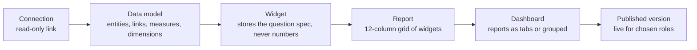

# Architecture — Tela Conversational PMO Analytics and Dashboard Platform

| Field | Value |
|---|---|
| Project | Tela — Conversational PMO Analytics & Dashboard Platform |
| Document status | Draft |
| Version | 0.1 |
| Last updated | 2026-10-21 |
| Evidence level | **L1 – Business only** for the product. Technology stack partly **mandated by stakeholder instruction (2026-10-21)**. Reference systems are secondary evidence (documents only, no code). All architecture in this document is **Proposed**. |
| Sources analyzed | 31 files — see [project_summary.md](project_summary.md#source-inventory-and-coverage) |
| Related documents | [Project summary](project_summary.md) · [Function document](function_document.md) · [Proposed Technical Design](technical_document.md) · [Database schema](db_scheme.md) · [Requirements](requirements.md) · [Business rules](business_rules.md) · [API catalog](api_catalog.md) · [Data dictionary](data_dictionary.md) · [Risk register](risk_register.md) · [Diagrams](diagrams/README.md) |

> **Important limitation.** Only business documents and reference write-ups were supplied. No source code, database DDL, OpenAPI specification or deployment files exist for the product described here. Everything below is a **proposed** design. It cannot confirm any actual code structure, database implementation, API behaviour or infrastructure.

---

## Table of contents

1. [Purpose, scope and status](#1-purpose-scope-and-status)
2. [Evidence level and confidence](#2-evidence-level-and-confidence)
3. [Executive architecture overview](#3-executive-architecture-overview)
4. [Business context and architectural drivers](#4-business-context-and-architectural-drivers)
5. [System boundaries and external actors](#5-system-boundaries-and-external-actors)
6. [Architecture principles and constraints](#6-architecture-principles-and-constraints)
7. [Current versus proposed architecture](#7-current-versus-proposed-architecture)
8. [System context](#8-system-context)
9. [Component architecture](#component-architecture)
10. [Module and feature breakdown](#10-module-and-feature-breakdown)
11. [End-to-end workflows](#11-end-to-end-workflows)
12. [Business rules and state transitions](#12-business-rules-and-state-transitions)
13. [Data architecture](#13-data-architecture)
14. [Database architecture summary](#14-database-architecture-summary)
15. [Connector architecture](#connector-architecture)
16. [API and integration boundaries](#16-api-and-integration-boundaries)
17. [Security architecture](#security-architecture)
18. [Agent and RAG architecture](#agent-and-rag-architecture)
19. [Deployment architecture](#deployment-architecture)
20. [Performance, scalability and capacity](#20-performance-scalability-and-capacity)
21. [Reliability, resilience and failure recovery](#21-reliability-resilience-and-failure-recovery)
22. [Logging, monitoring, tracing and alerting](#22-logging-monitoring-tracing-and-alerting)
23. [Backup, disaster recovery and continuity](#23-backup-disaster-recovery-and-continuity)
24. [Testing and quality strategy](#24-testing-and-quality-strategy)
25. [Architecture decision records](#architecture-decision-records)
26. [Architecture gaps and risks](#26-architecture-gaps-and-risks)
27. [Recommended architecture improvements](#27-recommended-architecture-improvements)
28. [Implementation priorities and migration](#28-implementation-priorities-and-migration)
29. [Assumptions and open questions](#29-assumptions-and-open-questions)
30. [Evidence needed to raise confidence](#30-evidence-needed-to-raise-confidence)
31. [Glossary](#31-glossary)
32. [Related documents](#32-related-documents)
33. [Source inventory and evidence references](#33-source-inventory-and-evidence-references)

---

## 1. Purpose, scope and status

**Purpose.** Describe what components the platform should have, why, how they interact, and which architecture decisions must be taken early. Code-level detail (stack versions, repository layout, environment variables, pipelines) lives in [technical_document.md](technical_document.md). Feature behaviour lives in [function_document.md](function_document.md). Physical tables live in [db_scheme.md](db_scheme.md).

**Scope.** Phase 1 of Tela as defined in S01 (journeys J1–J11), extended by the stakeholder instruction of 2026-10-21:

- React frontend and Python backend.
- PostgreSQL as the internal (metadata) database; pgvector for retrieval-augmented generation (RAG).
- Every service built as a Docker image for easy deployment.
- Source connectors for PostgreSQL, MySQL, SQL Server, MongoDB, Excel/CSV and Microsoft Dataverse, with an extensible adapter model.

**Out of scope (Phase 1, from S01 §5):** joins across two sources inside one widget, scheduled e-mail delivery, write-back to source systems, status-over-time snapshots. S01 §5 also lists file uploads as out of scope; this conflicts with the stakeholder instruction to support Excel (conflict C1, [GAP-011](risk_register.md#gap-register), Q-011). This document treats Excel/CSV as in scope and flags the conflict.

**Status.** Draft 0.1, proposed design. No part of this architecture has been built or tested.

---

## 2. Evidence level and confidence

| Area | Evidence level | What is established | What cannot be confirmed |
|---|---|---|---|
| Product purpose, roles, journeys | L1 (S01, S04–S09) | Business objects, roles, journeys J1–J11, guardrail NFRs | Actual UI behaviour (prototype JavaScript not executed by any source) |
| Technology choices (React, Python, PostgreSQL, pgvector, Docker, connector list) | Stakeholder mandate | That these are required | Versions, sizing, licensing fit |
| Logical architecture, components, ADRs | L1 → **Proposed** | Reasoned design from scope and references | That any component exists |
| Query safety patterns | Reference (secondary) S10–S31, S02 | That other systems report using AST validation, scope rewriting, read-only sessions, gateways | That those implementations work as described (their code was not supplied) |
| Connector behaviour (Dataverse, MongoDB, Excel) | **Inferred / Unknown** | General vendor capabilities as known to the authors | Tenant-specific Dataverse settings, throttling, endpoint availability — must be verified against current Microsoft documentation (RISK-004, REC-006) |
| Infrastructure, deployment, operations | **Proposed** | — | Environments, network, SLOs, costs |
| Runtime performance and reliability | **Unknown** | Prototype timings in S01 §6 (~6 s report build, ~0.4 s custom SQL) are illustrative only | Any production behaviour |

Confidence statement: the design is internally consistent with every supplied source, but every component, contract and number is a proposal until code, schemas and deployment files exist (see [§30](#30-evidence-needed-to-raise-confidence)).

---

## 3. Executive architecture overview

Tela is a **chat-first, governed reporting tool**. Admins connect existing databases read-only. People ask questions in plain English, and chat builds widgets, reports and dashboards. The PMO admin certifies the definitions everyone relies on (S01 §1).

The object chain from S01 §1 is the backbone of the architecture:

*Proposed. Logical object chain only; physical components are in [Component architecture](#component-architecture).*

Three architectural ideas carry the design:

1. **Chat changes specifications; the engine writes the query.** Language models (LLMs) produce a typed *query spec* (measure, breakdown, filters, limit, visual) against the approved data model. A deterministic query engine compiles that spec into the dialect of the source — SQL for PostgreSQL, MySQL, SQL Server, Dataverse TDS and DuckDB, or an aggregation pipeline for MongoDB (ADR-001). Only the *Custom SQL* widget accepts human-written SQL, and only after the validator passes it (FEAT-031).
2. **One shared, scope-enforcing query path.** Every surface — dashboards, chat answers, drill-downs, exports, custom SQL, certification previews and cache reads — goes through the same query engine, which injects the viewer's row scope and removes hidden fields before anything reaches the source. Nothing bypasses it (ADR-009). This directly addresses a defect reported in the Tela reference, where a widget refresh endpoint re-ran SQL without the viewer's scope (S30 RISK-004).
3. **Governance is data.** Measures, dimensions, groupings, bands, joins and custom SQL each carry a certification state (Personal, Certified, Custom SQL, Starter, Deleted). Publishing to a role is blocked until every widget is certified (RULE-009, RULE-024).

The platform is a set of Docker services: a React web app, a FastAPI API service hosting the agent orchestrator and query engine, an isolated connector runner, an LLM gateway, a knowledge (RAG) service, a background worker, Keycloak, PostgreSQL 16 with pgvector, Redis, a secrets store and S3-compatible object storage (ADR-005, ADR-006).

---

## 4. Business context and architectural drivers

| Driver | Source | Architectural consequence |
|---|---|---|
| D1 Data safety: read-only, never write, change or copy source tables; column samples not stored | S01 §4.1, §6 | Read-only identities, per-engine read-only session backstop, AST validator, no persisted source rows (ADR-002, ADR-009, ADR-010) |
| D2 Row scope from Microsoft group membership, enforced in every query; field hiding per role | S01 §2, §6 | Keycloak + Entra ID, app-owned scope policies, scope injection in one query path (ADR-003, ADR-009) |
| D3 One certified definition per question; look-alike detection | S01 §4.8, §6 | Semantic model with certified measures; spec-first compilation; look-alike analyser (ADR-001, FEAT-035) |
| D4 Transparency: every figure exposes its rule, SQL visible to creators/admins, data date shown | S01 §6 | Definitions stored as data; compiled query retained per execution; as-of resolution (RULE-018) |
| D5 Reversibility: undo, drafts separate from published, restore | S01 §6 | Immutable dashboard versions, undo log, soft delete (DATA-032, DATA-035) |
| D6 Chart integrity | S01 §4.4, §4.6 | Visual suitability rules in code (RULE-008); visual advisor agent only suggests |
| D7 Heterogeneous sources incl. MongoDB, Excel, Dataverse | Stakeholder mandate | Pluggable connector adapters with a common capability contract (ADR-002, ADR-012–014) |
| D8 Easy deployment | Stakeholder mandate | Docker image per service, Compose and Helm profiles (ADR-005) |
| D9 LLM data handling unresolved | S01 Q9; S05–S06 | Provider-neutral gateway chokepoint; zero raw-row egress by default (ADR-008, RULE-019) |
| D10 Dynamic, knowledge-enriched dashboards and charts | Stakeholder note on S31 | pgvector knowledge service, reviewed corpus, visual advisor agent (FEAT-014–016) |

---

## 5. System boundaries and external actors

| Actor / system | Type | Interaction | Trust |
|---|---|---|---|
| Admin (PMO) — STK-001 | Person | Connects sources, approves models, certifies, publishes, manages starter content | Authenticated; privileged |
| Creator — STK-002 | Person | Asks, builds widgets/reports/dashboards, personal fields, custom SQL, shares | Authenticated |
| Viewer — STK-003 | Person | Reads published dashboards, filters, drills, exports, asks in scope | Authenticated |
| Microsoft Entra ID | Identity provider | OIDC sign-in via Keycloak; optional SCIM provisioning; optional Microsoft Graph group lookup | External, trusted for identity claims only |
| Source databases (PostgreSQL, MySQL, SQL Server, MongoDB) | Data source | Read-only queries from the connector runner | Trusted for data; untrusted for metadata text (prompt-injection risk, RISK-014) |
| Microsoft Dataverse | Data source | TDS (SQL) endpoint first, Web API fallback | As above; subject to service limits (RISK-004) |
| Excel / CSV files | Data source | Uploaded by Admin into object storage; queried via DuckDB | Untrusted content until profiled |
| LLM providers (Azure OpenAI, Anthropic Claude, Google Gemini, local Ollama — subject to Q-009) | External service | Masked prompts through the LLM gateway | **Untrusted boundary** |
| Embedding runtime | External or local service | Text → vectors for the knowledge index | Untrusted for output correctness |

**In-boundary:** web app, API service, agent orchestrator, query engine, connector runner, LLM gateway, knowledge service, worker, Keycloak, metadata PostgreSQL, Redis, secrets store, object storage, observability stack.

Context diagram: [diagrams/system-context.md](diagrams/system-context.md).

---

## 6. Architecture principles and constraints

1. **The LLM is an untrusted reasoning component.** It proposes specs, plans, wording and explanations. It never executes anything, never decides access, and never produces a number shown to a user (RULE-022). (S02, S25 §7.)
2. **Fail closed.** Any parse failure, unknown object, unresolvable scope attribute, grant ambiguity, timeout or policy error stops execution and returns a safe, explained message. (S02, S11 §5, S25 §7.)
3. **Read-only in depth.** Three independent layers: a read-only source identity (REC-005), a read-only session or transaction per engine, and the validator/compiler that can only emit reads (ADR-002, ADR-009).
4. **Spec first.** Widgets, report plans and refinements are stored as typed specs; SQL or pipelines are compiled at run time for the viewer (ADR-001). This is how "store the question, never the numbers" (S01 §1) is honoured.
5. **One shared query path for every surface.** Dashboards, chat, drill, export, custom SQL, certification preview, pre-publish checks and cache lookups use the same `execute(spec, viewer)` entry point. There is no "admin shortcut" path.
6. **No source rows persisted.** Results live only in a short-TTL, scope-keyed cache (ADR-010). Column samples used for labelling are discarded after use (S01 §4.1).
7. **Filters narrow, never widen** (RULE-005). Scope is intersected with filters, never replaced.
8. **Same images everywhere.** One versioned set of Docker images serves local development, customer-hosted and SaaS deployments; only configuration profiles differ (S03 §4).
9. **Honest gaps.** When the data cannot support a request, Tela says so and leaves it out, as in S01 §4.5 and the PMO reference's disabled reports (S10 §8).
10. **Modular monolith first.** Split services only where isolation, scaling or security require it (S03 §3; ADR-006).

Constraints: stakeholder-mandated stack; Microsoft identity; no write-back; Phase 1 single-source widgets; LLM provider not yet approved (Q-009).

---

## 7. Current versus proposed architecture

There is **no current Tela implementation**. What exists is a clickable prototype (described by S01) and four reference systems documented by others. This section states what the proposed design takes from each. Reuse of any reference *code* depends on ownership and licensing that has not been confirmed (Q-019, RISK-018, REC-016).

| Reference | Reported state (secondary) | Taken conceptually into Tela | Deliberately not taken |
|---|---|---|---|
| PMO dashboard (S10–S22) | React 19 + FastAPI; MySQL `projects`/`project_requests` extracted from Dynamics CRM; certified metrics in code; Ask TELA dual path; SQLite custom reports; no authentication; `DEMO_CIO` pin; 200 rows / 15 s | PMO measures and rules as the PMO starter pack (FEAT-051, RULE-026–039); "reported status ≠ calculated health"; "forecast ≠ spend" honesty; disabled-report pattern for unsupported asks; derived-subquery scope rewrite; read-only grant verification; trust labels | SQLite store; deployment-pinned identity; persisted widget snapshots (conflict C6); in-memory pin tokens |
| Tela NL2SQL (S24–S30) | FastAPI + React 19/TS; gateway chokepoint; sqlglot AST validator; row-filter subquery rewrite; Postgres/MySQL/ClickHouse/DuckDB executors; 3-tier semantic layer; SSE trace; JSON flat-file stores, single worker | Gateway chokepoint and leak scanning; validator rules; fail-closed row rules; DuckDB for Excel; tiered semantic layer; SSE stage trace; value-free visual choice; grain/fan-out rules | Flat-file stores; LLM-written SQL as the main path (replaced by spec-first, ADR-001); refresh path without viewer scope |
| TelaKnowledge (S31, S02) | 24 Go services, 5 portals, 17-agent orchestrator, pgvector HNSW 1024-dim RAG, Keycloak, OPA, Vault, MinIO; operational gaps (health checks, restart policies, outbox not drained) | Agents with typed outputs; review-gated knowledge (pending → approved); hybrid retrieval on pgvector; citation coverage and deterministic fallback; masking rules; schema checksum before execution; signed/hashed statements | 24-service sprawl; Go stack; the operational gaps (REC-012) |
| Research analysis (S03) | Proposal | Keycloak broker + Entra (OIDC + PKCE), SCIM 2.0 option, app-owned roles and permissions, tenant isolation, hybrid hosting, FastAPI modular monolith + workers, ECharts for charts | Zoho People adapter (not in scope) |
| Product decision pack (S04–S09) | Draft options A/B/C | Read-only first; write-back as a separate future architecture; model-policy approval before real data; ground-truth evaluation | Final build-vs-buy decision (not ours to make here) |

---

## 8. System context

Tela sits between Microsoft identity, the organisation's source systems and an approved LLM provider. Users reach it only through the browser. The web app talks only to the API service. Only the connector runner talks to source systems. Only the LLM gateway talks to model providers.

- Context diagram: [diagrams/system-context.md](diagrams/system-context.md) (**Proposed**).
- Component interaction diagram: [diagrams/component-architecture.md](diagrams/component-architecture.md) (**Proposed**).

Important interactions:

| From | To | Purpose | Protocol (Proposed) |
|---|---|---|---|
| Browser | Web app (COMP-001) | Load SPA | HTTPS |
| Browser | API service (COMP-002) | REST + Server-Sent Events for chat streaming | HTTPS, `/api/v1` |
| Browser | Keycloak (COMP-010) | OIDC authorisation code + PKCE | HTTPS |
| Keycloak | Entra ID | Brokered sign-in | OIDC |
| API service | Connector runner (COMP-005) | Execute compiled, scoped query | Internal HTTPS/gRPC with signed task |
| API service | LLM gateway (COMP-006) | Masked prompts | Internal HTTPS |
| Connector runner | Sources | Read-only queries | Native drivers / TDS / HTTPS |
| Worker (COMP-008) | Runner, gateway, object storage | Introspection, indexing, exports | Internal |

---

## Component architecture

All components are **Proposed**.

| ID | Component | Responsibility | Technology (Proposed) | Owns data | Scaling | Failure mode | Security boundary |
|---|---|---|---|---|---|---|---|
| COMP-001 | Web app | Home, ask bar, chat, canvas, certification, publishing, viewer, admin screens; renders charts | React + TypeScript SPA, Vite build, served by nginx; Apache ECharts (ADR-007) | None (browser state only) | Static, CDN-cacheable | Shows error states; never computes figures | Untrusted client; hides UI by permission but never enforces |
| COMP-002 | API service | Authentication check, authorisation, all business operations, SSE streaming, module APIs (identity, connections, model, ask, content, governance, viewer, admin) | Python FastAPI modular monolith | All metadata via COMP-011 | Stateless, horizontal | Returns structured errors with request ID | Central policy enforcement point |
| COMP-003 | Agent orchestrator | Runs AG-01..AG-10, sequences tools, validates every agent output against schemas | Module inside COMP-002 | Conversations, turns, events | With COMP-002 | Falls back to deterministic answer or "cannot answer safely" | LLM output treated as untrusted input |
| COMP-004 | Query engine | Spec validation against model version, compilation per dialect, custom SQL AST validation, scope injection, field removal, limit injection, statement hashing | Module inside COMP-002 (sqlglot for SQL dialects; pipeline builder for MongoDB) | Compiled query records (DATA-047) | With COMP-002 | Fail closed on any doubt | The only producer of executable queries |
| COMP-005 | Connector runner | Executes signed, pre-compiled read-only tasks; per-engine drivers; read-only session; timeouts; row caps; result masking; schema checksum check | Python service, separate image, per-engine driver pools | None persistent | Horizontal, pool per connection | Task rejected or cancelled; never retries non-transient errors | Only component with network access to sources; holds short-lived credentials from COMP-013 |
| COMP-006 | LLM gateway | Single chokepoint to model providers: masking, pre-send leak scan, budget/ratelimit, output schema check, audit metadata (no prompt text in logs) | Python service, separate image | LLM invocation metadata (DATA-046) | Horizontal | Blocks call, returns typed refusal | Only component with egress to LLM providers |
| COMP-007 | Knowledge service | Chunking, embedding, hybrid retrieval (vector + keyword), review-gated corpus, gold examples | Module in COMP-002 (retrieval) + worker jobs (indexing); pgvector | Knowledge documents, chunks, gold examples (DATA-042–044) | With COMP-002 / COMP-008 | Retrieval empty → planner works from model only | Retrieves only approved items for the caller's tenant and connection |
| COMP-008 | Background worker | Introspection, model proposals, indexing, exports, pack updates, cache warm-up, SCIM reconciliation, outbox publishing, notifications | Python Celery workers with Redis broker (ADR-011) | Job state, outbox (DATA-049, DATA-050) | Horizontal by queue | Bounded retries, dead-letter, visible failures | Same policies as API; runs as service identity |
| COMP-009 | Export renderer | Renders PDF (every tab, filters and date in footer) and Excel (sheet per widget plus definitions) | Worker image with headless Chromium and openpyxl | Export files in COMP-014 (expiring) | With worker | Job fails visibly | Re-checks viewer scope at export time |
| COMP-010 | Identity broker | Brokers Entra ID sign-in, issues tokens, sessions | Keycloak | Keycloak realm data (own database/schema) | Clustered | Sign-in unavailable → no access (fail closed) | Authentication only; authorisation stays in the app |
| COMP-011 | Metadata database | All Tela metadata, governance, audit, RAG vectors | PostgreSQL 16 with pgvector; schemas iam, conn, model, defs, content, gov, chat, rag, ops | Everything in [db_scheme.md](db_scheme.md) | Vertical + read replica | Primary failover | Row-level security on tenant_id as defence in depth |
| COMP-012 | Redis | Celery broker, short-TTL result cache, rate limits, SSE fan-out | Redis 7 with auth and TLS | Ephemeral only | Replica / managed | Cache miss → re-query; queue loss mitigated by outbox | Cache keys include scope hash |
| COMP-013 | Secrets store | Source credentials, provider keys, signing keys | OpenBao or HashiCorp Vault (Azure Key Vault option) | Secrets | HA per product | No secrets → connectors disabled | Only runner and gateway may read their paths |
| COMP-014 | Object storage | Uploaded Excel/CSV files, export files, pack bundles | S3-compatible: MinIO or Azure Blob | Files with retention | Managed | Upload/export unavailable | Server-side encryption, pre-signed short-lived URLs |
| COMP-015 | Embedding runtime | Text embeddings for knowledge index | Ollama (local, e.g. mxbai-embed-large 1024-dim, as in S31) or approved provider via gateway (Q-016) | None | Horizontal | Indexing paused; retrieval falls back to keyword | Sees only reviewed metadata text |
| COMP-016 | Observability stack | Traces, metrics, logs, alerts | OpenTelemetry collector, Prometheus, Grafana, Loki (or Azure Monitor) | Telemetry | Managed | Degraded visibility only | No prompts, rows or secrets in telemetry |
| COMP-017 | Reverse proxy and TLS edge | TLS termination, routing, request size limits, rate limiting | Traefik or nginx ingress | None | Horizontal | — | Public entry point |

Interaction diagram: [diagrams/component-architecture.md](diagrams/component-architecture.md). Code-level internals: [technical_document.md](technical_document.md#repository-structure).

---

## 10. Module and feature breakdown

The 51 features are grouped into 13 modules. Full specifications are in [function_document.md](function_document.md#feature-specifications); requirements in [requirements.md](requirements.md#functional-requirements).

| Module | Features | Main components | Journeys |
|---|---|---|---|
| M01 Identity and access | FEAT-001–004 | COMP-010, COMP-002 | J2 |
| M02 Connections and data model | FEAT-005–013 | COMP-002, COMP-005, COMP-008, COMP-003 (AG-04) | J1, J11 |
| M03 Knowledge and RAG | FEAT-014–016 | COMP-007, COMP-015, COMP-003 (AG-07) | All chat journeys |
| M04 Home | FEAT-017 | COMP-001, COMP-002 | J2 |
| M05 Ask | FEAT-018–022 | COMP-003, COMP-004, COMP-005, COMP-006 | J4 |
| M06 Reports | FEAT-023–027 | COMP-003 (AG-05, AG-06, AG-07), COMP-004 | J5, J6 |
| M07 Advanced fields | FEAT-028–032 | COMP-004, COMP-003 (AG-10) | J7 |
| M08 Certification | FEAT-033–037 | COMP-002, COMP-003 (AG-09), COMP-004 | J8 |
| M09 Dashboards and publishing | FEAT-038–041 | COMP-002, COMP-004 | J9 |
| M10 Reading | FEAT-042–045 | COMP-001, COMP-004, COMP-009 | J3 |
| M11 Starter content | FEAT-046–047 | COMP-002, COMP-008 | J10 |
| M12 Platform administration | FEAT-048–050 | COMP-002, COMP-006, COMP-012 | — |
| M13 PMO starter pack | FEAT-051 | Content (pack bundle) | J1, J3 |

---

## 11. End-to-end workflows

All flows are **Proposed**. Step-level detail and acceptance tests are in [function_document.md](function_document.md#feature-specifications).

| Workflow | Summary | Diagram |
|---|---|---|
| Ask a question (J4) | SSE stream: intent → retrieve model + knowledge → spec plan (or clarification) → validate spec → compile → scope inject → runner executes → mask → visual choice → grounded narrative → live widget with definition, scope and date | [diagrams/ask-request-sequence.md](diagrams/ask-request-sequence.md) |
| Custom SQL check and run (J7) | Parse single statement → allow-list → read-only → inject scope and `:page_filters` → cap 10,000 rows / 20 s → run → badge "Custom SQL" | [diagrams/custom-sql-check-and-run.md](diagrams/custom-sql-check-and-run.md) |
| Certification (J8) | Request → queue → detail (rule, results across all data, usage, SQL, dependencies) → look-alike and semantic checks → Certify / Merge / Reject → audit → badge propagation | [diagrams/certification-sequence.md](diagrams/certification-sequence.md) |
| Compose and publish (J9) | Order reports → tabs or grouped → shared filters → preview as role or person → pre-publish checks → numbered version → live for roles; restore creates a new version | [diagrams/publish-sequence.md](diagrams/publish-sequence.md) |
| Connect a source (J1, J11) | Form → test read-only → introspect → model assistant proposes → admin corrects in words → starter pack match → approve v1 | [diagrams/connect-and-model-sequence.md](diagrams/connect-and-model-sequence.md) |
| RAG indexing and retrieval | Approved model and reviewed documents → chunk → embed → HNSW index → hybrid retrieval scoped by tenant and connection | [diagrams/rag-indexing-flow.md](diagrams/rag-indexing-flow.md) |

**Key cross-cutting rule:** each workflow ends in `query engine → connector runner`. No workflow sends a query to a source by any other route.

---

## 12. Business rules and state transitions

Rules are owned by [business_rules.md](business_rules.md). Architecturally significant rules:

| Rule | Where it is enforced (Proposed) |
|---|---|
| RULE-001 Read-only connection verification | Connector runner on connection test and periodically (cached briefly) |
| RULE-002 Single read-only statement validation · RULE-003 Approved object allow-list | Query engine validator |
| RULE-004 Mandatory scope injection · RULE-005 Filters narrow never widen | Query engine scope injector |
| RULE-006 Query row and time limits | Compiler (limit) + runner (session timeout, row stop) |
| RULE-008 Visual suitability | Shared rules library used by pin dialog, canvas and visual advisor guard |
| RULE-009 Certified-only publishing · RULE-024 Pre-publish checks | Publishing module |
| RULE-019 LLM data egress minimisation · RULE-021 Pre-send leak scanning | LLM gateway |
| RULE-020 Result value masking | Runner, before results leave it |
| RULE-022 Grounded narrative | Narrator guard: every number in text must exist in the result set |

Lifecycle state machines (all **Proposed**):

- Widget and definition certification states — [diagrams/widget-definition-lifecycle.md](diagrams/widget-definition-lifecycle.md)
- Dashboard draft, published and superseded versions — [diagrams/dashboard-version-lifecycle.md](diagrams/dashboard-version-lifecycle.md)
- Data model versions — [diagrams/model-version-lifecycle.md](diagrams/model-version-lifecycle.md)
- Full state tables per entity — [function_document.md](function_document.md#state-machines)

---

## 13. Data architecture

Tela holds **metadata, governance and audit**, never source rows.

| Store | Holds | Never holds |
|---|---|---|
| Metadata PostgreSQL (COMP-011), schemas `iam`, `conn`, `model`, `defs`, `content`, `gov`, `chat`, `rag`, `ops` | Users, groups, roles, scope and field policies; connection descriptors and secret references; introspected object catalogue; model versions, measures, dimensions, links; personal fields and custom SQL; widget, report and dashboard specs and versions; certification records; conversations; knowledge chunks with embeddings; audit and execution metadata | Source credentials, source rows, column samples |
| pgvector (inside COMP-011, `rag` schema) | Embeddings of approved model descriptions, glossary, reviewed documents, gold examples, chart patterns | Raw data values |
| Redis (COMP-012) | Short-TTL result cache keyed by (compiled-statement hash, scope hash, model version, as-of), queues, rate counters | Anything requiring durability |
| Object storage (COMP-014) | Uploaded Excel/CSV files (governed, ADR-012), generated exports (expiring), pack bundles | — |
| Secrets store (COMP-013) | Source credentials, provider keys, signing keys | — |

Domain model (logical): Tenant → Connection → Data model → Model version → (Entities, Fields, Links, Measures, Dimensions). Widgets reference a model version and a spec. Reports place widgets; dashboards order reports; publications point at a dashboard version and target roles.

Detailed tables: [db_scheme.md](db_scheme.md#table-catalog). Business meaning, classification and source-of-truth map: [data_dictionary.md](data_dictionary.md#source-of-truth-map).

---

## 14. Database architecture summary

| Database | Engine | Purpose | Owner | Notes |
|---|---|---|---|---|
| Tela metadata | PostgreSQL 16 + pgvector (Proposed versions; S31 reports pgvector 0.8 in a reference system) | All Tela state | COMP-002 / COMP-008 | One database, one schema per module; tenant_id on all tenant tables; RLS as defence in depth; HNSW index with cosine distance on 1024-dimension vectors (Proposed default) |
| Keycloak | PostgreSQL (separate database on same server, or separate server) | Identity broker state | COMP-010 | Kept apart from Tela schemas |
| Source systems | Customer-owned | Business data | STK-005 | Read-only; never modified |

Key schema findings (from the proposed model): every widget pins a model version (RULE-015); dashboard versions are immutable rows; certification decisions snapshot the definition at decision time (S01 §4.8); audit events are append-only. Full ER diagram: [db_scheme.md](db_scheme.md#entity-relationship-diagram).

---

## Connector architecture

All connectors implement one adapter contract (ADR-002): `test()`, `verify_read_only()`, `introspect()`, `capabilities()`, `compile(spec)` (delegated to the query engine dialect), `execute(task)`, `cancel()`, `distinct_values(field)`. The query engine only emits features a connector declares in `capabilities()` (e.g. window functions, `COUNT(DISTINCT)`, joins).

| Source | Protocol and driver family (Proposed) | Query language emitted | Read-only enforcement | Scope injection | Limits | Known constraints / status |
|---|---|---|---|---|---|---|
| PostgreSQL | Native wire protocol; psycopg 3 | PostgreSQL SQL via sqlglot | SELECT-only role + `SET SESSION CHARACTERISTICS AS TRANSACTION READ ONLY` / read-only transaction + `statement_timeout` | Derived subquery per governed table | 10,000 rows / 20 s (RULE-006) | Reported as live-verified in reference S25 |
| MySQL | MySQL protocol; PyMySQL or mysqlclient | MySQL SQL via sqlglot | SELECT-only user, grant inspection (`SHOW GRANTS`, as S13 RULE-019) + `START TRANSACTION READ ONLY` + `MAX_EXECUTION_TIME` | Derived subquery | Same | Reference S25 reports MySQL verified on mocks only |
| SQL Server | TDS; pyodbc with Microsoft ODBC driver | T-SQL via sqlglot (`TOP` instead of `LIMIT`) | `db_datareader`-only login; `ApplicationIntent=ReadOnly` where available; query timeout | Derived subquery | Same | In S01 scope; not in user list (GAP-012) |
| MongoDB | MongoDB wire protocol; PyMongo | Aggregation pipeline compiled from spec (ADR-014); no free-text MQL from LLM | User with `read` role only; `readPreference=secondaryPreferred` optional; `maxTimeMS` | Scope `$match` stage prepended before any user stage; `$lookup` only on approved links | Same; `allowDiskUse` off by default | Schema-less: introspection samples documents to infer fields, samples not stored (RISK-005); custom SQL widget not available for MongoDB (Proposed) |
| Excel / CSV | File in object storage; DuckDB in-process inside runner | DuckDB SQL via sqlglot | Files opened read-only; DuckDB database in memory, `enable_external_access` restricted | Derived subquery over sheet views | Same; upload size limit TBD | Upload is a governed copy of data (ADR-012, RISK-006, GAP-011) |
| Microsoft Dataverse | (a) TDS endpoint (read-only SQL) via pyodbc with Entra service-principal token; (b) fallback Web API (OData v4 / FetchXML) over HTTPS with MSAL client-credential token (ADR-013) | (a) Restricted T-SQL subset; (b) OData/FetchXML compiled from spec | Endpoint is read-only by design (to verify); application user with read-only security role | (a) Derived subquery if supported, otherwise WHERE conjunction on base table; (b) filter conjunction | Same caps plus Dataverse service-protection limits (unknown values — verify) | **Inferred:** PMO reference fields use Dynamics CRM logical names (`tpg_`, `tpgmea_`, S15 §7), so Dataverse is the native home of TPG data. TDS must be enabled per environment (Q-015). Exact T-SQL subset, timeouts and throttling must be verified against current Microsoft documentation (RISK-004, REC-006) |

Execution model: the API compiles and hashes the statement, signs a task (statement, parameters, hash, connection ID, schema checksum, limits) and sends it to the runner. The runner refuses tasks whose hash or signature does not match or whose live schema checksum differs from the model's (pattern reported in S02). Code-level detail: [technical_document.md](technical_document.md#connector-implementation).

---

## 16. API and integration boundaries

The API is a versioned REST surface at `/api/v1` plus SSE for chat. Endpoint contracts are owned by [api_catalog.md](api_catalog.md#endpoint-catalog).

| Boundary | IDs | Auth | Notes |
|---|---|---|---|
| Identity and admin IAM | API-001–006 | Bearer access token from Keycloak; SCIM uses provisioning token | SCIM optional (FEAT-004) |
| Connections and model | API-007–015 | Admin | File upload is multipart to object storage via API |
| Ask and widgets | API-016–023 | Creator (Viewer for in-scope asks on published content) | SSE stream for stage events |
| Reports, fields, custom SQL | API-024–033 | Creator | — |
| Certification | API-034–036 | Admin | — |
| Dashboards and publishing | API-037–042 | Creator builds, publisher publishes (GAP-006) | — |
| Viewer | API-043–046 | Any authenticated user in scope | Export is async |
| Starter content, knowledge, ops | API-047–057 | Admin (health is unauthenticated liveness only) | — |
| External integrations | API-058–069 | Service identities from COMP-013 | Entra, Graph, LLMs, embeddings, sources, object storage, secrets |

Failure propagation: source failure → runner typed error → widget error card with reason; LLM failure → deterministic fallback or "cannot answer safely"; identity failure → no access.

---

## Security architecture

**Identity (ADR-003).** Users sign in with Microsoft Entra ID through Keycloak (OIDC authorisation code with PKCE, S03 §5.1). The API validates access tokens (issuer, audience, signature, expiry, token type). Tela maps the immutable Entra object ID — never e-mail alone — to an internal user (S03 §5.2). Optional SCIM 2.0 provisioning keeps users and groups in sync (FEAT-004).

**Authorisation (app-owned).** Two layers, as recommended in S06 §8:

1. *Feature permissions* — role → permission keys (e.g. `connection.manage`, `model.approve`, `widget.create`, `sql.custom`, `cert.decide`, `dashboard.publish`, `export.run`).
2. *Data permissions* — scope policies (row predicates, e.g. `cio = user.attr.cio`) and field policies (hide or mask columns per role, e.g. finance fields hidden for CIOs, S01 §4.9).

Groups map to roles and scope attributes through explicit, audited mappings; privileged roles never come from name-matching (S03 §9). Where mappings are configured is open (C4, GAP-013, Q-013).

**Enforcement path.** Every query: resolve viewer → load scope and field policies → drop hidden fields from the spec (or reject custom SQL that references them) → compile → inject scope predicates on every governed table reference → re-parse and assert scoped → sign → runner executes read-only → mask values → return. The same path serves drill, export and cache keys (cache key includes the scope hash), closing the bypass class seen in S30 RISK-004.

**Metadata isolation.** `tenant_id` on every tenant table, enforced in repository code and by PostgreSQL row-level security with a transaction-local tenant setting (S03 §4).

**LLM boundary (ADR-008).** One gateway; zero raw-row egress by default (RULE-019). Prompts contain approved schema, definitions, gold examples and (only when policy allows) small aggregated widget results for "ask about a widget". Pre-send leak scanning for keys, connection strings, e-mails and secret-named fields (RULE-021, S02, S27 RULE-005). Output checked for blocked patterns and schema conformance; failures fall back deterministically (S02).

**Masking (RULE-020, from S02).** Secret-named columns (`password`, `otp`, `token`, `secret`, `pin`, `cvv`, `apikey`, `credential`, `privatekey`) always `[REDACTED]`; e-mail and phone partially masked unless a field policy allows clear text.

**Secrets.** Source credentials and keys live only in COMP-013; the metadata DB stores a secret reference. No secrets in browser code, prompts or logs.

**Audit.** Append-only audit events for sign-in, connection changes, model approval, certification decisions (with definition snapshot), publish/restore, shares, exports, policy denials and LLM calls (metadata only).

**Threats and controls (summary; full register in [risk_register.md](risk_register.md#risk-register)).**

| Threat | Control |
|---|---|
| Cross-scope data access via chat, drill, export, cache | Single query path; scope hash in cache key; tests TEST-071+ (RISK-001, RISK-015) |
| SQL injection / write via custom SQL | AST validator, read-only identity and session (RISK-010) |
| Prompt injection via column descriptions or uploaded documents | Reviewed corpus, instruction-stripping, agents cannot execute (RISK-014) |
| Data exfiltration to LLM provider | Gateway, egress rules, approved provider only (RISK-003) |
| Credential theft | Secrets store, short-lived tokens, rotation (RISK-009) |
| Export leakage | Scope recheck, watermark footer, policy (RISK-016) |
| Tenant crossover in SaaS | RLS + per-tenant keys + isolation tests (RISK-021) |

---

## Agent and RAG architecture

**Agents.** All agents live in the agent orchestrator (COMP-003), call the LLM only through the gateway, and return typed JSON that code validates before use. No agent can execute a query, change a published object or grant access (pattern from S31 and S02).

| Agent | Purpose | Inputs | Typed output | Tools it may request | Guard after output |
|---|---|---|---|---|---|
| AG-01 Intent router | Classify turn: ask, refine, report request, canvas edit, model edit, explain, out of scope | Message, conversation state, page context | `{intent, target_ids}` | None | Enum check; unknown → clarify |
| AG-02 Clarifier | Ask a question when meaning would change the answer (period, region, currency, cancelled records) | Candidate specs, ambiguity flags | `{question, options[]}` | Knowledge search | Max one question per turn |
| AG-03 Query-spec planner | Turn a question into a query spec over the approved model | Question, retrieved model slice, gold examples, standing notes | `QuerySpec` (measure IDs, dimension IDs, filters, limit, sort, time grain, comparison, visual hint) or `unsupported{reason}` | Knowledge search, distinct values (scoped) | Spec validator: IDs exist in model version, filters on allowed fields, values grounded (RULE-003, S30 GAP-001) |
| AG-04 Model assistant | Propose links, cardinality, measures, dimensions and questions after introspection; apply admin corrections | Introspected catalogue (no samples stored), admin text | `ModelChangeSet` | Column profile (transient) | Diff shown; admin approval required (FEAT-009) |
| AG-05 Report planner | One sentence → report plan: headline figures, sections, widgets, filters, named gaps | Request, model, certified measures | `ReportPlan` | Knowledge search | Every widget spec validated; gaps listed, never guessed (S01 §4.5) |
| AG-06 Canvas editor | Layout and content instructions → change list | Instruction, report layout | `CanvasChangeSet` | None | Preview before apply; undo log |
| AG-07 Visual advisor | Recommend visuals and enhancements (reference lines, comparisons, sort, top-N, annotations) | Spec, result *shape* (column kinds, cardinality), chart-pattern knowledge | `VisualRecommendation[]` | Knowledge search (chart patterns) | RULE-008 suitability check; unsuitable choices disabled with reason |
| AG-08 Narrator | Headline sentence and explanation | Result aggregates computed in code, definitions | `Narrative{text, cited_values[]}` | None | Every number must match a computed value (RULE-022); else template sentence |
| AG-09 Certification reviewer | Explain look-alikes and semantic differences in plain language | Candidate definition, similar certified definitions, computed diffs | `ReviewNote` | Knowledge search | Advisory only; decision stays with Admin |
| AG-10 SQL drafter | Draft custom SQL for a creator | Question, allowed objects | SQL text | None | Never auto-run; creator must press Check and run (FEAT-031) |

**RAG corpus (FEAT-014).** Approved model descriptions and synonyms; certified measure and dimension definitions; standing business notes; gold question → spec examples (FEAT-015); reviewed organisation documents (e.g. PMO charter definitions); chart-pattern knowledge (which visual suits which spec shape, PMO conventions such as "forecast is not spend"). New items enter as `pending_review`; only `approved` items are retrievable (review lifecycle reported in S02/S31).

**Retrieval.** Hybrid: pgvector HNSW cosine similarity plus PostgreSQL full-text search, merged and re-ranked; always filtered by tenant, connection and model version. Default embedding size 1024 (mxbai-embed-large in S31; Proposed and configurable, Q-016).

**How RAG enhances each dashboard and chart (stakeholder intent).** When a widget is planned, pinned or opened in the canvas, AG-07 retrieves chart patterns and related certified measures for that spec shape and offers enhancements: a better-suited visual, a target or budget reference line where a certified target exists, a previous-period comparison, a top-N cut, or a linked definition. Suggestions are chips; applying one changes the spec (not the rule) and is undoable (FEAT-016).

**Grounding.** Answers that cite knowledge must reach a citation-coverage threshold (≥ 0.70 in the S02 reference; Proposed default) or fall back to a deterministic answer built only from model definitions and computed results.

Flow diagram: [diagrams/rag-indexing-flow.md](diagrams/rag-indexing-flow.md). Implementation: [technical_document.md](technical_document.md#agent-implementation).

---

## Deployment architecture

All **Proposed** (ADR-005). Every service ships as a Docker image built from one repository and tagged with one release version.

| Image | Runs | Profiles |
|---|---|---|
| `tela-web` | COMP-001 nginx + SPA | all |
| `tela-api` | COMP-002/003/004/007 retrieval | all |
| `tela-runner` | COMP-005 | all |
| `tela-llm-gateway` | COMP-006 | all |
| `tela-worker` | COMP-008/009 (with Chromium) | all |
| `tela-migrate` | One-shot schema migrations | all |
| Third-party | Keycloak, PostgreSQL+pgvector, Redis, OpenBao, MinIO, Ollama (optional), OpenTelemetry collector, Prometheus, Grafana, Loki, Traefik | dev and customer-hosted (SaaS may use managed equivalents) |

**Networks.** `edge` (proxy, web, API, Keycloak), `app` (API, gateway, worker, runner, Redis, Postgres, OpenBao, MinIO), `sources` (runner only, egress to customer sources), `llm-egress` (gateway only). Only the runner joins `sources`; only the gateway has internet egress to LLM providers.

**Profiles.**

- *dev* — Docker Compose, all services local, synthetic data, Ollama optional.
- *customer-hosted* — Docker Compose or Helm on the customer's infrastructure; customer supplies Entra app registration, secrets store and backups (S03 §4 Model B).
- *SaaS* — Kubernetes with Helm; managed PostgreSQL with pgvector, managed Redis, cloud secrets and blob storage.

**Azure mapping (option, Proposed).** Azure Container Apps or AKS; Azure Database for PostgreSQL Flexible Server with the pgvector extension; Azure Cache for Redis; Azure Key Vault; Azure Blob Storage; Azure Monitor / Application Insights; Azure OpenAI through the gateway if approved (Q-009). Azure is mentioned as the sandbox platform in S06 §13.

Every container: non-root user, read-only root filesystem where possible, `no-new-privileges`, health and readiness endpoints, restart policy, resource limits (lessons from S31 §5–6). Diagram: [diagrams/deployment-docker.md](diagrams/deployment-docker.md). Pipeline: [technical_document.md](technical_document.md#build-and-deployment-pipeline).

---

## 20. Performance, scalability and capacity

No production targets exist (GAP-008, Q-010). S01 §6 shows ~6 s report build and ~0.4 s custom SQL on sample data — illustrative only.

Design levers (Proposed):

- Stateless API and gateway scale horizontally; workers scale per queue (exports, indexing, introspection).
- Runner keeps a bounded connection pool per source connection; per-connection concurrency limit protects sources (NFR-026).
- Per-user and per-instance chat concurrency limits (Proposed 2 and 8) with HTTP 429 on saturation (pattern from S12 NFR-013).
- Scope-keyed result cache (default TTL 15 minutes, configurable per connection; ADR-010) serves repeated dashboard loads.
- Dashboard load runs widget queries in parallel with a per-dashboard cap; widgets render independently.
- Pre-warm runner pools and model caches on start-up to avoid the 2–4 s cold start reported in S30 RISK-007.
- Indexes on metadata tables per [db_scheme.md](db_scheme.md#table-catalog); HNSW parameters tuned after corpus size is known.

Capacity assumptions to validate: number of tenants, users, connections, widgets per dashboard, concurrent viewers, and source query cost profiles.

---

## 21. Reliability, resilience and failure recovery

| Concern | Proposed approach |
|---|---|
| Health | `/healthz` (liveness) and `/readyz` (dependencies) on every service; Compose/Kubernetes probes; restart policies on all daemons (S31 found only 2 of 44 services with restart policies) |
| Fatal start-up errors | Exit non-zero (S31 found Go services exiting 0) |
| Timeouts | Source 20 s; LLM call 30 s (Proposed); SSE idle 60 s |
| Retries | Only transient errors (network, deadlock, 429 from provider) with bounded exponential backoff; never on validation or permission errors |
| Idempotency | Idempotency keys for publish, restore, certification decisions and exports |
| Outbox | Transactional outbox drained by a worker with monitoring of backlog (S31 found outboxes never drained) |
| Degradation | LLM down → certified measures, dashboards and viewer still work; knowledge down → planner uses model only; a failing widget does not break the page |
| Drafts vs live | Live version stays live when a publish fails (S01 §4.9) |

---

## 22. Logging, monitoring, tracing and alerting

- OpenTelemetry traces across browser request → API → orchestrator stages → gateway → runner; one correlation ID shown in error messages.
- Structured JSON logs; never log prompt text, result rows, SQL literals from viewers' filters or secrets (S02 "zero prompt/answer data in logs").
- Agent run log (ENH-024, DEC-25): each run of AG-01 – AG-10 and its steps in `ops.agent_runs` / `ops.agent_steps`, shown to Admins under AI › Agent runs. A model call step keeps the masked prompt the gateway sent and the raw reply, returned by the gateway to the API on request (`capture`) and stored only there — still never in logs, the ledger or traces; a tenant switch turns it off, text is cleared after the tenant's days, reads are audited.
- Metrics: questions per minute, clarification rate, spec-validation rejections, validator rejections, scope-injection failures, runner latency and timeouts per connection, cache hit rate, LLM latency, tokens and cost, leak-scanner blocks, export jobs, publish failures, outbox backlog.
- Alerts: repeated policy denials for one user, leak-scanner blocks, runner timeouts above threshold, connection read-only check failure, outbox backlog, certificate expiry, backup failure.

---

## 23. Backup, disaster recovery and continuity

Targets (RPO, RTO, retention) are **not specified** (GAP-014, REC-018, Q-018).

Proposed baseline: daily full backup plus point-in-time recovery for the metadata PostgreSQL and Keycloak databases; versioned object-storage buckets for uploads and pack bundles; secrets store snapshots; tested restore runbook each release. Source systems are customer-owned and outside Tela's backup scope. Redis is not backed up (ephemeral by design).

---

## 24. Testing and quality strategy

| Layer | Focus | Owner doc |
|---|---|---|
| Unit | Spec validator, compilers per dialect, scope injector, masking, visual suitability, band and grouping logic | [technical_document.md](technical_document.md) |
| Security | Validator fuzzing and injection corpus; scope isolation across every surface; LLM egress tests; tenant isolation | TEST-071+ in technical_document.md |
| Connector | Live containers for PostgreSQL, MySQL, SQL Server, MongoDB; DuckDB files; Dataverse sandbox environment | technical_document.md |
| Answer quality | Ground-truth evaluation set (FEAT-015): expected spec and expected result per question, per role; regression gate before release (REC-010) | function_document.md, technical_document.md |
| Functional | Journeys J1–J11 acceptance (TEST-001–070) | [function_document.md](function_document.md#acceptance-tests) |
| Non-functional | Load against representative sources, accessibility (WCAG 2.2 AA proposed, REC-017), browser matrix | requirements.md |

---

## Architecture decision records

All ADRs are **Proposed** and need stakeholder confirmation.

### ADR-001 Typed query spec instead of LLM-written SQL
- **Context:** S01 says chat changes the model and widget definitions and "the engine writes the SQL". References that let the LLM write SQL report fabricated enum values, dropped entities and wrong date columns (S30 GAP-001–003) and need heavy validation.
- **Decision:** AG-03 outputs a `QuerySpec` over model IDs. The query engine compiles it. Raw SQL exists only in the Custom SQL widget, written or drafted for a human who runs Check and run.
- **Alternatives:** LLM SQL with AST validation (Tela reference); hybrid certified intents plus LLM SQL (PMO reference).
- **Consequences:** Consistent numbers and natural certification; limited to what the model expresses — gaps are named and Custom SQL covers the rest. Compiler work per dialect is required.

### ADR-002 Pluggable connector adapters with per-engine read-only enforcement
- **Context:** Six source types with different protocols and safety features.
- **Decision:** One adapter contract; each adapter declares capabilities and its read-only mechanism; all run inside the isolated runner.
- **Alternatives:** One generic SQLAlchemy layer (does not cover MongoDB or Dataverse Web API); MCP-based connectors (mentioned as an open option in S09 GAP-004).
- **Consequences:** New sources add an adapter and a dialect; conformance test suite per adapter is mandatory.

### ADR-003 Keycloak broker with Entra ID and app-owned authorization
- **Context:** Microsoft sign-in is required; customers may later bring other IdPs; data scope is business-specific.
- **Decision:** Keycloak brokers Entra (OIDC + PKCE); Tela owns roles, permissions, scope and field policies (S03).
- **Alternatives:** Direct MSAL integration with Entra only (simpler, Microsoft-only); Entra app roles as the only authorisation source.
- **Consequences:** One more component to operate; provider-neutral; group overage and mapping need care (RISK-007).

### ADR-004 Single PostgreSQL metadata store with pgvector
- **Context:** Stakeholder mandate; references used SQLite and JSON files that blocked scaling (S16 RISK-004, S30 RISK-005).
- **Decision:** One PostgreSQL 16 database with module schemas; pgvector in the `rag` schema.
- **Alternatives:** Separate vector database; per-module databases.
- **Consequences:** Transactional consistency between definitions and their embeddings; vector workload shares resources (monitor; split later if needed).

### ADR-005 Docker images for every service with Compose and Helm profiles
- **Context:** Stakeholder mandate for easy deployment; hybrid hosting (S03 §4).
- **Decision:** Image per service, one version; Compose for dev and small customer installs; Helm for Kubernetes and SaaS.
- **Alternatives:** Single all-in-one image; platform-specific deployment only.
- **Consequences:** CI must build, scan and sign all images; configuration drives the differences.

### ADR-006 Modular monolith API plus separate runner, gateway and worker containers
- **Context:** S03 recommends a modular monolith; S31 shows the cost of 24 services; security needs network isolation for sources and LLM egress.
- **Decision:** One API codebase with strict module boundaries; separate containers only for the runner (source network), gateway (LLM egress) and worker (long jobs).
- **Alternatives:** Full microservices; single process.
- **Consequences:** Few moving parts with real isolation where it matters.

### ADR-007 Apache ECharts rendering from an internal chart spec
- **Context:** References differ (Recharts S11, Vega-Lite S27); S03 recommends ECharts for broad dashboard needs.
- **Decision:** Store an internal, library-neutral chart spec on the widget; render with ECharts in the web app.
- **Alternatives:** Vega-Lite (declarative, JSON-native); Recharts (React-native, narrower catalogue).
- **Consequences:** Renderer can be swapped; chart catalogue must be prioritised before promising breadth (REC-013, S09 RISK-010).
- **Amended 2026-10-28 (ENH-014, DEC-22):** D3 joins ECharts for the gallery visuals ECharts draws poorly, behind the same chart spec, tokens, table view and exports. **US-187 (wave 1):** the dumbbell is drawn with pinned `d3-scale` 4.0.2 (scales and ticks; React draws the SVG, so it prints as vectors), the bullet is HTML, and waterfall, Pareto, XmR, Gantt, funnel and small multiples are ECharts (`custom`, `funnel`, `markLine`, several grids). The catalogue renderers load as one lazy chunk (`CatalogueChart`), so the routes' first-visit bundles do not grow; the print route waits for that chunk before it reports ready. Figures the visuals need come in `chart_spec.figures`, worked out by the API. **US-188 (wave 2):** D3 draws the beeswarm (pinned `d3-force` 3.0.0 lays out the dots), ridgeline / raincloud, time to event and bump chart (pinned `d3-shape` 3.2.0 for the areas, step and bump lines) and UpSet (`d3-scale`), React drawing the SVG as for the dumbbell; the waffle is HTML; calendar heatmap, sankey and treemap are ECharts (`calendar` + `heatmap` with a piecewise legend, `sankey`, `treemap`). All stay in the lazy `CatalogueChart` chunk, keep the table view, the print route and the Excel figures table, and read the same tokens (the tenant's palette included). Densities, quartiles, the Kaplan–Meier estimate, ranks, flows and cells come from the API.

### ADR-008 Provider-neutral LLM gateway chokepoint
- **Context:** Model provider not approved (Q-009); leak risk.
- **Decision:** Only the gateway calls providers; per-agent model routing configurable; Azure OpenAI, Anthropic Claude, Google Gemini and local Ollama adapters.
- **Alternatives:** Direct SDK calls from modules.
- **Consequences:** Uniform masking, scanning, budgets and audit; small latency overhead.

### ADR-009 Scope enforcement by AST rewrite plus source read-only backstop
- **Context:** Scope must hold on every surface (S01 §6).
- **Decision:** Replace each governed table reference with a scoped derived table (or prepend `$match` for MongoDB), re-parse and assert; runner enforces read-only identity and session.
- **Alternatives:** Source-native row-level security only (not available uniformly, especially Excel and Dataverse TDS); WHERE-clause appending (bypassable with `OR`).
- **Consequences:** Uniform enforcement; some optimiser cost on derived tables; source RLS can be added as extra defence where available.

### ADR-010 No persisted result snapshots, scope-keyed short-TTL cache
- **Context:** S01 says widgets never store numbers; the PMO reference persisted snapshots (conflict C6).
- **Decision:** Cache results in Redis keyed by statement hash, scope hash, model version and as-of; TTL default 15 minutes.
- **Alternatives:** Persisted snapshots for offline fallback.
- **Consequences:** No stale numbers in storage; when a source is down, widgets show an error instead of old data (reconsider if Q-001 chooses a scheduled refresh model).

### ADR-011 Celery with Redis for background jobs
- **Context:** Introspection, indexing, exports and reconciliation need durable retries (S03 §10).
- **Decision:** Celery workers with Redis broker plus a transactional outbox in PostgreSQL.
- **Alternatives:** Dramatiq or RQ; PostgreSQL-based queues.
- **Consequences:** Familiar tooling; outbox ensures no lost events if Redis restarts.

### ADR-012 Excel and CSV via DuckDB over object-stored files
- **Context:** Stakeholder requires Excel; S01 §5 deferred file uploads (C1). The Tela reference used DuckDB for Excel (S25 §15).
- **Decision:** Admin uploads files to object storage; runner opens them read-only in in-memory DuckDB; each sheet becomes an entity in the data model; re-upload creates a new file version.
- **Alternatives:** Import into a Tela-managed database; read from SharePoint/OneDrive via Graph (later).
- **Consequences:** Tela holds a copy of uploaded data — this needs retention, classification and deletion rules (RISK-006, REC-008).

### ADR-013 Dataverse via TDS endpoint first, Web API fallback
- **Context:** Dataverse offers a read-only SQL (TDS) endpoint and an OData Web API (vendor capabilities as understood; verify, RISK-004).
- **Decision:** Prefer TDS so the SQL compiler and scope rewrite are reused; fall back to Web API/FetchXML where TDS is disabled or a construct is unsupported.
- **Alternatives:** Web API only; replicate Dataverse to a database (Azure Synapse Link) and connect to that.
- **Consequences:** Two code paths; a spike must confirm supported SQL, limits and authentication before commitment (REC-006, Q-015).

### ADR-014 MongoDB via compiled aggregation pipelines
- **Context:** MongoDB has no SQL; S01's engine is SQL-centred.
- **Decision:** Compile specs into aggregation pipelines with a leading scope `$match`; joins only via approved `$lookup` links; no Custom SQL widget on MongoDB in Phase 1.
- **Alternatives:** MongoDB Atlas SQL interface; BI connector; pre-flatten into a relational store.
- **Consequences:** Separate compiler and tests; field inference from sampled documents (samples not stored) (RISK-005, REC-007).

---

## 26. Architecture gaps and risks

Owned by [risk_register.md](risk_register.md#risk-register). Highest architectural items:

1. RISK-001 Scope leakage across surfaces — mitigated by the single query path (REC-004).
2. RISK-003 Unapproved LLM data handling — blocks real data until REC-002.
3. RISK-004 Dataverse endpoint constraints — needs the REC-006 spike.
4. RISK-005 MongoDB semantic mismatch — REC-007 spike.
5. RISK-006 Excel uploads copy data — REC-008.
6. RISK-012 Model version changes break widgets — REC-011.
7. RISK-019 Operational resilience gaps — REC-012.
8. GAP-001 Data freshness model undefined — REC-001; affects caching and "data as of".

---

## 27. Recommended architecture improvements

| Rec | Why necessary | Alternatives | Consequence of not doing it |
|---|---|---|---|
| REC-003 Build spec-first query engine with AST validator | Consistency and certification depend on it | LLM SQL with validation | Inconsistent numbers; certification meaningless |
| REC-004 Enforce scope in one shared query path for all surfaces | Every bypass is a data leak | Per-surface checks | Leak through drill, export or cache |
| REC-005 Provision dedicated read-only source identities | Third read-only layer | Rely on app checks only | One parser bug could write to a source |
| REC-006 Spike Dataverse TDS and Web API | Native TPG source; unknown limits | Replicate to SQL | Late surprises on the pilot source |
| REC-007 Spike MongoDB spec compilation | Non-SQL semantics | Atlas SQL | Wrong numbers on document data |
| REC-011 Version-pin widgets to model versions | Model edits must not silently change published numbers | Always latest | Published dashboards change without review |
| REC-012 Ship health checks, restart policies and CI from day one | Reference systems lacked them | Add later | Fragile operations |
| REC-014 Defend RAG against prompt injection | Metadata and documents are untrusted | Trust admin text | Agents manipulated by injected text |
| REC-020 Tenant isolation tests | SaaS profile | Separate deployments per tenant | Cross-tenant exposure |

---

## 28. Implementation priorities and migration

No dates are given (S04 asked that discussed timelines not be used).

| Phase | Content | Exit criteria |
|---|---|---|
| P0 Foundation | Repository, Docker images, Compose dev profile, CI with tests and image scanning; Keycloak + Entra sign-in; metadata schema and migrations; secrets store; LLM gateway; health checks | User signs in; services healthy; migrations repeatable |
| P1 Governed read path | One connector (PostgreSQL, or Dataverse if the spike passes); introspection; model assistant and approval; query spec engine, scope injection, runner; PMO starter pack; viewer with filters, definitions, drill; ask → live widget; evaluation suite | Scope isolation tests pass on every surface; ground-truth suite meets agreed threshold (Q-017) |
| P2 Authoring and governance | Pin, report from one request, canvas, edit with chat, personal fields, custom SQL, certification queue and decisions, compose and publish with versions, starter content management, exports, knowledge index and visual advisor | J4–J10 acceptance tests pass |
| P3 More sources and hardening | MySQL, SQL Server, MongoDB, Excel/CSV, Dataverse Web API fallback; SCIM; SaaS Helm profile; tenant isolation; backup/DR; performance tests | Connector conformance suites pass; NFR targets met |

Migration from references: no data migration is planned. PMO rules move as pack definitions (FEAT-051). Code reuse only after Q-019.

---

## 29. Assumptions and open questions

The project-wide list is in [project_summary.md](project_summary.md#open-questions). Architecture-specific items:

- **Assumption:** one source per widget in Phase 1 (S01 §4.1).
- **Assumption:** customers can provide read-only identities for every source.
- **Assumption:** Keycloak is acceptable to the customer's security team (else direct MSAL, ADR-003 alternative).
- Q-001 Refresh model per connection (affects ADR-010).
- Q-009 Approved LLM providers and data handling (affects ADR-008).
- Q-013 Where group mappings are configured.
- Q-014 SaaS, customer-hosted, or both in Phase 1.
- Q-015 Dataverse environment access and TDS enablement.
- Q-016 Embedding model hosting.
- Q-019 Reuse rights for reference code.

---

## 30. Evidence needed to raise confidence

In priority order:

1. Approved LLM/data policy (S05 names the approver).
2. Production source schemas or DDL for the pilot (TPG / Dataverse tables), with sample synthetic data.
3. Dataverse environment details: TDS enabled, app registration, security role.
4. Entra tenant details: groups, claims, group-to-role/scope mapping rules.
5. Source code and tests of the reference systems, with reuse rights, if reuse is intended.
6. Target hosting choice and network constraints.
7. Agreed NFR targets (latency, availability, concurrency, retention).

---

## 31. Glossary

Short list; full glossary in [project_summary.md](project_summary.md#glossary).

- **Query spec:** typed description of a widget's question (measure, breakdown, filters, limit, visual) compiled by the engine.
- **Scope:** rows a person may see; injected into every query.
- **Connector runner:** isolated service that executes signed, pre-compiled read-only tasks.
- **LLM gateway:** the only path to language-model providers.
- **RAG:** retrieval-augmented generation — retrieving approved knowledge to ground agent outputs.
- **HNSW:** approximate nearest-neighbour index used by pgvector.
- **TDS endpoint:** Dataverse's read-only SQL interface (vendor capability to verify).

---

## 32. Related documents

| File | Purpose |
|---|---|
| [architecture.md](architecture.md) | This document — components, boundaries, ADRs |
| [project_summary.md](project_summary.md) | Product overview, objectives, scope, roadmap, open questions |
| [function_document.md](function_document.md) | Feature specifications, permissions, workflows, acceptance tests |
| [technical_document.md](technical_document.md) | Proposed Technical Design — stack, code structure, configuration, pipelines |
| [db_scheme.md](db_scheme.md) | Proposed database schema and ER diagram |
| [requirements.md](requirements.md) | Functional and non-functional requirements catalogue |
| [business_rules.md](business_rules.md) | Rules and calculations with worked examples |
| [api_catalog.md](api_catalog.md) | Endpoint and integration contracts |
| [data_dictionary.md](data_dictionary.md) | Business data terms, classification, retention, source of truth |
| [risk_register.md](risk_register.md) | Risks, gaps and recommendations |
| [diagrams/README.md](diagrams/README.md) | Diagram index |

---

## 33. Source inventory and evidence references

Full inventory and coverage: [project_summary.md](project_summary.md#source-inventory-and-coverage).

| Source | What this document took from it |
|---|---|
| S01 scope.md | Object chain, roles, journeys, guardrail NFRs, limits (10,000 rows / 20 s), out-of-scope list, open questions |
| S02 guardrails.md | Gateway output safety, citation coverage, deterministic fallback, read-only transactions, schema checksum, statement checksum, masking rules, knowledge review lifecycle |
| S03 research_analysis.md | Keycloak + Entra, SCIM, app-owned authorisation, tenant isolation, hybrid hosting, modular monolith, ECharts |
| S04–S09 product_documents | Two-layer authorisation, separate write-back architecture, model-policy approval, options, risks |
| S10–S22 pmo_dashboard | PMO metrics and pack rules, Dynamics CRM field mapping (Dataverse inference), derived-subquery scope, grant verification, trust labels, disabled-report honesty, storage lessons |
| S24–S30 tela_nl2sql | Gateway chokepoint, AST validator, row-filter rewrite, multi-engine executors, DuckDB for Excel, semantic tiers, SSE trace, widget-refresh scope defect, NL2SQL quality gaps |
| S31 tela_knowledge | Agents with typed outputs, pgvector HNSW 1024-dim RAG, review gate, operational lessons (health checks, restart policies, outbox, TLS) |
