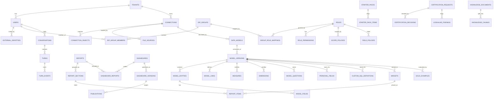
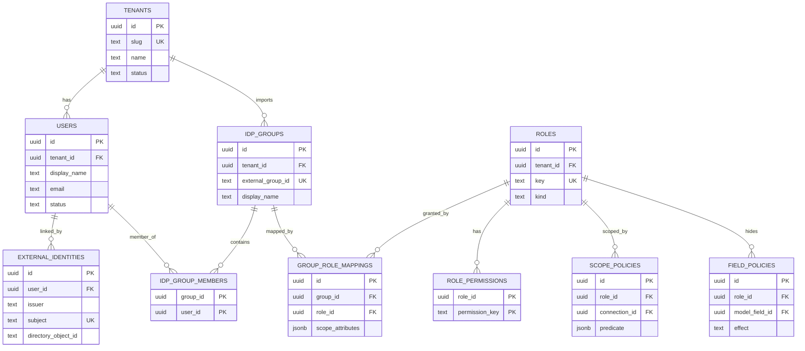
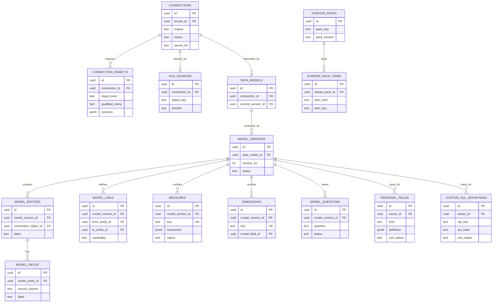
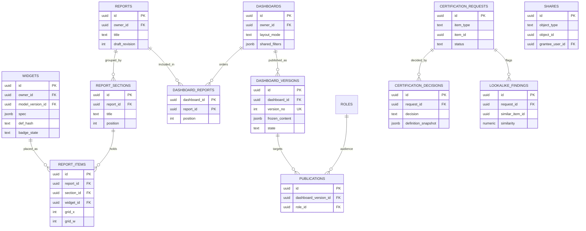

# Database Schema — Proposed Logical and Physical Data Model

| Field | Value |
|---|---|
| Project | Tela — Conversational PMO Analytics & Dashboard Platform |
| Document status | Draft |
| Version | 0.1 |
| Last updated | 2026-10-21 |
| Evidence level | L1 – Business only. Every table, column, type, key and index in this document is **Proposed**. The stack choice (PostgreSQL internal database, pgvector for RAG) is mandated by the stakeholder. The PMO source schema in the last section is **Reference (secondary)**. |
| Sources analyzed | 31 files — see [project_summary.md](project_summary.md#source-inventory-and-coverage) |
| Related documents | [Project summary](project_summary.md) · [Architecture](architecture.md) · [Function document](function_document.md) · [Technical document](technical_document.md) · [Data dictionary](data_dictionary.md) · [Business rules](business_rules.md) · [Requirements](requirements.md) · [API catalog](api_catalog.md) · [Risk register](risk_register.md) |

> **Important limitation.** No DDL, migrations, ORM models or ERD were supplied for the product being built. What follows is a proposed data model. It is derived from the Phase 1 scope (S01), the decision pack (S05–S09) and the reference systems' documents (S10–S31). No table or column name here exists yet. Treat every name as a design proposal to review.

---

## Table of contents

- [1. Purpose, scope and evidence](#1-purpose-scope-and-evidence)
- [2. Database inventory](#2-database-inventory)
- [Entity relationship diagram](#entity-relationship-diagram)
- [Table catalog](#table-catalog)
- [6. Relationships](#6-relationships)
- [7. Indexes and constraints](#7-indexes-and-constraints)
- [8. Enumerations and seed data](#8-enumerations-and-seed-data)
- [9. Views, functions, triggers and row-level security](#9-views-functions-triggers-and-row-level-security)
- [10. Cross-cutting conventions](#10-cross-cutting-conventions)
- [11. Data classification and retention summary](#11-data-classification-and-retention-summary)
- [12. Migration plan](#12-migration-plan)
- [13. Volume and growth estimates](#13-volume-and-growth-estimates)
- [14. Key query patterns and indexing recommendations](#14-key-query-patterns-and-indexing-recommendations)
- [15. Schema to requirement mapping](#15-schema-to-requirement-mapping)
- [16. Schema issues and recommendations](#16-schema-issues-and-recommendations)
- [17. Proposed DDL snippets](#17-proposed-ddl-snippets)
- [18. Reference source schema for the PMO starter pack](#18-reference-source-schema-for-the-pmo-starter-pack)
- [19. Open questions](#19-open-questions)
- [Change log](#change-log)

---

## 1. Purpose, scope and evidence

**Purpose.** This document describes how Tela stores its own data. That covers identities and policies, connection metadata, data models and certified definitions, widgets, reports and dashboards, governance records, conversations, the RAG knowledge index and operational records.

**What Tela never stores.** Rows from the customer's connected sources are never persisted (S01 §1, §4.1, §6 "Data safety"). The persistent stores hold only:

- *Definitions*: the question or spec, never the numbers (S01 §1 "Widget").
- *Metadata*: introspected table and column names and types.
- *Short-lived, scope-keyed result caches* in Redis (ADR-010).

Column samples read during model proposal are not stored (S01 §4.1).

**Evidence sources for this model**

| Area | Source | How used |
|---|---|---|
| Object model (Connection → Data model → Widget → Report → Dashboard → Published) | S01 §1 | Core content schema |
| Roles, scope, certification, versions, starter packs | S01 §2–§4.10 | iam, gov, content and model schemas |
| Identity tables (tenants, external identities, group mappings, provisioning) | S03 §7 | iam schema |
| Custom-report persistence lessons (SQLite single point of failure, def_hash dedupe) | S15, S16 (pmo_dashboard data dictionary and risk register) | widgets.def_hash; rejection of a file-based store |
| JSON flat-file stores limited to a single worker | S29, S30 (tela_nl2sql) | Rejection of a file-based store |
| pgvector 0.8, HNSW, 1024-dim mxbai-embed-large | S31 | rag schema |
| Outbox written but never drained | S31 §6.2 | ops.outbox_events, with an explicit relay and retention |

Every element is **Proposed** unless marked otherwise.

---

## 2. Database inventory

| Store | Engine (version Proposed) | Purpose | Owner component | Written by Tela? | Environment notes |
|---|---|---|---|---|---|
| Metadata database | PostgreSQL 16 with the `vector` extension (pgvector ≥ 0.7; S31 reports 0.8.0 in reference) | All Tela-owned state in schemas `iam`, `conn`, `model`, `defs`, `content`, `gov`, `chat`, `rag`, `ops` | COMP-011, accessed by COMP-002, COMP-007 and COMP-008 | Yes | One database per deployment. Separate databases per environment (NFR-020). Tenant isolation by `tenant_id` plus RLS. |
| Identity broker database | PostgreSQL (separate database or instance) used by Keycloak | Keycloak realms, clients, brokered identity links, sessions | COMP-010 | Indirectly (Keycloak) | Never shared with the metadata schemas. Backed up separately. |
| Cache and queue | Redis 7.x | Result cache (scope-keyed, TTL), Celery broker, rate limits, SSE fan-out | COMP-012 | Yes (ephemeral) | No durable business data. Loss is tolerable (see ADR-010). |
| Object storage | S3-compatible (MinIO, or Azure Blob via an S3 gateway or native SDK) | Uploaded Excel/CSV files (FEAT-011), generated exports (FEAT-045), knowledge source documents (FEAT-014) | COMP-014 | Yes | Server-side encryption. Lifecycle rules per bucket (see §11). |
| Secrets store | OpenBao or HashiCorp Vault | Source credentials, LLM API keys, signing keys | COMP-013 | Yes (secrets only) | The metadata DB stores only `secret_ref` paths. |
| Connected sources | PostgreSQL, MySQL, SQL Server, MongoDB, Excel/CSV (via DuckDB over the stored file), Dataverse | Customer data queried read-only | Customer (STK-005) | **Never** | Read-only identities only (RULE-001). No DDL or DML is ever issued. No table copies are made. |

---

## Entity relationship diagram

**Status: Proposed.** One overview diagram follows, and then smaller per-domain diagrams. Column lists are abbreviated in the diagrams. The [Table catalog](#table-catalog) is authoritative.

### Overview



### Identity and access (schema `iam`)



### Connections, models and definitions (schemas `conn`, `model`, `defs`)



### Content and governance (schemas `content`, `gov`)



### Conversations, knowledge and operations (schemas `chat`, `rag`, `ops`)

```mermaid
erDiagram
    USERS ||--o{ CONVERSATIONS : holds
    CONVERSATIONS ||--o{ TURNS : contains
    TURNS ||--o{ TURN_EVENTS : emits
    TURNS ||--o{ QUERY_EXECUTIONS : runs
    TURNS ||--o{ LLM_INVOCATIONS : calls
    KNOWLEDGE_DOCUMENTS ||--o{ KNOWLEDGE_CHUNKS : split_into
    MODEL_VERSIONS ||--o{ GOLD_EXAMPLES : evaluated_by
    USERS ||--o{ EXPORT_JOBS : requests
    USERS ||--o{ NOTIFICATIONS : receives
    CONVERSATIONS {
        uuid id PK
        uuid user_id FK
        uuid connection_id FK
    }
    TURNS {
        uuid id PK
        uuid conversation_id FK
        text question
        jsonb spec
        text status
    }
    TURN_EVENTS {
        bigint id PK
        uuid turn_id FK
        text stage
    }
    KNOWLEDGE_DOCUMENTS {
        uuid id PK
        text source_kind
        text review_status
    }
    KNOWLEDGE_CHUNKS {
        uuid id PK
        uuid document_id FK
        text content
        vector embedding
    }
    GOLD_EXAMPLES {
        uuid id PK
        uuid model_version_id FK
        text question
        jsonb expected_spec
        vector embedding
    }
    AUDIT_EVENTS {
        bigint id PK
        uuid actor_id
        text action
        text object_type
    }
    LLM_INVOCATIONS {
        uuid id PK
        uuid turn_id FK
        text agent
        int prompt_tokens
    }
    QUERY_EXECUTIONS {
        uuid id PK
        uuid turn_id FK
        text statement_hash
        int duration_ms
    }
    RESULT_CACHE_INDEX {
        text cache_key PK
        uuid widget_id
        timestamptz as_of
    }
    EXPORT_JOBS {
        uuid id PK
        uuid requested_by FK
        text format
        text status
    }
    OUTBOX_EVENTS {
        bigint id PK
        text topic
        timestamptz published_at
    }
    NOTIFICATIONS {
        uuid id PK
        uuid user_id FK
        text kind
    }
```



---

## Table catalog

Common columns are present on every table unless stated otherwise. They are not repeated in each table:

| Column | Type | Null | Default | Description |
|---|---|---|---|---|
| `created_at` | timestamptz | No | `now()` | Row creation time (UTC) |
| `updated_at` | timestamptz | No | `now()` | Maintained by the `set_updated_at` trigger |
| `created_by` | uuid | Yes | — | `iam.users.id` of the actor. NULL for system jobs. |

`tenant_id uuid NOT NULL REFERENCES iam.tenants(id)` is present on every tenant-scoped table. That is every table except `iam.tenants` and `model.starter_pack_items`; `model.starter_packs` and `model.pack_documents` have a nullable `tenant_id` (null = a global system pack, US-230). It is listed in the tables below for clarity. Classification codes (definitions in [data_dictionary.md](data_dictionary.md#classification-and-retention)) are: **PUB** Public · **INT** Internal · **CONF** Confidential · **PERS** Personal · **SENS** Sensitive.

### Schema `iam`

### tenants (DATA-001)

**Purpose:** One customer organisation (SaaS) or the single organisation (customer-hosted).
**Evidence:** Proposed from S03 §4 and §7 (tenant isolation, hybrid hosting).
**Status:** Proposed

| Column | Type | Null | Default | Key | Constraints | Description | Classification |
|---|---|---|---|---|---|---|---|
| id | uuid | No | uuid v7 | PK | | Tenant identifier | INT |
| slug | text | No | | UK | `^[a-z0-9-]{3,40}$` | URL-safe key | INT |
| name | text | No | | | | Display name | INT |
| status | text | No | 'active' | | CHECK in tenant_status | active, suspended, deprovisioned | INT |
| deployment_profile | text | No | 'saas' | | CHECK in ('saas','customer_hosted') | Hosting profile (S03 §4) | INT |
| settings | jsonb | No | '{}' | | | Non-secret settings: default time zone, locale, currency format (GAP-015) | INT |

**Indexes:** PK. Unique on `slug`.
**Relationships:** Parent of every tenant-scoped table (ON DELETE RESTRICT).
**Used by:** FEAT-001, FEAT-002, NFR-023.
**Issues and notes:** Hard delete is never used. Deprovisioning sets the status, and retention rules then apply.

### users (DATA-002)

**Purpose:** Internal user profile created at first sign-in or by SCIM provisioning.
**Evidence:** Proposed from S03 §7 (`users`, lifecycle states) and S01 §2.
**Status:** Proposed

| Column | Type | Null | Default | Key | Constraints | Description | Classification |
|---|---|---|---|---|---|---|---|
| id | uuid | No | uuid v7 | PK | | User id | INT |
| tenant_id | uuid | No | | FK | → tenants | Tenant | INT |
| display_name | text | No | | | | Name from the identity provider | PERS |
| email | citext | Yes | | | unique per tenant when present | Work e-mail. Never used alone to match identities (S03 §5.2). | PERS |
| status | text | No | 'pending' | | CHECK in user_status | pending, active, suspended, deprovisioned (S03 §7) | INT |
| locale | text | Yes | | | | UI locale | INT |
| time_zone | text | Yes | | | IANA name | User time zone | INT |
| last_login_at | timestamptz | Yes | | | | Last successful sign-in | INT |
| effective_roles_cache | jsonb | No | '[]' | | | Denormalised role keys, recomputed on group change. Authorisation re-resolves on every request (see notes). | INT |

**Indexes:** `(tenant_id, lower(email))` unique where email is not null. `(tenant_id, status)`.
**Relationships:** `external_identities.user_id` (CASCADE). `idp_group_members.user_id` (CASCADE). Owned content references the user with RESTRICT (content is reassigned, not deleted).
**Used by:** FEAT-001, FEAT-004, FEAT-017, FEAT-048.
**Issues and notes:** `effective_roles_cache` is a convenience only. NFR-002 requires the server to recompute scope per request or per short-lived session.

### external_identities (DATA-003)

**Purpose:** Links an internal user to an immutable identity-provider subject (issuer plus subject and Entra object id).
**Evidence:** Proposed from S03 §5.2 and §7 (`uq_external_identity`).
**Status:** Proposed

| Column | Type | Null | Default | Key | Constraints | Description | Classification |
|---|---|---|---|---|---|---|---|
| id | uuid | No | uuid v7 | PK | | | INT |
| tenant_id | uuid | No | | FK | → tenants | | INT |
| user_id | uuid | No | | FK | → users ON DELETE CASCADE | | INT |
| provider | text | No | 'entra' | | CHECK in idp_provider | entra, oidc, saml | INT |
| issuer | text | No | | | | Trusted issuer URL (tenant-specific authority) | INT |
| subject | text | No | | | | Token `sub` as brokered by Keycloak | PERS |
| directory_tenant_id | text | Yes | | | | Entra `tid` | INT |
| directory_object_id | text | Yes | | | | Entra `oid` (stable) | PERS |
| last_seen_at | timestamptz | Yes | | | | | INT |

**Indexes:** Unique `(issuer, subject)`. Unique `(directory_tenant_id, directory_object_id)` where not null.
**Relationships:** Many-to-one to users.
**Used by:** FEAT-001, FEAT-004.

### idp_groups (DATA-004)

**Purpose:** Groups imported from Entra ID (token claims, SCIM or Microsoft Graph). These are the input to role and scope mapping (S01 §2).
**Evidence:** Proposed from S03 §7 (`external_groups`).
**Status:** Proposed

| Column | Type | Null | Default | Key | Constraints | Description | Classification |
|---|---|---|---|---|---|---|---|
| id | uuid | No | uuid v7 | PK | | | INT |
| tenant_id | uuid | No | | FK | | | INT |
| external_group_id | text | No | | UK | unique per tenant | Entra group object id | INT |
| display_name | text | No | | | | | INT |
| source | text | No | 'claim' | | CHECK in ('claim','scim','graph') | How the group was learned | INT |
| last_synced_at | timestamptz | Yes | | | | | INT |

**Indexes:** Unique `(tenant_id, external_group_id)`.
**Used by:** FEAT-002, FEAT-004.
**Issues and notes:** Entra group "overage" (tokens carry a link instead of the group list when membership is large) requires a Graph lookup or SCIM sync. See RISK-007.

### idp_group_members (DATA-005)

**Purpose:** Current membership of users in identity-provider groups.
**Evidence:** Proposed (S03 §7 `external_group_memberships`).
**Status:** Proposed

| Column | Type | Null | Default | Key | Constraints | Description | Classification |
|---|---|---|---|---|---|---|---|
| tenant_id | uuid | No | | FK | | | INT |
| group_id | uuid | No | | PK, FK | → idp_groups CASCADE | | INT |
| user_id | uuid | No | | PK, FK | → users CASCADE | | INT |
| source | text | No | | | claim, scim, graph | | INT |
| observed_at | timestamptz | No | now() | | | Last confirmation | INT |

**Indexes:** PK `(group_id, user_id)`. Index `(user_id)`.
**Used by:** FEAT-002, FEAT-003.

### roles (DATA-006)

**Purpose:** Application roles. These are the system roles Admin, Creator and Viewer (S01 §2), plus audience/business roles such as CIO, Executive and Delivery manager that are used as publish targets (S01 §4.9).
**Evidence:** Proposed (S01 §2, §4.9; S03 §9).
**Status:** Proposed

| Column | Type | Null | Default | Key | Constraints | Description | Classification |
|---|---|---|---|---|---|---|---|
| id | uuid | No | uuid v7 | PK | | | INT |
| tenant_id | uuid | Yes | | FK | NULL for global system roles | | INT |
| key | text | No | | UK | `^[a-z_]{2,40}$` | admin, creator, viewer, cio, executive, delivery_manager… | INT |
| name | text | No | | | | Display name | INT |
| kind | text | No | | | CHECK in role_kind | system (capability) or audience (publish target and scope) | INT |
| is_protected | boolean | No | false | | | Privileged roles need explicit mapping (S03 §9) | INT |

**Indexes:** Unique `(coalesce(tenant_id, '00000000-0000-0000-0000-000000000000'), key)`.
**Used by:** FEAT-002, FEAT-039, FEAT-046.
**Issues and notes:** Whether audience roles are fixed or configurable is open (GAP-002, Q-003).

### role_permissions (DATA-007)

**Purpose:** Capability keys granted to a role (for example `content.publish`).
**Evidence:** Proposed (S03 §9 permission keys).
**Status:** Proposed

| Column | Type | Null | Default | Key | Constraints | Description | Classification |
|---|---|---|---|---|---|---|---|
| role_id | uuid | No | | PK, FK | → roles CASCADE | | INT |
| permission_key | text | No | | PK | must exist in permission catalogue (§8) | | INT |

**Used by:** FEAT-002 and every authorised API.

### group_role_mappings (DATA-008)

**Purpose:** An explicit, auditable mapping from an Entra group to a role, with optional scope attributes (for example `cio = 'Nomsa Osei'` taken from a group or claim).
**Evidence:** Proposed (S03 §9; S01 §2; conflict C4 → GAP-013).
**Status:** Proposed

| Column | Type | Null | Default | Key | Constraints | Description | Classification |
|---|---|---|---|---|---|---|---|
| id | uuid | No | uuid v7 | PK | | | INT |
| tenant_id | uuid | No | | FK | | | INT |
| group_id | uuid | No | | FK | → idp_groups CASCADE | | INT |
| role_id | uuid | No | | FK | → roles RESTRICT | | INT |
| scope_attributes | jsonb | No | '{}' | | validated JSON schema | Attribute values injected into scope predicates (for example `{"cio": ["Nomsa Osei"]}`) | CONF |
| approved_by | uuid | Yes | | FK | → users | Required when `roles.is_protected` | INT |
| approved_at | timestamptz | Yes | | | | | INT |

**Indexes:** Unique `(group_id, role_id)`.
**Used by:** FEAT-002, RULE-004.

### scope_policies (DATA-009)

**Purpose:** Row-level scope rules per role and connection. Structured predicates are injected into every query (RULE-004, RULE-005).
**Evidence:** Proposed (S01 §6 Security/scope; reference row filters S27 RULE-004).
**Status:** Proposed

| Column | Type | Null | Default | Key | Constraints | Description | Classification |
|---|---|---|---|---|---|---|---|
| id | uuid | No | uuid v7 | PK | | | INT |
| tenant_id | uuid | No | | FK | | | INT |
| role_id | uuid | No | | FK | → roles CASCADE | | INT |
| connection_id | uuid | No | | FK | → connections CASCADE | | INT |
| entity_key | text | No | | | | Model entity the predicate applies to | INT |
| predicate | jsonb | No | | | `{column, op, value | {attr}}` list, AND-combined | Structured condition. Never free SQL. | CONF |
| description | text | No | | | | Plain-language explanation shown on the locked scope chip | INT |
| is_active | boolean | No | true | | | | INT |

**Indexes:** `(tenant_id, connection_id, role_id)`.
**Used by:** FEAT-003, FEAT-042, RULE-004.
**Issues and notes:** A user with several roles receives the union of row scopes. Filters still only narrow that union (RULE-005). The union semantics need confirmation (Q-003).

### field_policies (DATA-010)

**Purpose:** Field-level hiding per role, for example finance fields hidden from CIOs (S01 §6).
**Evidence:** Proposed.
**Status:** Proposed

| Column | Type | Null | Default | Key | Constraints | Description | Classification |
|---|---|---|---|---|---|---|---|
| id | uuid | No | uuid v7 | PK | | | INT |
| tenant_id | uuid | No | | FK | | | INT |
| role_id | uuid | No | | FK | → roles CASCADE | | INT |
| model_field_key | text | No | | | | Stable field key across model versions | INT |
| connection_id | uuid | No | | FK | → connections CASCADE | | INT |
| effect | text | No | 'hide' | | CHECK in ('hide','mask') | `hide` removes the field. `mask` applies RULE-020. | INT |

**Indexes:** Unique `(role_id, connection_id, model_field_key)`.
**Used by:** FEAT-003, FEAT-039 (preview shows hidden widgets), RULE-020.

### Schema `conn`

### connections (DATA-011)

**Purpose:** A read-only link to one source (S01 §1). Credentials are never stored here.
**Evidence:** Proposed (S01 §4.1; stakeholder connector list; S29 DATA-005 lesson: plaintext passwords in JSON).
**Status:** Proposed

| Column | Type | Null | Default | Key | Constraints | Description | Classification |
|---|---|---|---|---|---|---|---|
| id | uuid | No | uuid v7 | PK | | | INT |
| tenant_id | uuid | No | | FK | | | INT |
| name | text | No | | | unique per tenant | Display name | INT |
| engine | text | No | | | CHECK in connection_engine | postgres, mysql, sqlserver, mongodb, excel, csv, dataverse | INT |
| descriptor | jsonb | No | '{}' | | no secrets (validated) | host, port, database, schema list, Dataverse environment URL, SSL mode, auth method | CONF |
| secret_ref | text | Yes | | | path in OpenBao/Vault. NULL for file sources. | Reference only | CONF |
| status | text | No | 'draft' | | CHECK in connection_status | draft, testing, active, error, disabled | INT |
| read_only_verified_at | timestamptz | Yes | | | | Last successful RULE-001 check | INT |
| read_only_evidence | jsonb | Yes | | | | Engine-specific proof summary (for example a grant list hash). No secrets. | CONF |
| schema_checksum | text | Yes | | | | Hash of the last introspected catalogue (S02 schema checksum idea) | INT |
| freshness_policy | jsonb | No | '{"mode":"live","cache_ttl_s":900}' | | | Freshness model per Q-001 / REC-001 | INT |
| row_cap | integer | No | 10000 | | 1..10000 | Per-connection cap (RULE-006) | INT |
| timeout_ms | integer | No | 20000 | | 1000..20000 | Statement timeout (RULE-006) | INT |
| deleted_at | timestamptz | Yes | | | | Soft delete | INT |

**Indexes:** Unique `(tenant_id, name)` where `deleted_at` is null. `(tenant_id, status)`.
**Relationships:** Children are connection_objects, file_sources, data_models, scope_policies and field_policies.
**Used by:** FEAT-005, FEAT-011, FEAT-012, FEAT-013, RULE-001, RULE-006.

### connection_objects (DATA-012)

**Purpose:** Introspected catalogue metadata (tables, views, collections, Dataverse tables, worksheets) with column names and types only. No sample values are stored (S01 §4.1).
**Evidence:** Proposed.
**Status:** Proposed

| Column | Type | Null | Default | Key | Constraints | Description | Classification |
|---|---|---|---|---|---|---|---|
| id | uuid | No | uuid v7 | PK | | | INT |
| tenant_id | uuid | No | | FK | | | INT |
| connection_id | uuid | No | | FK | → connections CASCADE | | INT |
| object_kind | text | No | | | CHECK in ('table','view','collection','sheet','dataverse_table') | | INT |
| qualified_name | text | No | | | | `schema.table`, `db.collection`, `sheet!range`, Dataverse logical name | INT |
| display_name | text | Yes | | | | Source display name (for example a Dataverse display name) | INT |
| columns | jsonb | No | '[]' | | | `[{name, type, nullable, pk, fk_ref, inferred}]`. MongoDB types are inferred from a schema sample, and the sample itself is not stored. | INT |
| is_allowed | boolean | No | false | | | Admin allow-list for querying (RULE-003) | INT |
| introspected_at | timestamptz | No | now() | | | | INT |

**Indexes:** Unique `(connection_id, qualified_name)`.
**Used by:** FEAT-006, FEAT-007, RULE-003.

### file_sources (DATA-013)

**Purpose:** The uploaded Excel or CSV file that backs an `excel` or `csv` connection (FEAT-011, ADR-012). Each upload is a governed copy (RISK-006).
**Evidence:** Proposed (stakeholder instruction; conflict C1).
**Status:** Proposed

| Column | Type | Null | Default | Key | Constraints | Description | Classification |
|---|---|---|---|---|---|---|---|
| id | uuid | No | uuid v7 | PK | | | INT |
| tenant_id | uuid | No | | FK | | | INT |
| connection_id | uuid | No | | FK, UK | → connections CASCADE. One current file per connection. | | INT |
| object_key | text | No | | | | Object storage key | CONF |
| original_filename | text | No | | | | | INT |
| content_type | text | No | | | xlsx, xls, csv mime types only | | INT |
| size_bytes | bigint | No | | | ≤ configured max (Proposed 50 MB) | | INT |
| sha256 | text | No | | | | Integrity and deduplication | INT |
| sheet_manifest | jsonb | No | '[]' | | | Sheets, header row, detected types | INT |
| retention_until | timestamptz | Yes | | | | Lifecycle (REC-008) | INT |
| replaced_at | timestamptz | Yes | | | | Set when superseded | INT |

**Used by:** FEAT-011, RULE-018 (as-of = upload time).

### Schema `model`

### data_models (DATA-014)

**Purpose:** The meaning of one connection's data (S01 §1). Holds a pointer to the current certified version.
**Evidence:** Proposed (S01 §4.1).
**Status:** Proposed

| Column | Type | Null | Default | Key | Constraints | Description | Classification |
|---|---|---|---|---|---|---|---|
| id | uuid | No | uuid v7 | PK | | | INT |
| tenant_id | uuid | No | | FK | | | INT |
| connection_id | uuid | No | | FK, UK | → connections RESTRICT | One model per connection (S01 §4.1) | INT |
| current_version_id | uuid | Yes | | FK | → model_versions (deferrable) | Latest approved version | INT |
| draft_version_id | uuid | Yes | | FK | → model_versions | Working draft edited via the model assistant | INT |
| installed_pack_id | uuid | Yes | | FK | → starter_packs | Pack that seeded this model | INT |

**Used by:** FEAT-007, FEAT-009, FEAT-010.

### model_versions (DATA-015)

**Purpose:** An immutable approved version (v1, v2, …) or the single mutable draft (S01 §4.1 "Approve model").
**Evidence:** Proposed.
**Status:** Proposed

| Column | Type | Null | Default | Key | Constraints | Description | Classification |
|---|---|---|---|---|---|---|---|
| id | uuid | No | uuid v7 | PK | | | INT |
| tenant_id | uuid | No | | FK | | | INT |
| data_model_id | uuid | No | | FK | → data_models CASCADE | | INT |
| version_no | integer | Yes | | UK | unique per model. NULL while draft. | 1, 2, 3… | INT |
| status | text | No | 'draft' | | CHECK in model_version_status | draft, approved, superseded | INT |
| schema_checksum | text | No | | | | Catalogue checksum this version was built on | INT |
| change_summary | text | Yes | | | | Plain-language diff | INT |
| approved_by | uuid | Yes | | FK | → users | Admin | INT |
| approved_at | timestamptz | Yes | | | | | INT |
| definition_snapshot | jsonb | Yes | | | | Frozen full model JSON (audit, RULE-015) | CONF |

**Indexes:** Unique `(data_model_id, version_no)`. Partial unique `(data_model_id)` where `status = 'draft'` (only one draft).
**Issues and notes:** Rows with status approved are immutable. A trigger rejects UPDATE except the transition to `superseded`.

### model_entities (DATA-016)

**Purpose:** A source object included in the model, with a business label.
**Evidence:** Proposed.
**Status:** Proposed

| Column | Type | Null | Default | Key | Constraints | Description | Classification |
|---|---|---|---|---|---|---|---|
| id | uuid | No | uuid v7 | PK | | | INT |
| tenant_id | uuid | No | | FK | | | INT |
| model_version_id | uuid | No | | FK | → model_versions CASCADE | | INT |
| connection_object_id | uuid | No | | FK | → connection_objects RESTRICT | | INT |
| key | text | No | | UK | unique per version | Stable key, for example `projects` | INT |
| label | text | No | | | | Business name | INT |
| description | text | Yes | | | | | INT |
| grain | text | Yes | | | | Plain statement of what one row means (fan-out guard, RULE-014) | INT |

### model_fields (DATA-017)

**Purpose:** A column of an entity, with its label, format, description and blank handling.
**Evidence:** Proposed (S01 §4.1 corrections: rename, descriptions, currency formatting).
**Status:** Proposed

| Column | Type | Null | Default | Key | Constraints | Description | Classification |
|---|---|---|---|---|---|---|---|
| id | uuid | No | uuid v7 | PK | | | INT |
| tenant_id | uuid | No | | FK | | | INT |
| model_entity_id | uuid | No | | FK | → model_entities CASCADE | | INT |
| key | text | No | | UK | unique per entity; stable across versions | | INT |
| source_column | text | No | | | must exist in connection_objects.columns | | INT |
| label | text | No | | | | | INT |
| description | text | Yes | | | | | INT |
| data_type | text | No | | | CHECK in field_type | text, integer, decimal, date, datetime, boolean, json | INT |
| semantic_type | text | Yes | | | | currency, percent, email, phone, person_name, identifier, free_text | INT |
| format | jsonb | No | '{}' | | | Currency code, decimals, date format | INT |
| sensitivity | text | No | 'internal' | | CHECK in sensitivity | public, internal, confidential, personal, sensitive. Drives RULE-019 and RULE-020. | INT |
| is_queryable | boolean | No | true | | | Excluded fields never reach the planner (S11 41-column allow-list lesson) | INT |
| blank_handling | text | Yes | | | | Plain rule (S01 §4.3 definition popover) | INT |

### model_links (DATA-018)

**Purpose:** An approved join between entities with cardinality. These are the only join paths allowed (S01 §4.7, RULE-014).
**Evidence:** Proposed.
**Status:** Proposed

| Column | Type | Null | Default | Key | Constraints | Description | Classification |
|---|---|---|---|---|---|---|---|
| id | uuid | No | uuid v7 | PK | | | INT |
| tenant_id | uuid | No | | FK | | | INT |
| model_version_id | uuid | No | | FK | → model_versions CASCADE | | INT |
| from_entity_id | uuid | No | | FK | → model_entities CASCADE | | INT |
| to_entity_id | uuid | No | | FK | → model_entities CASCADE | | INT |
| from_field_keys | text[] | No | | | | | INT |
| to_field_keys | text[] | No | | | same length as from_field_keys | | INT |
| cardinality | text | No | | | CHECK in ('one_to_one','many_to_one','one_to_many') | S01 §4.1 | INT |
| origin | text | No | | | CHECK in ('foreign_key','proposed','admin') | FK-derived or assistant-proposed (S26 REQ-018 lesson) | INT |

**Indexes:** Unique `(model_version_id, from_entity_id, to_entity_id, from_field_keys)`.

### measures (DATA-019)

**Purpose:** A certified measure, written once and reused everywhere (S01 §3).
**Evidence:** Proposed.
**Status:** Proposed

| Column | Type | Null | Default | Key | Constraints | Description | Classification |
|---|---|---|---|---|---|---|---|
| id | uuid | No | uuid v7 | PK | | | INT |
| tenant_id | uuid | No | | FK | | | INT |
| model_version_id | uuid | No | | FK | → model_versions CASCADE | | INT |
| key | text | No | | UK | unique `(model_version_id, key)` | for example `overdue_go_lives` | INT |
| label | text | No | | | | | INT |
| aggregation | text | No | | | CHECK in ('count','count_distinct','sum','avg','min','max','ratio','custom') | | INT |
| expression | jsonb | No | | | typed expression AST (ADR-001) | Base field, filters, numerator and denominator. Never raw SQL. | CONF |
| plain_rule | text | No | | | | Readable rule shown in the definition popover | INT |
| blank_handling | text | No | | | | | INT |
| currency_field_key | text | Yes | | | | Enforces RULE-023 | INT |
| rule_ref | text | Yes | | | | For example `RULE-028` for PMO pack measures | INT |
| status | text | No | 'certified' | | CHECK in ('certified','deprecated') | | INT |

### dimensions (DATA-020)

**Purpose:** A field that can be grouped by, with an optional hierarchy and sort order.
**Evidence:** Proposed.
**Status:** Proposed

| Column | Type | Null | Default | Key | Constraints | Description | Classification |
|---|---|---|---|---|---|---|---|
| id | uuid | No | uuid v7 | PK | | | INT |
| tenant_id | uuid | No | | FK | | | INT |
| model_version_id | uuid | No | | FK | CASCADE | | INT |
| key | text | No | | UK | unique `(model_version_id, key)` | | INT |
| model_field_id | uuid | No | | FK | → model_fields CASCADE | | INT |
| label | text | No | | | | | INT |
| is_temporal | boolean | No | false | | | Enables trend visuals (RULE-008) | INT |
| sort_order | jsonb | Yes | | | | Custom order, for example lifecycle phases | INT |

### model_questions (DATA-021)

**Purpose:** Explicit questions raised by the model assistant where meaning cannot be inferred, for example currency, VAT or cancelled records (S01 §4.1).
**Evidence:** Proposed.
**Status:** Proposed

| Column | Type | Null | Default | Key | Constraints | Description | Classification |
|---|---|---|---|---|---|---|---|
| id | uuid | No | uuid v7 | PK | | | INT |
| tenant_id | uuid | No | | FK | | | INT |
| model_version_id | uuid | No | | FK | CASCADE | | INT |
| question | text | No | | | | | INT |
| target_ref | jsonb | Yes | | | | Entity, field or measure concerned | INT |
| answer | text | Yes | | | | Admin's answer | INT |
| status | text | No | 'open' | | CHECK in ('open','answered','dismissed') | Open questions block approval unless dismissed | INT |

### starter_packs (DATA-022)

**Purpose:** Catalogue of installable packs, for example the PMO pack for TPG (S01 §4.1, §4.10). System packs (`tenant_id` null) are global, loaded by `tela-admin load-packs` and read-only; a tenant's own packs (ENH-025, US-230, migration 0048) are its rows. RLS: a tenant reads the system packs and its own; the application role inserts, updates and deletes its own rows of status `draft` only, and may move its own draft to `released` (US-238, migration 0052; the API runs the release checks first). A released or retired version is frozen (trigger: only released → retired). A tenant pack may not reuse a system pack's key. Four eyes (DEC-26, trigger): a tenant draft becomes released only when it was submitted and names `released_by` and `released_at`, and `released_by` is neither `created_by` nor `submitted_by`.
**Evidence:** Migrations 0007, 0048, 0049 (Pack Studio, US-232: `released_at` empty while a draft, `updated_at`), 0052 (release review, US-238).
**Status:** Built

| Column | Type | Null | Default | Key | Constraints | Description | Classification |
|---|---|---|---|---|---|---|---|
| id | uuid | No | uuid v7 | PK | | | INT |
| tenant_id | uuid | Yes | | FK, UK | → tenants CASCADE | Null = system pack (US-230) | INT |
| pack_key | text | No | | UK | with owner and pack_version | `pmo_tpg` | INT |
| pack_version | text | No | | UK | semver | | INT |
| title | text | No | | | | | INT |
| detection_signature | jsonb | No | | | | Required objects and columns used for detection | INT |
| manifest | jsonb | No | | | | Measures, dimensions, reports and widgets | INT |
| manifest_sha256 | text | No | | | | SHA of the manifest; a released version never changes (load-packs refuses) | INT |
| status | text | No | 'released' | | CHECK in ('draft','released','retired') | Only released versions are offered for install and updates | INT |
| created_by | uuid | Yes | | | | Author of a tenant pack | INT |
| based_on_pack_id | uuid | Yes | | FK | → starter_packs SET NULL | The pack a tenant pack was cloned from | INT |
| released_at | timestamptz | Yes | | | CHECK status = 'draft' OR released_at not null | Empty while a draft (0049) | INT |
| updated_at | timestamptz | No | now() | | trigger `util.set_updated_at` | Last edit of a draft (0049; the Versions tab) | INT |
| submitted_by, submitted_at | uuid, timestamptz | Yes | | | | The author submitted this draft for review (0052); set while it waits, and the draft is locked for edits | INT |
| submitted_revision | text | Yes | | | | SHA over the manifest, every document and the attachments as submitted; release refuses a draft that changed since | INT |
| review | jsonb | Yes | | | | What was submitted: test connection, check report, a reason per warning (by issue id), note, diff summary; on release also the release-time checks | INT |
| returned_by, returned_at, returned_reason | uuid, timestamptz, text | Yes | | | | A reviewer sent it back with this reason (0052) | INT |
| released_by | uuid | Yes | | | four eyes (trigger) | Who released it: an Admin or certifier who is not the author (0052) | INT |

**Indexes:** Unique `(COALESCE(tenant_id, nil uuid), pack_key, pack_version)`; `(tenant_id)` where not null.

### pack_documents (DATA-052)

**Purpose:** A pack's knowledge files as stored documents, one per kind (ENH-025, US-230): `glossary`, `value_synonyms`, `dashboard_rules`, `chart_patterns`, `analysis_recipes`, `report_blueprints`, `gold_examples`. Read through `packs/source.py::PackSource` by install, pack updates, knowledge indexing and the wording check (US-231). Same RLS as its pack; frozen once the pack is released.
**Evidence:** Migration 0048.
**Status:** Built

| Column | Type | Null | Default | Key | Constraints | Description | Classification |
|---|---|---|---|---|---|---|---|
| id | uuid | No | uuid v7 | PK | | | INT |
| pack_id | uuid | No | | FK, UK | → starter_packs CASCADE; with kind | | INT |
| tenant_id | uuid | Yes | | FK | → tenants CASCADE; equals the pack's (trigger) | Null for a system pack | INT |
| kind | text | No | | UK | CHECK in the seven kinds | | INT |
| body | json | No | | | | The document, validated by its loader. `json`, not `jsonb`, so the file's key order is kept (chunk text follows it) | INT |
| sha256 | text | No | | | 64 hex | SHA of the body (sorted keys); load-packs refuses a changed body under a released version | INT |
| created_at, updated_at | timestamptz | No | now() | | | | INT |

### pack_attachments (DATA-053)

**Purpose:** Context documents attached to a pack (ENH-025, US-233): Markdown, text, PDF or Word files with the business context behind it. Stored like a US-102 knowledge document (bytes in the object store under the tenant's `knowledge` class); on install each is copied to the connection's `rag.knowledge_documents` as `pending_review`. A clone's rows share the stored file; the file is deleted with the last row naming it. Same RLS as the pack's documents; frozen once the pack is released.
**Evidence:** Migration 0051.
**Status:** Built

| Column | Type | Null | Default | Key | Constraints | Description | Classification |
|---|---|---|---|---|---|---|---|
| id | uuid | No | | PK | | | INT |
| pack_id | uuid | No | | FK, UK | → starter_packs CASCADE; with content_hash | | INT |
| tenant_id | uuid | Yes | | FK | → tenants CASCADE; equals the pack's (trigger) | | INT |
| title | text | No | | | 1–200 characters | | INT |
| original_filename, content_type | text | No | | | | As uploaded | INT |
| size_bytes | bigint | No | | | > 0 | | INT |
| content_hash | text | No | | UK | 64 hex | SHA-256 of the file; a connection that already has it is not given a second copy | INT |
| object_key | text | No | | | indexed | `tenant/<t>/knowledge/packs/<pack>/<id>.<ext>` | INT |
| created_by | uuid | Yes | | | | | INT |
| created_at | timestamptz | No | now() | | | | INT |

### starter_pack_items (DATA-023)

**Purpose:** The installed starter reports per tenant, with state and visibility (S01 §4.10).
**Evidence:** Proposed.
**Status:** Proposed

| Column | Type | Null | Default | Key | Constraints | Description | Classification |
|---|---|---|---|---|---|---|---|
| id | uuid | No | uuid v7 | PK | | | INT |
| tenant_id | uuid | No | | FK | | (tenant-scoped installation row) | INT |
| starter_pack_id | uuid | No | | FK | → starter_packs RESTRICT | | INT |
| item_kind | text | No | | | CHECK in ('report','dashboard','measure') | | INT |
| item_key | text | No | | | | Key in the manifest | INT |
| content_id | uuid | Yes | | | | Installed report or dashboard id | INT |
| state | text | No | 'active' | | CHECK in ('active','deleted') | Deletable and restorable (RULE-017) | INT |
| hidden_from_role_ids | uuid[] | No | '{}' | | | "Hide from a role" | INT |
| copy_count | integer | No | 0 | | | Number of user copies, maintained on copy | INT |

**Indexes:** Unique `(tenant_id, starter_pack_id, item_key)`.

### Schema `defs`

### personal_fields (DATA-024)

**Purpose:** A creator's grouping, band or cross-table measure. Applied at query level only (S01 §4.7).
**Evidence:** Proposed.
**Status:** Proposed

| Column | Type | Null | Default | Key | Constraints | Description | Classification |
|---|---|---|---|---|---|---|---|
| id | uuid | No | uuid v7 | PK | | | INT |
| tenant_id | uuid | No | | FK | | | INT |
| owner_id | uuid | No | | FK | → users RESTRICT | | INT |
| model_version_id | uuid | No | | FK | → model_versions RESTRICT | | INT |
| kind | text | No | | | CHECK in ('grouping','band','join_measure') | | INT |
| key | text | No | | | unique `(owner_id, model_version_id, key)` | | INT |
| label | text | No | | | | | INT |
| definition | jsonb | No | | | typed (RULE-012, RULE-013, RULE-014) | Mapping, edges or link path | CONF |
| plain_rule | text | No | | | | Includes blank and edge handling | INT |
| cert_status | text | No | 'personal' | | CHECK in cert_status | personal, pending, certified, rejected, merged | INT |
| certified_as | uuid | Yes | | | | Measure or dimension id after certify or merge | INT |
| deleted_at | timestamptz | Yes | | | | | INT |

### custom_sql_definitions (DATA-025)

**Purpose:** A custom SQL widget's statement, validated by "Check and run" (S01 §4.7).
**Evidence:** Proposed.
**Status:** Proposed

| Column | Type | Null | Default | Key | Constraints | Description | Classification |
|---|---|---|---|---|---|---|---|
| id | uuid | No | uuid v7 | PK | | | INT |
| tenant_id | uuid | No | | FK | | | INT |
| owner_id | uuid | No | | FK | → users RESTRICT | | INT |
| connection_id | uuid | No | | FK | → connections RESTRICT | One database per widget | INT |
| model_version_id | uuid | No | | FK | | Allow-list basis | INT |
| dialect | text | No | | | postgres, mysql, tsql, duckdb | Not offered for MongoDB (ADR-014) | INT |
| sql_text | text | No | | | contains `:page_filters` placeholder at most once | Read-only SELECT (RULE-002) | CONF |
| ast_hash | text | No | | | | Normalised AST hash for look-alike and dedupe | INT |
| last_check | jsonb | Yes | | | | Result of Check and run (pass or fail per rule, row count, ms) | INT |
| drafted_by_ai | boolean | No | false | | | AG-10 drafted | INT |
| cert_status | text | No | 'personal' | | CHECK in cert_status | | INT |

### Schema `content`

### widgets (DATA-026)

**Purpose:** One live chart, table or figure. It stores the question and spec, never the numbers (S01 §1).
**Evidence:** Proposed (S01 §4.4; def_hash lesson S15).
**Status:** Proposed

| Column | Type | Null | Default | Key | Constraints | Description | Classification |
|---|---|---|---|---|---|---|---|
| id | uuid | No | uuid v7 | PK | | | INT |
| tenant_id | uuid | No | | FK | | | INT |
| owner_id | uuid | No | | FK | → users RESTRICT | | INT |
| connection_id | uuid | No | | FK | → connections RESTRICT | One source per widget (S01 §4.1) | INT |
| model_version_id | uuid | No | | FK | → model_versions RESTRICT | Version pin (RULE-015, REC-011) | INT |
| title | text | No | | | | | INT |
| question | text | Yes | | | | Originating question | CONF |
| source_kind | text | No | | | CHECK in ('spec','custom_sql') | | INT |
| spec | jsonb | No | | | typed query spec (ADR-001) | Measure, breakdown, filters, limit, visual, columns | CONF |
| custom_sql_id | uuid | Yes | | FK | → custom_sql_definitions | When source_kind is custom_sql | INT |
| visual | text | No | | | CHECK in visual_type | | INT |
| follow_page_filters | boolean | No | true | | | S01 §4.4 | INT |
| own_filters | jsonb | No | '[]' | | | Badge-shown persistent filter | INT |
| def_hash | text | No | | | sha256 of the canonical spec | Deduplication | INT |
| badge_state | text | No | | | CHECK in ('certified','personal','custom_sql','starter') | Derived from the definitions used | INT |
| deleted_at | timestamptz | Yes | | | | | INT |

**Indexes:** Unique `(owner_id, def_hash)` where `deleted_at` is null. `(tenant_id, connection_id)`.

### reports (DATA-027)

**Purpose:** A page of widgets on a 12-column grid, with sections, headline figures and page filters (S01 §1, §4.6).
**Evidence:** Proposed.
**Status:** Proposed

| Column | Type | Null | Default | Key | Constraints | Description | Classification |
|---|---|---|---|---|---|---|---|
| id | uuid | No | uuid v7 | PK | | | INT |
| tenant_id | uuid | No | | FK | | | INT |
| owner_id | uuid | No | | FK | RESTRICT | | INT |
| title | text | No | | | | | INT |
| page_filters | jsonb | No | '[]' | | | Filter bar definition | INT |
| origin | text | No | 'user' | | CHECK in ('user','starter','copy') | | INT |
| copied_from_id | uuid | Yes | | FK | → reports | Starter copy lineage | INT |
| plan | jsonb | Yes | | | | Last report plan (FEAT-023), including named gaps | INT |
| draft_revision | integer | No | 0 | | | Optimistic concurrency for autosave | INT |
| deleted_at | timestamptz | Yes | | | | | INT |

### report_sections (DATA-028)

**Purpose:** A named, collapsible group of widgets.
**Evidence:** Proposed.
**Status:** Proposed

| Column | Type | Null | Default | Key | Constraints | Description | Classification |
|---|---|---|---|---|---|---|---|
| id | uuid | No | uuid v7 | PK | | | INT |
| tenant_id | uuid | No | | FK | | | INT |
| report_id | uuid | No | | FK | → reports CASCADE | | INT |
| title | text | No | | | | | INT |
| kind | text | No | 'normal' | | CHECK in ('headline','normal') | Headline figures row | INT |
| position | integer | No | | | unique `(report_id, position)` deferrable | | INT |
| collapsed | boolean | No | false | | | | INT |

### report_items (DATA-029)

**Purpose:** Placement of a widget or text note on the grid.
**Evidence:** Proposed (S01 §4.6, 12-column grid).
**Status:** Proposed

| Column | Type | Null | Default | Key | Constraints | Description | Classification |
|---|---|---|---|---|---|---|---|
| id | uuid | No | uuid v7 | PK | | | INT |
| tenant_id | uuid | No | | FK | | | INT |
| report_id | uuid | No | | FK | → reports CASCADE | | INT |
| section_id | uuid | No | | FK | → report_sections CASCADE | | INT |
| item_kind | text | No | 'widget' | | CHECK in ('widget','text_note') | | INT |
| widget_id | uuid | Yes | | FK | → widgets RESTRICT | Required when item_kind is widget | INT |
| text_content | text | Yes | | | | Markdown-lite note | INT |
| grid_x | smallint | No | | | 0..11 | | INT |
| grid_y | smallint | No | | | ≥ 0 | | INT |
| grid_w | smallint | No | | | 1..12, grid_x + grid_w ≤ 12 | | INT |
| grid_h | smallint | No | | | 1..24 | | INT |

### dashboards (DATA-030)

**Purpose:** Several reports shown as tabs or grouped on one page, with one shared filter bar (S01 §1, §4.9).
**Evidence:** Proposed.
**Status:** Proposed

| Column | Type | Null | Default | Key | Constraints | Description | Classification |
|---|---|---|---|---|---|---|---|
| id | uuid | No | uuid v7 | PK | | | INT |
| tenant_id | uuid | No | | FK | | | INT |
| owner_id | uuid | No | | FK | RESTRICT | | INT |
| title | text | No | | | | | INT |
| layout_mode | text | No | 'tabs' | | CHECK in ('tabs','grouped') | | INT |
| shared_filters | jsonb | No | '[]' | | | | INT |
| live_version_id | uuid | Yes | | FK | → dashboard_versions | Currently published version | INT |
| draft_revision | integer | No | 0 | | | | INT |
| deleted_at | timestamptz | Yes | | | | | INT |

### dashboard_reports (DATA-031)

**Purpose:** Ordered membership of reports in a dashboard draft.
**Evidence:** Proposed.
**Status:** Proposed

| Column | Type | Null | Default | Key | Constraints | Description | Classification |
|---|---|---|---|---|---|---|---|
| tenant_id | uuid | No | | FK | | | INT |
| dashboard_id | uuid | No | | PK, FK | → dashboards CASCADE | | INT |
| report_id | uuid | No | | PK, FK | → reports RESTRICT | | INT |
| position | integer | No | | | unique `(dashboard_id, position)` | | INT |
| group_title | text | Yes | | | | Used in grouped mode | INT |

### dashboard_versions (DATA-032)

**Purpose:** An immutable published version, frozen at publish time with every widget spec and definition reference (S01 §4.9; RULE-016).
**Evidence:** Proposed.
**Status:** Proposed

| Column | Type | Null | Default | Key | Constraints | Description | Classification |
|---|---|---|---|---|---|---|---|
| id | uuid | No | uuid v7 | PK | | | INT |
| tenant_id | uuid | No | | FK | | | INT |
| dashboard_id | uuid | No | | FK | → dashboards RESTRICT | | INT |
| version_no | integer | No | | UK | unique `(dashboard_id, version_no)` | v1, v2… | INT |
| frozen_content | jsonb | No | | | | Reports, layouts, widget specs and model version pins | CONF |
| precheck_result | jsonb | No | | | | RULE-024 results per role | INT |
| state | text | No | 'live' | | CHECK in ('live','superseded') | | INT |
| restored_from_id | uuid | Yes | | FK | → dashboard_versions | Restore creates a new version (RULE-016) | INT |
| published_by | uuid | No | | FK | → users | | INT |
| published_at | timestamptz | No | now() | | | | INT |

**Indexes:** Unique `(dashboard_id, version_no)`. Partial unique `(dashboard_id)` where `state = 'live'`.

### publications (DATA-033)

**Purpose:** The roles a version is live for.
**Evidence:** Proposed.
**Status:** Proposed

| Column | Type | Null | Default | Key | Constraints | Description | Classification |
|---|---|---|---|---|---|---|---|
| id | uuid | No | uuid v7 | PK | | | INT |
| tenant_id | uuid | No | | FK | | | INT |
| dashboard_version_id | uuid | No | | FK | → dashboard_versions CASCADE | | INT |
| role_id | uuid | No | | FK | → roles RESTRICT | | INT |

**Indexes:** Unique `(dashboard_version_id, role_id)`. Index `(tenant_id, role_id)` for the Home shelf "Published to my role".

### shares (DATA-034)

**Purpose:** View sharing of widgets, reports, dashboards or custom SQL widgets with named people, with no certification required (S01 §4.7, §4.9).
**Evidence:** Proposed. The permission level is open (GAP-005).
**Status:** Proposed

| Column | Type | Null | Default | Key | Constraints | Description | Classification |
|---|---|---|---|---|---|---|---|
| id | uuid | No | uuid v7 | PK | | | INT |
| tenant_id | uuid | No | | FK | | | INT |
| object_type | text | No | | | CHECK in ('widget','report','dashboard') | | INT |
| object_id | uuid | No | | | | Polymorphic, validated by trigger | INT |
| grantee_user_id | uuid | No | | FK | → users CASCADE | | INT |
| permission | text | No | 'view' | | CHECK in ('view','edit') | `edit` reserved pending Q-005 | INT |
| shared_by | uuid | No | | FK | → users | | INT |

**Indexes:** Unique `(object_type, object_id, grantee_user_id)`. Index `(grantee_user_id)` for "Shared with me".
**Issues and notes:** Viewers always see shared content inside their own scope. Sharing never widens row access (RULE-005).

### drafts_undo_log (DATA-035)

**Purpose:** Reversible change log for chat edits, spec refinements and canvas edits. Supports Undo and Undo all (S01 §4.4, §4.6; NFR-009).
**Evidence:** Proposed.
**Status:** Proposed

| Column | Type | Null | Default | Key | Constraints | Description | Classification |
|---|---|---|---|---|---|---|---|
| id | bigint | No | identity | PK | | | INT |
| tenant_id | uuid | No | | FK | | | INT |
| object_type | text | No | | | widget, report, dashboard, turn_spec | | INT |
| object_id | uuid | No | | | | | INT |
| revision | integer | No | | | unique `(object_type, object_id, revision)` | | INT |
| change_source | text | No | | | CHECK in ('chat','canvas','refine','system') | | INT |
| forward_patch | jsonb | No | | | JSON Patch | | INT |
| inverse_patch | jsonb | No | | | JSON Patch | | INT |
| summary | text | No | | | | Shown in the preview list | INT |
| actor_id | uuid | No | | FK | → users | | INT |

**Issues and notes:** Retention is limited to recent revisions per object (Proposed: 200) or 90 days.

### Schema `gov`

### certification_requests (DATA-036)

**Purpose:** An item awaiting an Admin decision: grouping, band, join measure or custom SQL widget (S01 §4.8).
**Evidence:** Proposed.
**Status:** Proposed

| Column | Type | Null | Default | Key | Constraints | Description | Classification |
|---|---|---|---|---|---|---|---|
| id | uuid | No | uuid v7 | PK | | | INT |
| tenant_id | uuid | No | | FK | | | INT |
| item_type | text | No | | | CHECK in ('grouping','band','join_measure','custom_sql') | | INT |
| item_id | uuid | No | | | | personal_fields or custom_sql_definitions id | INT |
| item_snapshot | jsonb | No | | | | Definition at request time | CONF |
| trigger | text | No | | | CHECK in ('shared','publish_bound','manual') | RULE-010 | INT |
| requested_by | uuid | No | | FK | → users | | INT |
| status | text | No | 'pending' | | CHECK in ('pending','certified','merged','rejected','withdrawn') | | INT |
| depends_on | uuid[] | No | '{}' | | | Other pending requests | INT |
| usage_snapshot | jsonb | No | '{}' | | | Where used: reports, widgets, pending publishes | INT |

**Indexes:** Partial unique `(item_type, item_id)` where `status = 'pending'`. Index `(tenant_id, status)`.

### certification_decisions (DATA-037)

**Purpose:** Immutable decision record: who, when, decision, and the definition at that moment (S01 §4.8, §6 Auditability).
**Evidence:** Proposed.
**Status:** Proposed

| Column | Type | Null | Default | Key | Constraints | Description | Classification |
|---|---|---|---|---|---|---|---|
| id | uuid | No | uuid v7 | PK | | | INT |
| tenant_id | uuid | No | | FK | | | INT |
| request_id | uuid | No | | FK | → certification_requests RESTRICT | | INT |
| decision | text | No | | | CHECK in ('certify','merge','reject') | | INT |
| merged_into_ref | jsonb | Yes | | | | Target measure or dimension when merged | INT |
| note | text | Yes | | | required when decision is reject | | INT |
| definition_snapshot | jsonb | No | | | | | CONF |
| decided_by | uuid | No | | FK | → users | | INT |
| decided_at | timestamptz | No | now() | | | | INT |

**Issues and notes:** Insert only. UPDATE and DELETE are revoked from the application role.

### lookalike_findings (DATA-038)

**Purpose:** Similar existing certified fields that would give a different answer to the same question (S01 §4.8; RULE-011).
**Evidence:** Proposed.
**Status:** Proposed

| Column | Type | Null | Default | Key | Constraints | Description | Classification |
|---|---|---|---|---|---|---|---|
| id | uuid | No | uuid v7 | PK | | | INT |
| tenant_id | uuid | No | | FK | | | INT |
| request_id | uuid | No | | FK | → certification_requests CASCADE | | INT |
| similar_kind | text | No | | | measure, dimension, custom_sql | | INT |
| similar_item_id | uuid | No | | | | | INT |
| similarity | numeric(5,4) | No | | | 0..1 | Combined structural and embedding score | INT |
| difference_summary | text | No | | | | For example "includes cancelled invoices" | INT |
| result_delta | jsonb | Yes | | | | Aggregate comparison across all data (counts only) | CONF |

### Schema `chat`

### conversations (DATA-039)

**Purpose:** A user's chat thread bound to a connection.
**Evidence:** Proposed (S29 DATA-009 pattern).
**Status:** Proposed

| Column | Type | Null | Default | Key | Constraints | Description | Classification |
|---|---|---|---|---|---|---|---|
| id | uuid | No | uuid v7 | PK | | | INT |
| tenant_id | uuid | No | | FK | | | INT |
| user_id | uuid | No | | FK | → users CASCADE | | INT |
| connection_id | uuid | Yes | | FK | → connections SET NULL | | INT |
| context | jsonb | No | '{}' | | | Bound report or widget for "ask about a widget" | INT |
| title | text | Yes | | | | | CONF |

### turns (DATA-040)

**Purpose:** One question and answer: the question, the resolved spec, status and the scope applied. Result rows are not stored.
**Evidence:** Proposed.
**Status:** Proposed

| Column | Type | Null | Default | Key | Constraints | Description | Classification |
|---|---|---|---|---|---|---|---|
| id | uuid | No | uuid v7 | PK | | | INT |
| tenant_id | uuid | No | | FK | | | INT |
| conversation_id | uuid | No | | FK | → conversations CASCADE | | INT |
| seq | integer | No | | | unique `(conversation_id, seq)` | | INT |
| question | text | No | | | | User text (may contain personal data) | CONF |
| intent | text | Yes | | | | ask, refine, clarify_answer, explain, out_of_scope | INT |
| spec | jsonb | Yes | | | | Resolved typed spec | CONF |
| clarification | jsonb | Yes | | | | Question and options when status is needs_clarification | INT |
| status | text | No | 'running' | | CHECK in turn_status | running, needs_clarification, answered, refused, error | INT |
| refusal_code | text | Yes | | | | For example scope_unsupported or validation_error | INT |
| scope_hash | text | Yes | | | | Hash of the applied scope (no values) | INT |
| as_of | timestamptz | Yes | | | | Data date of the answer | INT |
| badge_state | text | Yes | | | | certified or personal | INT |
| duration_ms | integer | Yes | | | | | INT |

### turn_events (DATA-041)

**Purpose:** Stage trace events streamed to the client (SSE) and kept for support (S26 pattern).
**Evidence:** Proposed.
**Status:** Proposed

| Column | Type | Null | Default | Key | Constraints | Description | Classification |
|---|---|---|---|---|---|---|---|
| id | bigint | No | identity | PK | | | INT |
| tenant_id | uuid | No | | FK | | | INT |
| turn_id | uuid | No | | FK | → turns CASCADE | | INT |
| stage | text | No | | | intent, retrieval, planning, validation, scoping, execution, viz, narrative, complete, error | | INT |
| payload | jsonb | No | '{}' | | | Metadata only, no rows | INT |
| at | timestamptz | No | now() | | | | INT |

**Issues and notes:** This is high-volume. Monthly partitioning by `at` and 90-day retention are Proposed.

### Schema `rag`

### knowledge_documents (DATA-042)

**Purpose:** Sources indexed for retrieval. These are model definitions (auto-generated from approved versions), glossary entries, PMO charter or KPI documents, chart pattern guidance and gold examples summaries (FEAT-014, FEAT-016).
**Evidence:** Proposed (S31 knowledge-api with review lifecycle; S02 §5 "default to pending_review").
**Status:** Proposed

| Column | Type | Null | Default | Key | Constraints | Description | Classification |
|---|---|---|---|---|---|---|---|
| id | uuid | No | uuid v7 | PK | | | INT |
| tenant_id | uuid | Yes | | FK | NULL for global guidance such as chart patterns | | INT |
| connection_id | uuid | Yes | | FK | → connections CASCADE | | INT |
| model_version_id | uuid | Yes | | FK | → model_versions CASCADE | | INT |
| source_kind | text | No | | | CHECK in ('model_definition','glossary','uploaded_doc','chart_pattern','gold_summary') | | INT |
| title | text | No | | | | | INT |
| object_key | text | Yes | | | | Original file in object storage | CONF |
| content_hash | text | No | | | | Re-index detection | INT |
| review_status | text | No | 'pending_review' | | CHECK in ('pending_review','approved','rejected','retired') | Only approved documents are retrievable (S02 §5) | INT |
| reviewed_by | uuid | Yes | | FK | → users | | INT |
| embedding_model | text | No | | | | for example `mxbai-embed-large` | INT |

### knowledge_chunks (DATA-043)

**Purpose:** Retrievable passages with an embedding and a full-text vector for hybrid search.
**Evidence:** Proposed (S31: pgvector HNSW 1024-dim).
**Status:** Proposed

| Column | Type | Null | Default | Key | Constraints | Description | Classification |
|---|---|---|---|---|---|---|---|
| id | uuid | No | uuid v7 | PK | | | INT |
| tenant_id | uuid | Yes | | FK | | | INT |
| document_id | uuid | No | | FK | → knowledge_documents CASCADE | | INT |
| chunk_no | integer | No | | | unique `(document_id, chunk_no)` | | INT |
| content | text | No | | | ≤ 2,000 characters (Proposed) | Passage text. Never source rows. | CONF |
| metadata | jsonb | No | '{}' | | | Entity, field or measure keys and visual type | INT |
| tsv | tsvector | No | | | generated from content | Lexical search | INT |
| embedding | vector(1024) | No | | | dimension must match embedding_model | Semantic search | CONF |

### gold_examples (DATA-044)

**Purpose:** Verified question → expected spec or SQL pairs. Used for few-shot retrieval and as the ground-truth evaluation set (FEAT-015, REC-010).
**Evidence:** Proposed (S05 "ground truth"; S28 "few-shot gold examples").
**Status:** Proposed

| Column | Type | Null | Default | Key | Constraints | Description | Classification |
|---|---|---|---|---|---|---|---|
| id | uuid | No | uuid v7 | PK | | | INT |
| tenant_id | uuid | No | | FK | | | INT |
| model_version_id | uuid | No | | FK | → model_versions CASCADE | | INT |
| question | text | No | | | | | CONF |
| expected_spec | jsonb | No | | | | | CONF |
| expected_result_fingerprint | jsonb | Yes | | | | Row count and aggregate checksum under a named test scope | CONF |
| test_scope_role_id | uuid | Yes | | FK | → roles | Scope used for evaluation | INT |
| tags | text[] | No | '{}' | | | For example ambiguity, join, temporal | INT |
| use_for_fewshot | boolean | No | true | | | | INT |
| embedding | vector(1024) | No | | | | | CONF |
| verified_by | uuid | No | | FK | → users | | INT |

### Schema `ops`

### audit_events (DATA-045)

**Purpose:** Append-only audit trail. Covers sign-in, connection changes, model approvals, certification, publish, restore, export, sharing, policy changes and scope denials (S01 §6; NFR-007).
**Evidence:** Proposed.
**Status:** Proposed

| Column | Type | Null | Default | Key | Constraints | Description | Classification |
|---|---|---|---|---|---|---|---|
| id | bigint | No | identity | PK | | | INT |
| tenant_id | uuid | No | | FK | | | INT |
| occurred_at | timestamptz | No | now() | | partition key | | INT |
| actor_id | uuid | Yes | | | | NULL for system | INT |
| actor_ip | inet | Yes | | | | | PERS |
| action | text | No | | | dotted key, for example `dashboard.publish` | | INT |
| object_type | text | No | | | | | INT |
| object_id | text | Yes | | | | | INT |
| outcome | text | No | | | CHECK in ('allow','deny','success','failure') | | INT |
| correlation_id | text | No | | | | Trace id | INT |
| details | jsonb | No | '{}' | | no secrets, no row values | | CONF |
| prev_hash | text | Yes | | | | Hash chain for tamper evidence (Proposed) | INT |

**Issues and notes:** Monthly range partitions. The application role has INSERT and SELECT only. The retention period is open (Q-018).

### llm_invocations (DATA-046)

**Purpose:** Metadata-only ledger of gateway calls. No prompt or answer text is stored (S02 §1 "Zero Prompt/Answer Data in Logs"; S26 audit pattern).
**Evidence:** Proposed.
**Status:** Proposed

| Column | Type | Null | Default | Key | Constraints | Description | Classification |
|---|---|---|---|---|---|---|---|
| id | uuid | No | uuid v7 | PK | | | INT |
| tenant_id | uuid | No | | FK | | | INT |
| turn_id | uuid | Yes | | FK | → turns SET NULL | | INT |
| agent | text | No | | | AG-01..AG-10 code | | INT |
| provider | text | No | | | | | INT |
| model | text | No | | | | | INT |
| payload_hash | text | No | | | | sha256 of the masked payload | INT |
| scanner_verdict | text | No | | | CHECK in ('clean','blocked') | RULE-021 | INT |
| blocked_reason | text | Yes | | | | Pattern class only | INT |
| prompt_tokens | integer | Yes | | | | | INT |
| completion_tokens | integer | Yes | | | | | INT |
| est_cost_usd | numeric(12,6) | Yes | | | | | INT |
| latency_ms | integer | Yes | | | | | INT |
| status | text | No | | | ok, invalid_output, timeout, error | | INT |

### query_executions (DATA-047)

**Purpose:** Record of every source query: which surface, scope hash, statement hash, duration, rows and outcome. Used for source-load monitoring (RISK-008) and audit.
**Evidence:** Proposed.
**Status:** Proposed

| Column | Type | Null | Default | Key | Constraints | Description | Classification |
|---|---|---|---|---|---|---|---|
| id | uuid | No | uuid v7 | PK | | | INT |
| tenant_id | uuid | No | | FK | | | INT |
| connection_id | uuid | No | | FK | | | INT |
| surface | text | No | | | ask, widget_run, drill, export, custom_sql_check, filter_values, precheck, certification_preview | | INT |
| turn_id | uuid | Yes | | | | | INT |
| widget_id | uuid | Yes | | | | | INT |
| user_id | uuid | Yes | | | | | INT |
| scope_hash | text | No | | | | | INT |
| statement_hash | text | No | | | | Hash of the compiled statement (S02 signed checksum idea) | INT |
| statement_text | text | Yes | | | stored only when the tenant setting allows | Compiled SQL or pipeline (visible to creators and admins, S01 §6) | CONF |
| row_count | integer | Yes | | | | | INT |
| truncated | boolean | No | false | | | Hit the row cap | INT |
| duration_ms | integer | Yes | | | | | INT |
| outcome | text | No | | | ok, timeout, rejected, error | | INT |
| cache_hit | boolean | No | false | | | | INT |

**Issues and notes:** Partitioned monthly. Retention of 90 days is Proposed.

### result_cache_index (DATA-048)

**Purpose:** Index of cached results held in Redis. The rows themselves are never stored in PostgreSQL. Used to show the "data as of" time and to invalidate caches (ADR-010, RULE-018).
**Evidence:** Proposed.
**Status:** Proposed

| Column | Type | Null | Default | Key | Constraints | Description | Classification |
|---|---|---|---|---|---|---|---|
| cache_key | text | No | | PK | sha256(tenant, connection, model_version, spec_hash, scope_hash, filters_hash) | | INT |
| tenant_id | uuid | No | | FK | | | INT |
| connection_id | uuid | No | | FK | | | INT |
| widget_id | uuid | Yes | | | | | INT |
| as_of | timestamptz | No | | | | Time the source was queried | INT |
| expires_at | timestamptz | No | | | | | INT |

**Indexes:** `(connection_id)` for bulk invalidation. `(expires_at)` for the sweeper.

### export_jobs (DATA-049)

**Purpose:** Asynchronous PDF and Excel exports (S01 §4.3).
**Evidence:** Proposed.
**Status:** Proposed

| Column | Type | Null | Default | Key | Constraints | Description | Classification |
|---|---|---|---|---|---|---|---|
| id | uuid | No | uuid v7 | PK | | | INT |
| tenant_id | uuid | No | | FK | | | INT |
| requested_by | uuid | No | | FK | → users | Export runs under this user's scope | INT |
| object_type | text | No | | | dashboard, report, widget, drill_list | | INT |
| object_id | uuid | No | | | | | INT |
| dashboard_version_id | uuid | Yes | | FK | | | INT |
| format | text | No | | | CHECK in ('pdf','xlsx') | | INT |
| filters | jsonb | No | '[]' | | | Printed in the footer | INT |
| status | text | No | 'queued' | | queued, running, done, failed, expired | | INT |
| object_key | text | Yes | | | | Output file | CONF |
| expires_at | timestamptz | Yes | | | | Proposed 24 h | INT |
| error | text | Yes | | | | | INT |

### outbox_events (DATA-050)

**Purpose:** Transactional outbox for propagation (badge updates, notifications, cache invalidation, re-indexing). A relay publishes the rows and a sweeper purges them, avoiding the never-drained outbox seen in S31 §6.2.
**Evidence:** Proposed.
**Status:** Proposed

| Column | Type | Null | Default | Key | Constraints | Description | Classification |
|---|---|---|---|---|---|---|---|
| id | bigint | No | identity | PK | | | INT |
| tenant_id | uuid | No | | FK | | | INT |
| topic | text | No | | | for example `certification.decided` | | INT |
| aggregate_id | uuid | No | | | | | INT |
| payload | jsonb | No | | | | | INT |
| created_at | timestamptz | No | now() | | | | INT |
| published_at | timestamptz | Yes | | | | | INT |
| attempts | integer | No | 0 | | | | INT |
| last_error | text | Yes | | | | Dead-letter after 10 attempts | INT |

**Indexes:** Partial index `(created_at)` where `published_at` is null.

### notifications (DATA-051)

**Purpose:** In-app notifications, for example "your field was merged", "certification requested", "pack update available" or "export ready".
**Evidence:** Proposed (S01 §4.8 "author notified", §4.10 "notify when a newer pack").
**Status:** Proposed

| Column | Type | Null | Default | Key | Constraints | Description | Classification |
|---|---|---|---|---|---|---|---|
| id | uuid | No | uuid v7 | PK | | | INT |
| tenant_id | uuid | No | | FK | | | INT |
| user_id | uuid | No | | FK | → users CASCADE | | INT |
| kind | text | No | | | | | INT |
| title | text | No | | | | | INT |
| body | text | No | | | | | INT |
| link | text | Yes | | | | In-app route | INT |
| read_at | timestamptz | Yes | | | | | INT |

**Indexes:** `(user_id, read_at)`.

---

## 6. Relationships

| Parent → Child | Cardinality | On delete | Notes |
|---|---|---|---|
| tenants → (all tenant tables) | 1:N | RESTRICT | Tenants are deprovisioned, never deleted |
| users → external_identities | 1:N | CASCADE | |
| idp_groups ↔ users via idp_group_members | M:N | CASCADE both | |
| idp_groups → group_role_mappings ← roles | M:N | CASCADE group / RESTRICT role | |
| roles → role_permissions, scope_policies, field_policies | 1:N | CASCADE | |
| connections → connection_objects | 1:N | CASCADE | |
| connections → file_sources | 1:0..1 (current) | CASCADE | Superseded files are kept until retention ends |
| connections → data_models | 1:1 | RESTRICT | |
| data_models → model_versions | 1:N | CASCADE | Approved versions are immutable |
| model_versions → entities, links, measures, dimensions, questions | 1:N | CASCADE | Only drafts are ever deleted |
| model_entities → model_fields | 1:N | CASCADE | |
| model_versions → widgets, personal_fields, custom_sql_definitions | 1:N | RESTRICT | Versions in use cannot be removed (RULE-015) |
| reports → report_sections → report_items | 1:N, 1:N | CASCADE | |
| widgets → report_items | 1:N | RESTRICT | A widget can sit on many reports. Removing it from the library needs explicit handling. |
| dashboards ↔ reports via dashboard_reports | M:N | CASCADE dashboard / RESTRICT report | |
| dashboards → dashboard_versions | 1:N | RESTRICT | |
| dashboard_versions → publications ← roles | M:N | CASCADE version / RESTRICT role | |
| certification_requests → decisions, lookalike_findings | 1:N | RESTRICT / CASCADE | |
| conversations → turns → turn_events | 1:N | CASCADE | |
| knowledge_documents → knowledge_chunks | 1:N | CASCADE | |
| **Implied (no FK)** shares.object_id, certification_requests.item_id, audit_events.object_id, query_executions.widget_id | polymorphic | — | Validated in application code and triggers. Orphans are swept nightly. |

---

## 7. Indexes and constraints

| Table | Index or constraint | Type | Purpose | Supports |
|---|---|---|---|---|
| external_identities | `(issuer, subject)` | unique | One identity per subject. No e-mail-only matching (S03 §5.2). | Sign-in |
| idp_groups | `(tenant_id, external_group_id)` | unique | Idempotent sync | SCIM retries |
| connections | `(tenant_id, name) WHERE deleted_at IS NULL` | partial unique | | Admin UI |
| connection_objects | `(connection_id, qualified_name)` | unique | Idempotent re-introspection | FEAT-006 |
| model_versions | `(data_model_id, version_no)`, `(data_model_id) WHERE status='draft'` | unique, partial unique | One draft. Sequential versions. | FEAT-009 |
| measures | `(model_version_id, key)` | unique | One certified definition per key (NFR-006) | Planner lookup |
| dimensions | `(model_version_id, key)` | unique | | |
| widgets | `(owner_id, def_hash) WHERE deleted_at IS NULL` | partial unique | Dedupe the library (S15 lesson) | Pin |
| report_items | CHECK `grid_x + grid_w <= 12` | check | 12-column grid | FEAT-024 |
| dashboard_versions | `(dashboard_id, version_no)`, `(dashboard_id) WHERE state='live'` | unique, partial unique | One live version | FEAT-040 |
| publications | `(dashboard_version_id, role_id)` unique, `(tenant_id, role_id)` | unique, btree | Home "Published to my role" | FEAT-017 |
| shares | `(grantee_user_id)` | btree | "Shared with me" | FEAT-017 |
| certification_requests | `(item_type, item_id) WHERE status='pending'` | partial unique | No duplicate pending items | FEAT-033 |
| knowledge_chunks | `USING hnsw (embedding vector_cosine_ops) WITH (m=16, ef_construction=64)` | HNSW | Semantic retrieval | FEAT-014 |
| knowledge_chunks | `USING gin (tsv)` | GIN | Lexical half of hybrid search | FEAT-014 |
| knowledge_chunks | `(tenant_id, document_id)` | btree | Tenant pre-filter | FEAT-014 |
| gold_examples | `USING hnsw (embedding vector_cosine_ops)` | HNSW | Few-shot retrieval | FEAT-015 |
| audit_events | `(tenant_id, occurred_at DESC)`, `(tenant_id, object_type, object_id)` | btree per partition | Audit viewer | FEAT-048 |
| query_executions | `(connection_id, created_at DESC)` | btree per partition | Load monitoring | RISK-008 |
| outbox_events | `(created_at) WHERE published_at IS NULL` | partial | Relay polling | |
| result_cache_index | `(connection_id)`, `(expires_at)` | btree | Invalidation and sweep | ADR-010 |

The HNSW parameters are pgvector defaults (Proposed). Tune them after the evaluation set exists (REC-010). Set `hnsw.ef_search` per query (Proposed 40–100). Tenant filtering combined with HNSW can lose recall, so filter by tenant first or use iterative scans where the pgvector version supports them (verify against the deployed version).

---

## 8. Enumerations and seed data

Enumerations are implemented as `text` with CHECK constraints rather than PostgreSQL ENUM types. This makes migrations easier.

| Enumeration | Values |
|---|---|
| tenant_status | active, suspended, deprovisioned |
| user_status | pending, active, suspended, deprovisioned |
| idp_provider | entra, oidc, saml |
| role_kind | system, audience |
| connection_engine | postgres, mysql, sqlserver, mongodb, excel, csv, dataverse |
| connection_status | draft, testing, active, error, disabled |
| model_version_status | draft, approved, superseded |
| field_type | text, integer, decimal, date, datetime, boolean, json |
| sensitivity | public, internal, confidential, personal, sensitive |
| cert_status | personal, pending, certified, rejected, merged |
| visual_type | figure, ranked_bar, column, paired_bar, table, line, stacked_status_bar, donut (S01 §4.11) |
| badge | certified, personal, custom_sql, starter, deleted (S01 §3) |
| turn_status | running, needs_clarification, answered, refused, error |
| layout_mode | tabs, grouped |
| dashboard_version_state | live, superseded |
| export_format | pdf, xlsx |
| knowledge_review_status | pending_review, approved, rejected, retired |

**Seed data (Proposed)**

| Role key | Kind | Permissions |
|---|---|---|
| admin | system | `connections.manage`, `model.approve`, `certification.decide`, `content.publish`, `starter.manage`, `policies.manage`, `audit.read`, `llm.settings`, `knowledge.review`, plus all creator permissions |
| creator | system | `ask.use`, `widget.create`, `report.create`, `dashboard.create`, `fields.personal`, `custom_sql.create`, `content.share`, `certification.request`, `export.run`, plus all viewer permissions |
| viewer | system | `dashboard.view`, `definition.view`, `drill.run`, `ask.use`, `export.run` |
| cio, executive, delivery_manager | audience | none (publish targets and scope carriers) |

`content.publish` for creators is open (GAP-006 / Q-006). The default seed gives it to admin only, matching the J9 prototype (S01 §4.9). Viewers may "ask questions" (S01 §2), so `ask.use` is included, but `widget.create` (pin) is not ("Cannot build or pin").

Global seed data also includes the `pmo_tpg` starter pack manifest (FEAT-051), which binds to the reference schema in §18.

---

## 9. Views, functions, triggers and row-level security

| Object | Kind | Plain-English explanation |
|---|---|---|
| `util.set_updated_at()` | trigger function | Sets `updated_at = now()` before every UPDATE. Attached to all tables that have the column. |
| `util.forbid_update()` | trigger function | Raises an error on UPDATE or DELETE for immutable tables: approved model_versions (except the status change to superseded), dashboard_versions (except state), certification_decisions and audit_events. |
| `util.audit_hash_chain()` | trigger | Computes `prev_hash` for audit_events (tamper evidence, Proposed). |
| `content.v_home_shelves` | view | Unions starter items, publications for the user's roles, owned items and shares. Used by API-056. |
| `gov.v_queue` | view | Pending requests with requester, usage count and look-alike count. |
| `iam.f_effective_roles(user_id)` | SQL function | Roles from group mappings. Protected roles count only if the mapping is approved. |
| RLS policies | policy | `CREATE POLICY tenant_isolation ON <table> USING (tenant_id = current_setting('app.tenant_id')::uuid)` on every tenant-scoped table. The API sets `SET LOCAL app.tenant_id` per transaction. The application role does not own the tables and has no BYPASSRLS (defence in depth, S03 §4). |

RLS caveats with connection pooling: use `SET LOCAL` inside a transaction only. Never use a session-level SET with PgBouncer in transaction mode. Global rows (`tenant_id IS NULL`) require `USING (tenant_id IS NULL OR tenant_id = …)` on the read policy only.

---

## 10. Cross-cutting conventions

| Topic | Convention (Proposed) |
|---|---|
| Naming | snake_case. Plural table names. One PostgreSQL schema per module (iam, conn, model, defs, content, gov, chat, rag, ops, util). |
| Primary keys | `uuid`, generated as UUID v7 in the application (time-ordered, index friendly). `bigint identity` for high-volume append tables (audit_events, turn_events, outbox_events, drafts_undo_log). |
| Timestamps | `timestamptz`, stored in UTC. Presented in the user or tenant time zone (GAP-015). |
| Soft delete | `deleted_at` on restorable content (connections, widgets, reports, dashboards, personal_fields). Starter items use `state = 'deleted'` and "Restore from pack". |
| Audit columns | `created_at`, `updated_at`, `created_by` on all tables. Business-significant actions are also written to ops.audit_events. |
| Multi-tenancy | `tenant_id` on every tenant-scoped row, plus RLS, plus application checks (NFR-023). |
| Versioning | Model versions and dashboard versions are immutable snapshots. Drafts are mutable with `draft_revision` for optimistic concurrency. |
| JSON | JSONB for specs, predicates and manifests, each validated against a versioned JSON Schema (`spec_schema_version` inside the document). |
| Money | Tela does not store source money values. Where configuration stores amounts, it uses `numeric(18,2)`, never float. |
| Secrets | Never stored. `secret_ref` only (NFR-013). |
| Source data | Never persisted. Only Redis results with TTL, keyed by scope (ADR-010). |
| Embeddings | `vector(1024)` with the model name recorded. Changing the model requires a full re-embed (§12). |

---

## 11. Data classification and retention summary

The full definitions, owners and the source-of-truth map are in [data_dictionary.md](data_dictionary.md#classification-and-retention). Summary:

| Data | Classification | Retention (Proposed, pending Q-018 and GAP-014) |
|---|---|---|
| users, external_identities, group memberships | Personal | Life of account. Personal fields anonymised 30 days after deprovisioning. |
| connections.descriptor, scope and field policies | Confidential | Life of connection |
| measures, model versions, certification decisions | Internal / Confidential | Life of tenant (audit value) |
| widgets, reports, dashboards, versions | Internal / Confidential | Life of tenant. Soft-deleted items purged after 90 days. |
| turns.question, conversations | Confidential (may contain personal data) | 180 days |
| turn_events, query_executions, llm_invocations | Internal | 90 days |
| audit_events | Internal / Personal (IP) | Open (Q-018). Proposed minimum 1 year. |
| file_sources (Excel/CSV) | Confidential (customer data copy) | Until replaced, plus 30 days, or as the admin configures (REC-008) |
| export files | Confidential | 24 hours |
| Redis result cache | Confidential | TTL (default 900 s) |
| knowledge_chunks | Confidential | Life of source document |

---

## 12. Migration plan

Alembic is the proposed migration tool (S03 §3 "SQLAlchemy 2.x + Alembic"). Ordered revision list:

| Revision | Content | Risk |
|---|---|---|
| 0001_extensions_util | `CREATE EXTENSION vector, citext, pgcrypto`. util schema. updated_at and forbid_update functions. | Extension privileges are needed on managed PostgreSQL. Verify pgvector availability on the target (Azure Flexible Server needs it allow-listed). |
| 0002_iam | tenants, users, external_identities, idp_groups, idp_group_members, roles, role_permissions, group_role_mappings, seed roles | |
| 0003_iam_policies | scope_policies, field_policies | |
| 0004_conn | connections, connection_objects, file_sources | |
| 0005_model | data_models, model_versions, entities, fields, links, measures, dimensions, model_questions | Deferrable FK `current_version_id` |
| 0006_packs | starter_packs, starter_pack_items, PMO pack seed | Seed is versioned data. Re-running must be idempotent. |
| 0007_defs | personal_fields, custom_sql_definitions | |
| 0008_content | widgets, reports, sections, items, dashboards, dashboard_reports, dashboard_versions, publications, shares, drafts_undo_log | |
| 0009_gov | certification_requests, decisions, lookalike_findings | |
| 0010_chat | conversations, turns, turn_events (partitioned) | Partition creation job required |
| 0011_rag | knowledge_documents, knowledge_chunks, gold_examples, HNSW and GIN indexes | HNSW builds are slow on large tables. Use `CREATE INDEX CONCURRENTLY` in later revisions. |
| 0012_ops | audit_events (partitioned), llm_invocations, query_executions, result_cache_index, export_jobs, outbox_events, notifications | |
| 0013_rls | Enable RLS and create policies on all tenant tables. Revoke UPDATE and DELETE on immutable tables. | **High risk.** A wrong policy causes empty results or leaks. Gate it with TEST-071..TEST-099 scope-isolation tests. |
| later: re-embed | Changing the embedding model or dimension requires a new column `embedding_v2 vector(N)`, a backfill, an index swap and dropping the old column | Destructive. Run as a blue/green migration. |

Rules: expand-then-contract for column renames. Never drop a column in the same release that stops using it. Every migration has a downgrade except data-destructive ones, which are flagged in the release notes.

---

## 13. Volume and growth estimates

All figures are **Assumptions** for sizing. No usage data was supplied.

| Table | Assumption per tenant | Growth | Notes |
|---|---|---|---|
| users | 50–2,000 | Slow | |
| connections | 1–10 | Slow | |
| connection_objects | 10–500 per connection (S25 mentions 300+ tables in a reference) | Re-introspection | |
| measures and dimensions | 50–500 per model version | Per version | |
| widgets | 1,000–20,000 | Moderate | |
| turns | 200–5,000 per day | High | Partition and retain 180 days |
| turn_events | ~10 per turn | Very high | Partition and retain 90 days |
| query_executions | 1–20 per turn or dashboard view | Very high | Partition |
| audit_events | 1,000–20,000 per day | High | Partition |
| knowledge_chunks | 5,000–200,000 | Moderate | HNSW memory ≈ rows × (1024 × 4 bytes + overhead) ≈ 4–5 KB per row, so about 1 GB at 200k rows. Plan the RAM accordingly. |

---

## 14. Key query patterns and indexing recommendations

| Pattern | Query shape | Index |
|---|---|---|
| Resolve a principal per request | users by external identity, then group mappings, then roles, then scope policies | external_identities unique. group_role_mappings by group. Cache in Redis for at most 60 s (S16 RISK-003 grant-cache lesson: keep the TTL short). |
| Home shelves | publications by role ids; shares by grantee; content by owner | `publications(tenant_id, role_id)`, `shares(grantee_user_id)`, `reports(owner_id)` |
| Planner context | measures and dimensions by model_version_id; top-k chunks by vector and tsv | Unique keys. HNSW plus GIN with reciprocal-rank fusion. |
| Certification queue | `status = 'pending'` ordered by created_at | `(tenant_id, status)` |
| Look-alike search | measures of the same version filtered by base entity, then embedding similarity on the plain_rule | Add `measures.embedding vector(1024)` later if needed (Proposed) |
| Widget run | cache_key lookup in Redis, then a compile and execute | Redis key |
| Audit viewer | by tenant, time range and object | Partitioned btree |

---

## 15. Schema to requirement mapping

| DATA | Table | Features | Rules |
|---|---|---|---|
| DATA-001..DATA-005 | tenants, users, external_identities, idp_groups, idp_group_members | FEAT-001, FEAT-002, FEAT-004 | — |
| DATA-006..DATA-008 | roles, role_permissions, group_role_mappings | FEAT-002, FEAT-039 | RULE-009 |
| DATA-009, DATA-010 | scope_policies, field_policies | FEAT-003, FEAT-027, FEAT-039, FEAT-042 | RULE-004, RULE-005, RULE-020 |
| DATA-011..DATA-013 | connections, connection_objects, file_sources | FEAT-005, FEAT-006, FEAT-011, FEAT-012, FEAT-013 | RULE-001, RULE-003, RULE-006, RULE-018 |
| DATA-014..DATA-021 | data_models … model_questions | FEAT-007, FEAT-008, FEAT-009 | RULE-014, RULE-015, RULE-023 |
| DATA-022, DATA-023, DATA-052, DATA-053 | starter_packs, starter_pack_items, pack_documents, pack_attachments | FEAT-010, FEAT-046, FEAT-047, FEAT-051 | RULE-017, RULE-026..RULE-039 |
| DATA-024, DATA-025 | personal_fields, custom_sql_definitions | FEAT-028..FEAT-032 | RULE-002, RULE-007, RULE-012, RULE-013, RULE-014 |
| DATA-026..DATA-029 | widgets, reports, sections, items | FEAT-018, FEAT-020, FEAT-021, FEAT-023, FEAT-024, FEAT-025, FEAT-026 | RULE-008, RULE-015 |
| DATA-030..DATA-034 | dashboards … shares | FEAT-038..FEAT-042 | RULE-009, RULE-016, RULE-024 |
| DATA-035 | drafts_undo_log | FEAT-020, FEAT-025, FEAT-027 | — |
| DATA-036..DATA-038 | certification tables | FEAT-032..FEAT-037 | RULE-010, RULE-011 |
| DATA-039..DATA-041 | conversations, turns, turn_events | FEAT-018, FEAT-019, FEAT-022 | RULE-019, RULE-022 |
| DATA-042..DATA-044 | knowledge_documents, knowledge_chunks, gold_examples | FEAT-014, FEAT-015, FEAT-016 | RULE-019 |
| DATA-045..DATA-051 | ops tables | FEAT-044, FEAT-045, FEAT-048, FEAT-049, FEAT-050 | RULE-018, RULE-021, RULE-025 |

---

## 16. Schema issues and recommendations

| # | Issue or risk | Recommendation |
|---|---|---|
| 1 | Reference systems persisted state in a single SQLite file (S16 RISK-004) or JSON flat files that limit them to one worker (S30 RISK-005). | Use PostgreSQL for all state from day one (ADR-004). Never use file stores. |
| 2 | The reference stored DB passwords in plaintext JSON (S30 RISK-003). | Store `secret_ref` only. Credentials live in OpenBao/Vault (REC-005, NFR-013). |
| 3 | The reference kept widget snapshots of data (S20). | Do not persist result rows (ADR-010). Use a short-TTL Redis cache only. |
| 4 | The reference outbox was never drained (S31). | Use outbox_events with a relay, attempts, dead-letter and a purge job. Monitor relay lag. |
| 5 | Polymorphic references (shares, certification_requests) have no FK. | Add validation triggers and a nightly orphan sweep. |
| 6 | Multiple roles combine row scopes, and the semantics are open. | Confirm union-of-scopes (Q-003). Encode it in `iam.f_effective_roles`. |
| 7 | Model version pinning can strand widgets on old versions. | Provide an upgrade assistant with a diff. Apply the RULE-015 policy (Q-007). |
| 8 | Embedding-model lock-in. | Record `embedding_model` and plan the re-embed migration. |
| 9 | Audit tables could hold personal data (actor_ip). | Pseudonymise after the retention period. Restrict read access (`audit.read`). |
| 10 | Excel uploads are a copy of customer data, which contradicts the "never copies" ethos (C1). | Apply explicit retention, encryption and an admin warning (REC-008, RISK-006). |
| 11 | turns.question may hold personal data. | Apply the classification and 180-day retention. Exclude it from LLM logs. |

---

## 17. Proposed DDL snippets

All snippets are **Proposed**, not existing code.

```sql
-- Proposed: extensions (revision 0001)
CREATE EXTENSION IF NOT EXISTS vector;
CREATE EXTENSION IF NOT EXISTS citext;
CREATE EXTENSION IF NOT EXISTS pgcrypto;

CREATE SCHEMA IF NOT EXISTS util;
CREATE OR REPLACE FUNCTION util.set_updated_at() RETURNS trigger
LANGUAGE plpgsql AS $$
BEGIN
  NEW.updated_at := now();
  RETURN NEW;
END $$;
```

```sql
-- Proposed: connections (revision 0004)
CREATE TABLE conn.connections (
  id                    uuid PRIMARY KEY,
  tenant_id             uuid NOT NULL REFERENCES iam.tenants(id),
  name                  text NOT NULL,
  engine                text NOT NULL CHECK (engine IN
                          ('postgres','mysql','sqlserver','mongodb','excel','csv','dataverse')),
  descriptor            jsonb NOT NULL DEFAULT '{}',
  secret_ref            text,
  status                text NOT NULL DEFAULT 'draft' CHECK (status IN
                          ('draft','testing','active','error','disabled')),
  read_only_verified_at timestamptz,
  schema_checksum       text,
  freshness_policy      jsonb NOT NULL DEFAULT '{"mode":"live","cache_ttl_s":900}',
  row_cap               integer NOT NULL DEFAULT 10000 CHECK (row_cap BETWEEN 1 AND 10000),
  timeout_ms            integer NOT NULL DEFAULT 20000 CHECK (timeout_ms BETWEEN 1000 AND 20000),
  deleted_at            timestamptz,
  created_at            timestamptz NOT NULL DEFAULT now(),
  updated_at            timestamptz NOT NULL DEFAULT now(),
  created_by            uuid
);
CREATE UNIQUE INDEX uq_connections_name ON conn.connections (tenant_id, name)
  WHERE deleted_at IS NULL;
ALTER TABLE conn.connections ENABLE ROW LEVEL SECURITY;
CREATE POLICY tenant_isolation ON conn.connections
  USING (tenant_id = current_setting('app.tenant_id')::uuid);
```

```sql
-- Proposed: knowledge chunks with hybrid search (revision 0011)
CREATE TABLE rag.knowledge_chunks (
  id          uuid PRIMARY KEY,
  tenant_id   uuid REFERENCES iam.tenants(id),
  document_id uuid NOT NULL REFERENCES rag.knowledge_documents(id) ON DELETE CASCADE,
  chunk_no    integer NOT NULL,
  content     text NOT NULL,
  metadata    jsonb NOT NULL DEFAULT '{}',
  tsv         tsvector GENERATED ALWAYS AS (to_tsvector('english', content)) STORED,
  embedding   vector(1024) NOT NULL,
  created_at  timestamptz NOT NULL DEFAULT now(),
  updated_at  timestamptz NOT NULL DEFAULT now(),
  UNIQUE (document_id, chunk_no)
);
CREATE INDEX ix_chunks_embedding ON rag.knowledge_chunks
  USING hnsw (embedding vector_cosine_ops) WITH (m = 16, ef_construction = 64);
CREATE INDEX ix_chunks_tsv ON rag.knowledge_chunks USING gin (tsv);
CREATE INDEX ix_chunks_tenant_doc ON rag.knowledge_chunks (tenant_id, document_id);
```

```sql
-- Proposed: one live version per dashboard (revision 0008)
CREATE UNIQUE INDEX uq_dashboard_live ON content.dashboard_versions (dashboard_id)
  WHERE state = 'live';
CREATE UNIQUE INDEX uq_widget_dedupe ON content.widgets (owner_id, def_hash)
  WHERE deleted_at IS NULL;
```

```sql
-- Proposed: hybrid retrieval query (approved documents only)
WITH sem AS (
  SELECT c.id, row_number() OVER (ORDER BY c.embedding <=> :qvec) AS r
  FROM rag.knowledge_chunks c JOIN rag.knowledge_documents d ON d.id = c.document_id
  WHERE d.review_status = 'approved' AND (c.tenant_id = :tenant OR c.tenant_id IS NULL)
  ORDER BY c.embedding <=> :qvec LIMIT 40),
lex AS (
  SELECT c.id, row_number() OVER (ORDER BY ts_rank(c.tsv, q) DESC) AS r
  FROM rag.knowledge_chunks c JOIN rag.knowledge_documents d ON d.id = c.document_id,
       plainto_tsquery('english', :qtext) q
  WHERE c.tsv @@ q AND d.review_status = 'approved'
    AND (c.tenant_id = :tenant OR c.tenant_id IS NULL)
  LIMIT 40)
SELECT id, sum(1.0 / (60 + r)) AS rrf
FROM (SELECT * FROM sem UNION ALL SELECT * FROM lex) u
GROUP BY id ORDER BY rrf DESC LIMIT 8;
```

---

## 18. Reference source schema for the PMO starter pack

> **Reference (secondary) — not owned by Tela.** This section reproduces the source schema as described by the pmo_dashboard documents (S15 data dictionary, S22 ER diagram). It is a synthetic MySQL extract (`tpg_synthetic`) of Microsoft Dynamics CRM / TPG Project Online records. The schema was not supplied as DDL. Tela never writes to it. The PMO starter pack (FEAT-051) binds its measures (RULE-026..RULE-039) to these columns. The production schema is not supplied (GAP-009). Because the logical names (`tpg_`, `tpgmea_`) are Dynamics CRM attributes, the live source is most likely **Dataverse** (Inferred), reached through FEAT-012. Pack detection must match either the MySQL extract column names or the Dataverse logical names.

### projects (reference)

| Column | Type (reference) | Meaning (S15) | Dataverse / CRM logical name (S15 §7) | Pack usage |
|---|---|---|---|---|
| project_id | VARCHAR(64) PK | Project record id | tpg_projectid | Key |
| project_number | VARCHAR(64) UK | Business id (PRJ-###) | tpgmea_projectnumber | Drill label |
| name | VARCHAR(255) | Title | tpg_title / tpg_name | Label |
| portfolio, program | VARCHAR(100) | Grouping | — (not mapped in S15) | Dimensions |
| status | VARCHAR(32) | Record state, Active or Inactive (not the open rule since DEC-24) | — | — |
| current_state | VARCHAR(64) | Project Created, Active, On Hold, Completed, Dropped, Cancelled, Archived, Expired | — | RULE-026, RULE-027, RULE-028 |
| lifecycle_phase | VARCHAR(64) | Assign PM … Closure | — | Dimension |
| cio | VARCHAR(100) | Assigned CIO; the reference tenancy boundary | tpgmea_customcio | Scope attribute (scope_policies) |
| region | VARCHAR(64) | DPO, East Africa, Francophone, GCC - UAE, KSA, Jordan | tpgmea_region | Dimension, scope |
| delivery_manager | VARCHAR(100) | PM | tpgmea_deliverymanager | Dimension (personal data) |
| priority | VARCHAR(32) | Critical, High, Moderate, Low | — | Dimension |
| platform | VARCHAR(64) | Network One, Network Flex, Magnati, Legacy / Other | — | Dimension |
| key_priority_project | VARCHAR(8) | Yes/No | — | Filter |
| percent_complete | FLOAT 0–100 | Progress | — | RULE-033 |
| overall_kpi, schedule_kpi, cost_kpi, issue_kpi | VARCHAR(16) | Reported RAG | — | RULE-029, RULE-030, RULE-033 |
| planned_deployment_date | DATE | Target go-live | tpgmea_planneddeploymentdate | RULE-028, RULE-032 |
| first_baselined_deployment_date | DATE | Baseline | tpgmea_firstbaselineddate | RULE-033 |
| actual_deployment_date | DATE | Deployed | tpgmea_actualdeploymentdate | RULE-028 |
| actual_project_start_date | DATE | Start | — | RULE-033 |
| on_hold_date | DATE | On hold since | — | On-hold aging |
| approved_budget_value_usd | DECIMAL(15,2) | Approved budget | tpgmea_approvedbudgetvaluesusd | RULE-036, RULE-037 |
| cost_total_usd | DECIMAL(15,2) | Forecast EAC, **not spend** | tpgmea_costtotal_usd | RULE-036, RULE-037 |
| cost_internal/external/hw/sw/contingency_usd | DECIMAL(15,2) | EAC components | — | Finance report |
| approved_pcr_counter | INT | Approved change requests | — | Governance |
| project_request_id | VARCHAR(64) FK | Originating request | — | Link (many_to_one) |
| modified_on | DATETIME | Last modification | — | RULE-031 |

### project_requests (reference)

| Column | Type (reference) | Meaning | CRM logical name | Pack usage |
|---|---|---|---|---|
| project_request_id | VARCHAR(64) PK | Request id | — | Key |
| project_number | VARCHAR(64) | Converted project number | — | Conversion |
| title | VARCHAR(255) | Title | — | Label |
| request_state | VARCHAR(64) | New, Active, On Hold, Return to Requester, Approved, Rejected, Dropped | — | RULE-038 |
| cio, region, priority | VARCHAR | As projects | tpgmea_customcio, tpgmea_region | Scope, dimensions |
| stage1_discovery_planned_start/end_date, stage1_discovery_actual_end_date | DATE | Discovery | — | Discovery variance |
| dou_required, dou_planned_date, dou_issued_date | VARCHAR/DATE | DOU gate | tpgmea_dourequired, tpgmea_planneddouissuancedate, tpgmea_dousubmissiondate | RULE-039 |
| darb_exempted, darb_review_date, darb_approval_date | VARCHAR/DATE | DARB gate | tpgmea_darbreviewdate, tpgmea_darbapprovaltimestamp | RULE-039 |
| sow_planned_date, sow_issued_date | DATE | SOW gate | tpgmea_tentativedateofsowissuance, tpgmea_sowissueddate | RULE-039 |
| approved_budget_value_usd, cost_total_usd | DECIMAL(15,2) | Budget and estimate | as projects | Commercial |
| total_setup_revenue_usd, recurring_revenue_annual_baseline_usd | DECIMAL(15,2) | Revenue estimates | — | Commercial (confidential) |
| efforts_internal_mandays, efforts_external_mandays | INT | Effort | — | Demand effort |

**Reference relationship:** `project_requests 1 —— 0..1 projects` via `projects.project_request_id` (S15 ER diagram). In the Tela model this becomes a `many_to_one` link from projects to project_requests (RULE-014).

**Reference data gaps that the pack must honour:** there is no actual spend, timesheets, milestones, RAID or historical snapshots (S10 §8). The corresponding reports stay out of the pack and are named as gaps (FEAT-023 "gaps are named, not guessed").

---

## 19. Open questions

| ID | Question | Impact on schema |
|---|---|---|
| Q-001 | Refresh model and cadence per connection | connections.freshness_policy shape; whether a materialised cache is needed |
| Q-003 | Fixed or configurable roles; group-to-role/scope mapping | roles.kind, scope union semantics |
| Q-005 | View-only or edit sharing | shares.permission |
| Q-006 | Who may publish to roles | Seed permission for `content.publish` |
| Q-007 | Model version change impact policy | widgets.model_version_id pinning and upgrade flow |
| Q-008 | Export limits | export_jobs constraints |
| Q-011 | Confirm Excel/CSV in Phase 1 | file_sources table retained or dropped |
| Q-014 | SaaS, customer-hosted, or both | Tenant RLS strategy; database per tenant as an option |
| Q-015 | Dataverse environment access | descriptor fields for Dataverse (environment URL, TDS on or off) |
| Q-016 | Embedding model hosting | vector dimension (1024 assumed) |
| Q-018 | Audit retention period | Partition retention |

---

## Change log

| Date | Version | Sources added | Summary |
|---|---|---|---|
| 2026-10-21 | 0.1 | S01–S31 | Initial proposed data model (51 tables), ER diagrams, RLS conventions, migration plan, reference PMO source schema |
| 2026-11-13 | — | ENH-030 | Migration 0059: `ops.agent_prompt_versions` (tenant, prompt_key, version, body — null means the code default, note, created_by/at; unique per tenant, key, version) and `ops.agent_skills` (tenant, agent AG-01…AG-10, name unique per agent ignoring case, Markdown body ≤ 8,000, enabled, position); both under tenant RLS. |
