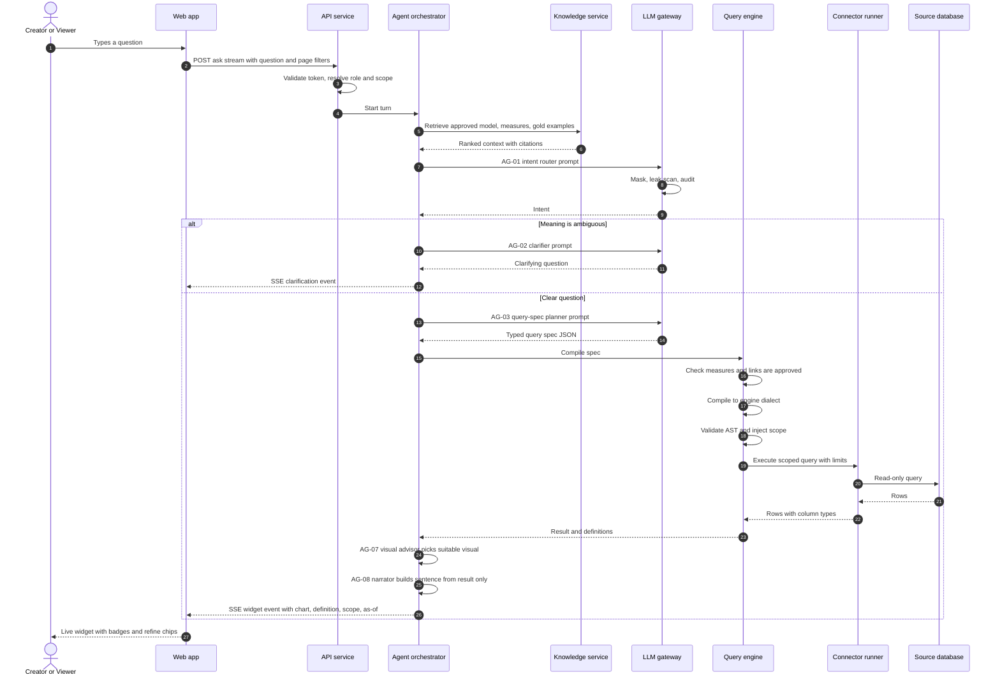

# Ask Request Sequence

| Field | Value |
|---|---|
| Project | Tela — Conversational PMO Analytics & Dashboard Platform |
| Label | **Proposed** |
| Related documents | [Architecture](../architecture.md#agent-and-rag-architecture) · [Function document](../function_document.md#feat-018-ask-a-question) · [API catalog](../api_catalog.md) · [Diagram index](README.md) |

## Purpose

Traces a question from the ask bar to a live widget answer streamed back to the browser.

## Key interactions

- The planner returns a typed spec, not SQL (ADR-001). The query engine compiles and validates it.
- Scope comes from the token, never from the request body (RULE-004, RULE-005).
- The narrator may only state figures present in the result (RULE-022). Raw rows are not sent to the model (RULE-019).
- Stage events stream over SSE so the user sees progress.
