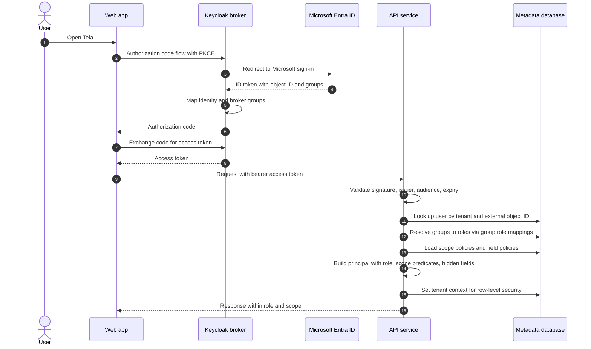

# Authentication and Scope Flow

| Field | Value |
|---|---|
| Project | Tela — Conversational PMO Analytics & Dashboard Platform |
| Label | **Proposed** |
| Related documents | [Architecture](../architecture.md#security-architecture) · [Technical document](../technical_document.md) · [Function document](../function_document.md#roles-and-permission-matrix) · [Diagram index](README.md) |

## Purpose

Shows Microsoft sign-in through the Keycloak broker and how the API turns identity into role and data scope.

## Key interactions

- Users are matched on stable directory identifiers, never on e-mail alone (S03 §5.2).
- Group membership never grants Admin without an explicit, approved mapping (S03 §9, RISK-007).
- Scope predicates are attached to the principal and injected by the query engine on every surface (RULE-004). Where mappings are configured is open (GAP-013).
