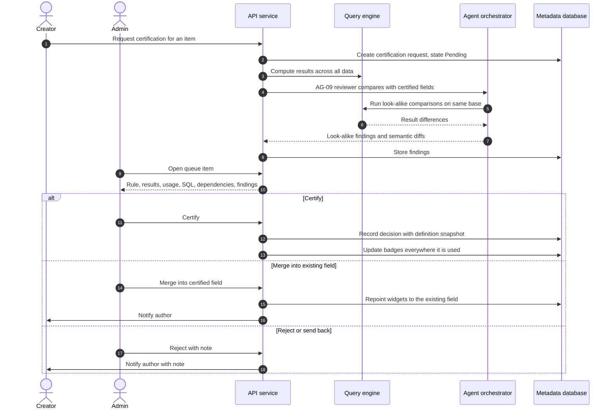

# Certification Sequence

| Field | Value |
|---|---|
| Project | Tela — Conversational PMO Analytics & Dashboard Platform |
| Label | **Proposed** |
| Related documents | [Function document](../function_document.md#feat-037-certification-decisions) · [Business rules](../business_rules.md) · [Widget definition lifecycle](widget-definition-lifecycle.md) · [Diagram index](README.md) |

## Purpose

Shows how a personal grouping, band, join measure or custom SQL widget becomes certified, merged or rejected.

## Key interactions

- Items enter the queue only when shared or placed on something going to a role (RULE-010).
- Look-alike detection compares definitions and results, not only names (RULE-011).
- Every decision is logged with who, when and the definition at that moment (NFR-007).
