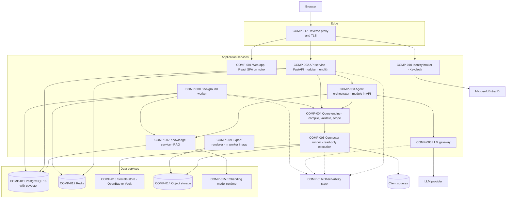

# Component Architecture Diagram

| Field | Value |
|---|---|
| Project | Tela — Conversational PMO Analytics & Dashboard Platform |
| Label | **Proposed** |
| Related documents | [Architecture](../architecture.md#component-architecture) · [Technical document](../technical_document.md) · [Diagram index](README.md) |

## Purpose

Shows the Docker services (COMP IDs) and how requests and data move between them.

## Key interactions

- The API service is the only public application endpoint besides the SPA and Keycloak.
- Only the connector runner holds source credentials (fetched from COMP-013) and opens source connections. Every call to it arrives through the query engine's scoped path (REC-004).
- Only the LLM gateway talks to model providers (ADR-008).
- The worker runs introspection, indexing, cache warming, exports and pack updates from Redis queues (ADR-011).
