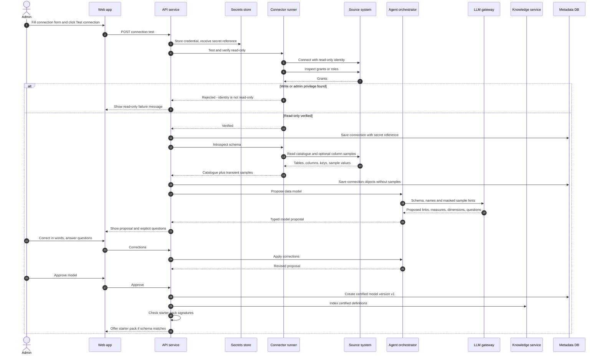

# Connect a Source and Approve the Data Model — Sequence

| Field | Value |
|---|---|
| Project | Tela — Conversational PMO Analytics & Dashboard Platform |
| Label | **Proposed** (L1 — derived from S01 §4.1, J1 and J11; no implementation exists) |
| Related documents | [Architecture](../architecture.md) · [Project summary](../project_summary.md) · [Functional specification](../function_document.md) · [Business rules](../business_rules.md) · [Diagram index](README.md) |

## Purpose

Shows journeys J1 and J11: an admin adds a read-only connection, Tela verifies that it is read-only, introspects the schema without storing samples, the model assistant (AG-04) proposes links, measures and dimensions and asks explicit questions, the admin corrects the model in plain language, and approves it as a certified version. Starter pack detection and knowledge indexing follow approval.

## Key interactions

- Credentials go straight to the secrets store; the metadata database keeps only a reference (ADR-004, NFR-013).
- The runner refuses connections whose identity can write (RULE-001). Samples used to propose labels are passed to the assistant only in masked form and are **not stored** (S01 §4.1, RULE-019).
- Approval creates an immutable model version; later corrections produce v2, v3 (FEAT-009, RULE-015).
- Only certified definitions are indexed into the knowledge service for retrieval (FEAT-014).
