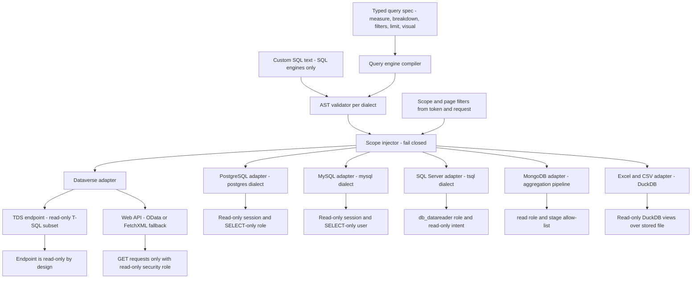

# Connector Adapters Diagram

| Field | Value |
|---|---|
| Project | Tela — Conversational PMO Analytics & Dashboard Platform |
| Label | **Proposed** |
| Related documents | [Architecture](../architecture.md#connector-architecture) · [Technical document](../technical_document.md#connector-implementation) · [Diagram index](README.md) |

## Purpose

Shows how one typed query spec is compiled for each source engine, and where read-only access is enforced.

## Key interactions

- One spec, many compilers: measures and links come from the approved model, so every engine answers the same definition (ADR-001, ADR-002).
- Each adapter has two read-only layers: code validation and a database-level identity (RULE-001, REC-005).
- Dataverse capabilities and limits are assumptions until the spike (REC-006, ADR-013). MongoDB uses compiled pipelines with a mandatory first scope stage (ADR-014).
