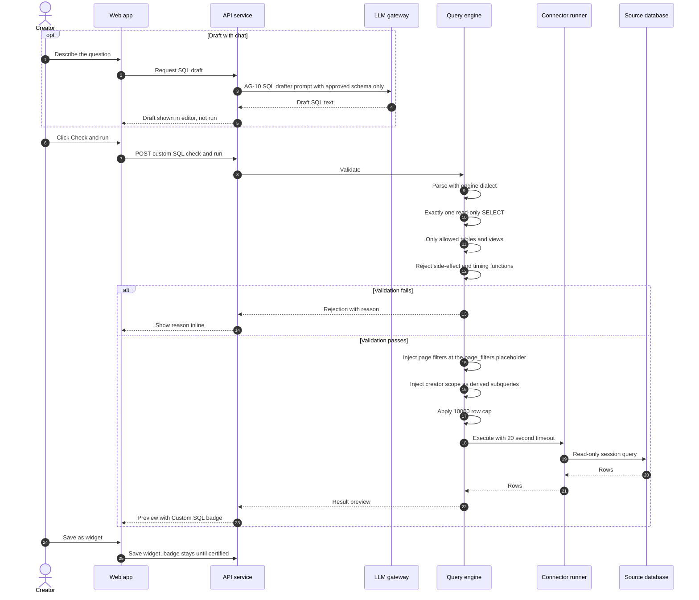

# Custom SQL Check and Run

| Field | Value |
|---|---|
| Project | Tela — Conversational PMO Analytics & Dashboard Platform |
| Label | **Proposed** |
| Related documents | [Function document](../function_document.md#feat-031-custom-sql-widget) · [Business rules](../business_rules.md) · [Technical document](../technical_document.md) · [Diagram index](README.md) |

## Purpose

Shows how a hand-written or chat-drafted custom SQL widget is validated before it touches the source.

## Key interactions

- The drafter never runs SQL; a person must press Check and run.
- Validation order follows RULE-002, RULE-003, RULE-007, RULE-004 and RULE-006.
- The source identity is read-only regardless of validation (RULE-001), giving two independent layers.
- Custom SQL is unavailable on MongoDB connections in Phase 1 (ADR-014).
