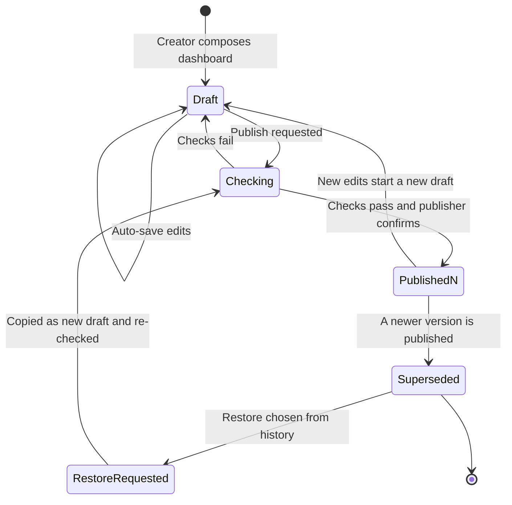

# Dashboard Version Lifecycle

| Field | Value |
|---|---|
| Project | Tela — Conversational PMO Analytics & Dashboard Platform |
| Label | **Proposed** |
| Related documents | [Function document](../function_document.md#state-machines) · [Business rules](../business_rules.md) · [Publish sequence](publish-sequence.md) · [Diagram index](README.md) |

## Purpose

Shows how a dashboard moves from draft to published versions, and how restore works.

## Key interactions

- Viewers always see the last published version while a draft is edited (S01 §4.6).
- Restore never reactivates an old version in place; it creates version N plus 1 (RULE-016).
- Deleting a starter report creates a new draft without it; the live version stays until republished (RULE-017).
