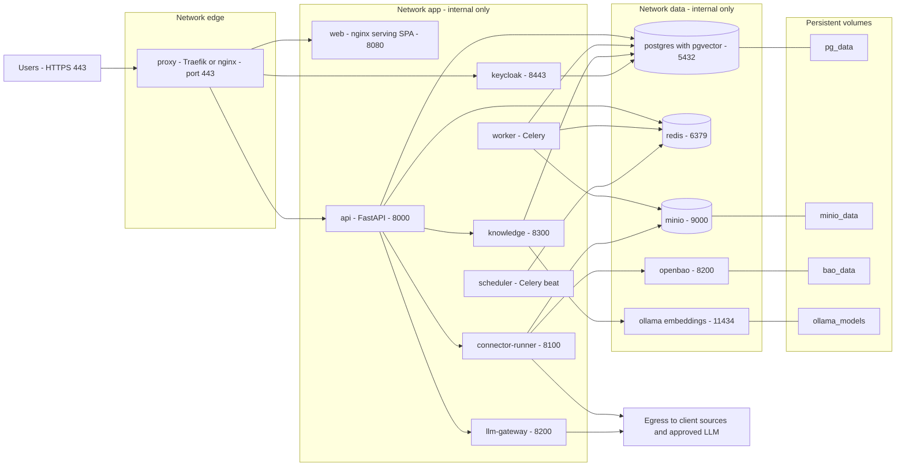

# Docker Deployment Diagram

| Field | Value |
|---|---|
| Project | Tela — Conversational PMO Analytics & Dashboard Platform |
| Label | **Proposed** |
| Related documents | [Architecture](../architecture.md#deployment-architecture) · [Technical document](../technical_document.md#build-and-deployment-pipeline) · [Diagram index](README.md) |

## Purpose

Shows the containers, Docker networks, exposed ports and persistent volumes for a single-host Compose profile. A Helm profile uses the same images (ADR-005).

## Key interactions

- Only the proxy publishes a host port. Internal ports bind to Docker networks, not 0.0.0.0 on the host (lesson from S31 §6.2).
- Only the connector runner and LLM gateway have egress; this simplifies firewall rules.
- Every container needs a health check and restart policy (REC-012). Port numbers are illustrative defaults.
