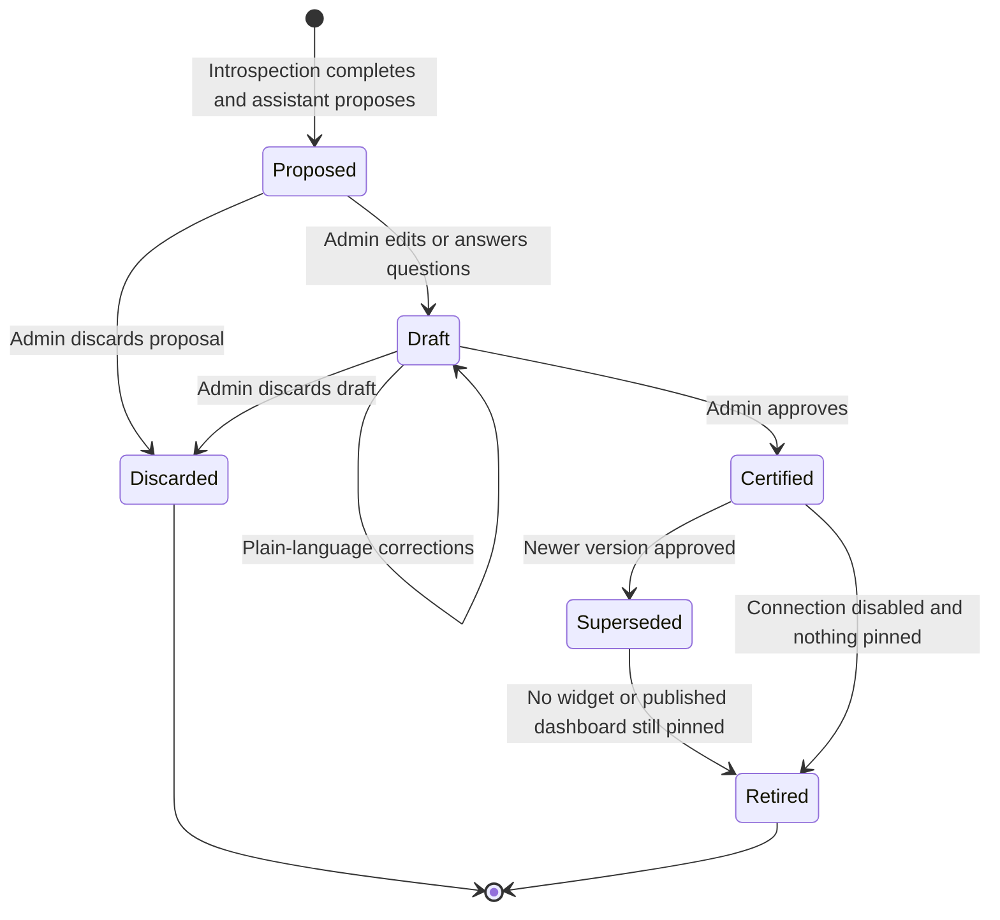

# Data Model Version Lifecycle

| Field | Value |
|---|---|
| Project | Tela — Conversational PMO Analytics & Dashboard Platform |
| Label | **Proposed** (L1 — derived from S01 §4.1 "Approve model → certified version v1, v2, …"; impact policy is open, Q-007) |
| Related documents | [Architecture](../architecture.md) · [Project summary](../project_summary.md) · [Functional specification](../function_document.md) · [Business rules](../business_rules.md) · [Diagram index](README.md) |

## Purpose

Models the life of a data model version for one connection, from the assistant's first proposal to certification, supersession and retirement. Widgets pin the model version they were built on; how they move to a newer version is governed by RULE-015 and is still an open decision (Q-007).

## Key interactions

| Transition | Who | Guard | Effect |
|---|---|---|---|
| Draft → Certified | Admin | All explicit questions answered or deferred; every measure has a rule and blank handling | Version number increments; definitions indexed for retrieval; creators can query the connection immediately (J11) |
| Certified → Superseded | Admin | A newer version is approved | Existing widgets keep running on their pinned version until migrated (Proposed, RULE-015) |
| Superseded → Retired | System | No widget, report or published dashboard references the version | Version kept read-only for audit |
