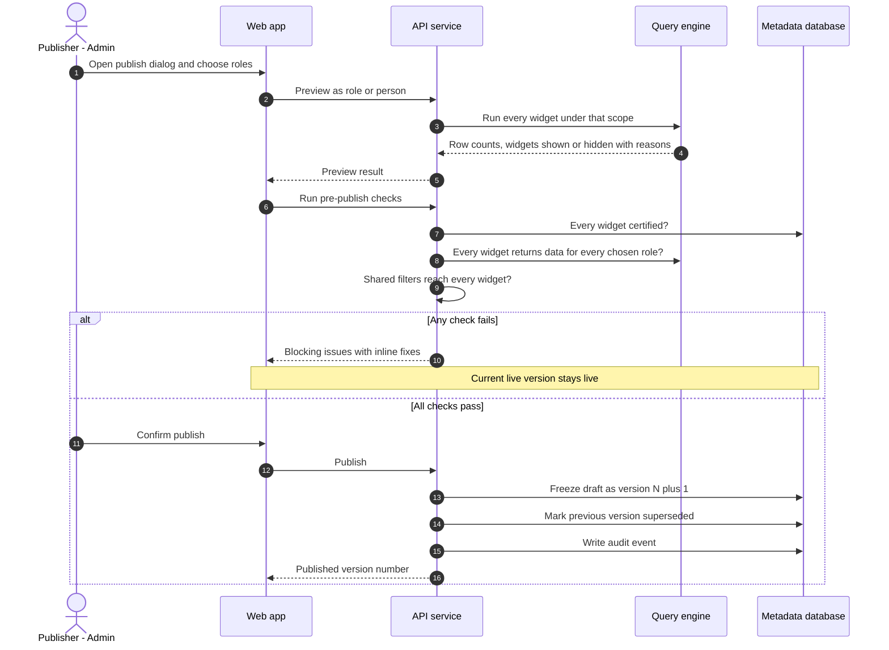

# Publish Sequence

| Field | Value |
|---|---|
| Project | Tela — Conversational PMO Analytics & Dashboard Platform |
| Label | **Proposed** |
| Related documents | [Function document](../function_document.md#feat-039-publish-to-roles) · [Dashboard version lifecycle](dashboard-version-lifecycle.md) · [Business rules](../business_rules.md) · [Diagram index](README.md) |

## Purpose

Shows preview as role, pre-publish checks and creation of a new published version.

## Key interactions

- Publishing to a role requires every widget certified (RULE-009, RULE-024).
- Failing checks never take the live version down.
- Who may publish (Admin only or a separate publisher) is open (GAP-006, Q-006).
