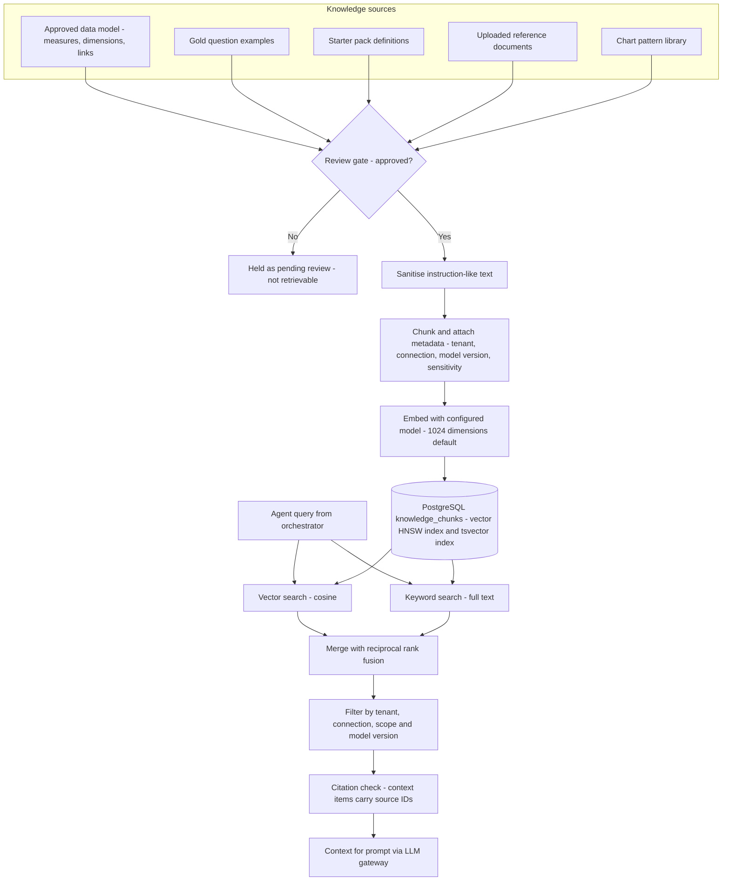

# RAG Indexing and Retrieval Flow

| Field | Value |
|---|---|
| Project | Tela — Conversational PMO Analytics & Dashboard Platform |
| Label | **Proposed** |
| Related documents | [Architecture](../architecture.md#agent-and-rag-architecture) · [Technical document](../technical_document.md#agent-implementation) · [DB scheme](../db_scheme.md) · [Diagram index](README.md) |

## Purpose

Shows how knowledge enters the pgvector index and how agents retrieve it safely.

## Key interactions

- Nothing is retrievable until approved, following the TelaKnowledge review lifecycle (S02 §5). Certified model items are approved by definition.
- Hybrid retrieval (vector plus keyword) mirrors the TelaKnowledge reference (S31 §3.1); embedding dimension and model are configurable (Q-016).
- Source data rows are never indexed.
