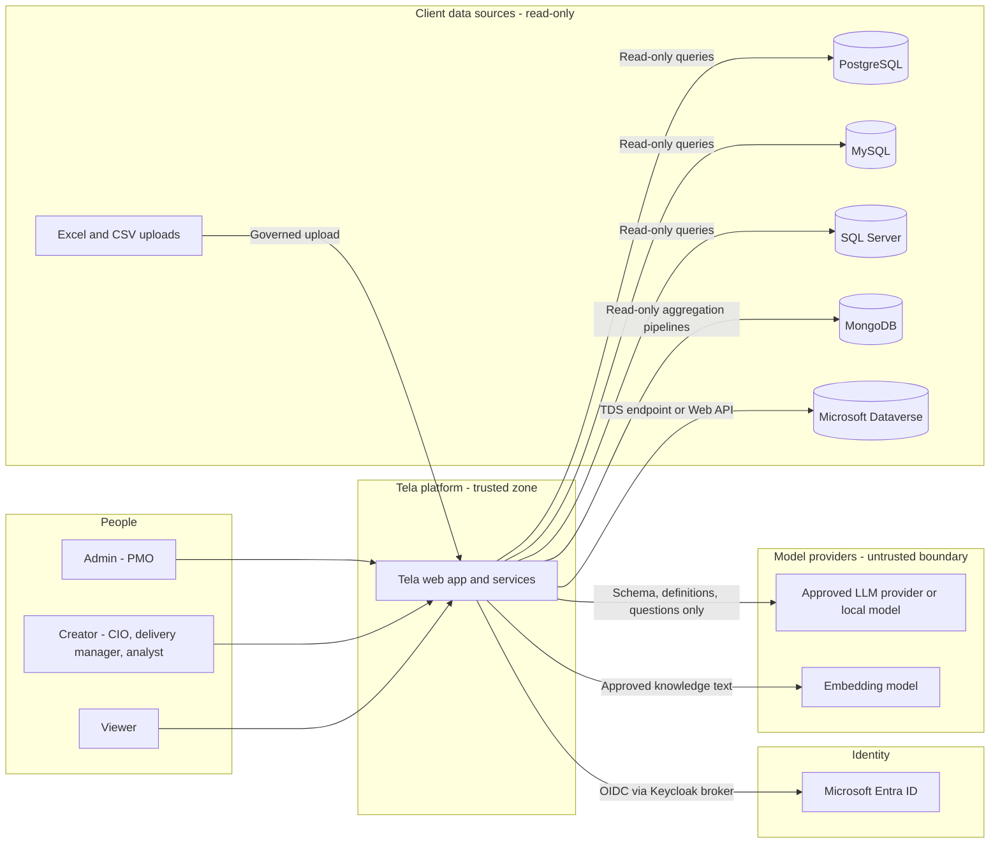

# System Context Diagram

| Field | Value |
|---|---|
| Project | Tela — Conversational PMO Analytics & Dashboard Platform |
| Label | **Proposed** |
| Related documents | [Architecture](../architecture.md) · [Project summary](../project_summary.md) · [Diagram index](README.md) |

## Purpose

Shows who uses Tela, which external systems it depends on, and the trust boundaries between them.

## Key interactions

- All people sign in with Microsoft; role and scope come from group membership.
- Tela only reads from sources. It never writes, alters schemas or copies tables. Excel/CSV is the exception: the uploaded file is stored under governance (ADR-012).
- Model providers receive schema, definitions and questions, never raw rows (RULE-019). Which provider is allowed is open (Q-009).
