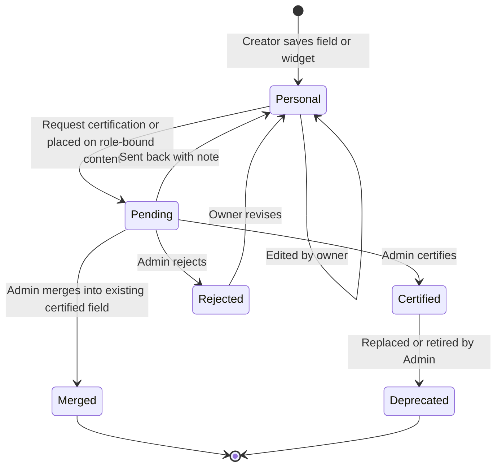

# Widget and Field Definition Lifecycle

| Field | Value |
|---|---|
| Project | Tela — Conversational PMO Analytics & Dashboard Platform |
| Label | **Proposed** |
| Related documents | [Function document](../function_document.md#state-machines) · [Business rules](../business_rules.md) · [Certification sequence](certification-sequence.md) · [Diagram index](README.md) |

## Purpose

Shows the states of a personal definition (grouping, band, join measure, custom SQL widget) from creation to certification or retirement.

## Key interactions

- Personal items are usable and shareable with named people but cannot reach a role until Certified (RULE-009).
- Merge repoints all widgets to the existing certified field and notifies the author (S01 §4.8).
- Editing a Certified item creates a new Pending revision; the certified version stays in use until decided (Proposed).
