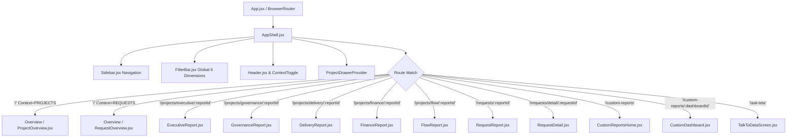
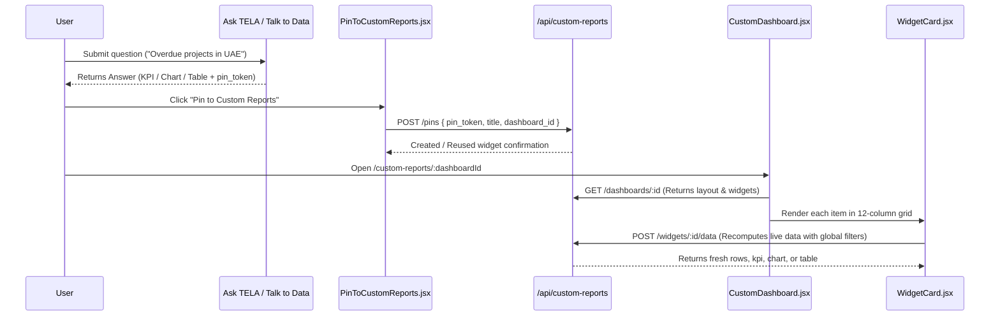

# PMO Intelligence — Comprehensive Report Screens Catalog & Architecture Specification

> **Document Version**: 2.0  
> **Source Repository**: `PMO-UpdatedLatest/frontend` & `PMO-UpdatedLatest/backend`  
> **Target Audience**: AI Agents, Dashboard Engineers, PMO Architects, Full-Stack Developers  
> **Purpose**: Serves as the authoritative specification of all screens, metrics, dimensions, layouts, and API integrations in the PMO Intelligence platform to enable automated dashboard and report generation.

---

## 1. System Architecture & Common Report Framework

### 1.1 High-Level Routing & Context Architecture

The frontend is built on **React (Vite)** with **React Router v6** and **Tailwind CSS**.
The application operates in two distinct operational contexts:
1. **`PROJECTS`**: Post-approval delivery portfolio tracking (TPG project entities).
2. **`REQUESTS`**: Pre-approval intake demand pipeline (TPG request entities).



### 1.2 The Standard Report Page Structure (`ReportFrame`)

Every standard report is wrapped with `ReportFrame` (`src/components/ui/Page.jsx`).
The standard component hierarchy is:

```
<ReportFrame eyebrow="..." title="..." subtitle="..." state={...} isEmpty={...}>
  ├── <PageHeader>
  │     ├── Eyebrow (e.g. "Executive", "Delivery", "Governance", "Finance", "Flow", "Requests")
  │     ├── <h1> Title
  │     ├── Subtitle (1-2 sentences defining the business scope)
  │     ├── <AsOf /> (Reporting date indicator: "Data as of DD Mon YYYY")
  │     └── Actions (ReportDownloadButton + optional contextual buttons)
  ├── Page Body (or Skeleton / ErrorState / EmptyState)
  │     ├── [Optional Callout] (e.g., filter caveats, rule definitions)
  │     ├── KPI Strip: <div className="grid grid-cols-2 md:grid-cols-4 (or 5) gap-2">
  │     │     └── <KpiCard ... />
  │     ├── Visual Analytics: <div className="grid grid-cols-1 xl:grid-cols-12 gap-3">
  │     │     └── <Panel title="..." note="..."> (Charts: Donut, Columns, BarList, PairedBarList, HeatGrid, TrendChart, Meter)
  │     ├── Detail Grid: <Panel strip title="...">
  │     │     └── <DataTable ... /> (Interactive table with col / rcol columns, search, sorting, CSV export)
  │     └── <Footnote> (Domain truth, exclusions, and data limitation disclosures)
```

### 1.3 Data Fetching & State Lifecycle

- **Shared Response Cache** (`src/lib/api.js`):
  - In-flight promise sharing and TTL-based caching (60s TTL). Multiple reports sharing an endpoint (e.g. 8 executive reports consuming `/api/executive`) do not duplicate backend queries.
  - **Dimmed Background Refresh**: On filter change or refetch, existing data remains visible with `loading: true` and CSS opacity reduction (`opacity-60`) rather than flashing a blank loader.
- **Hook Signatures**:
  - `useReport(path, filters)`: Sends a `POST` request with serialized 6-dimension filters `{ cio: [], region: [], ... }`.
  - `useProjects(filters)`: Reads full project row-level data and calculated health scores via `/api/projects`.
  - `useRequestRows(filters)`: Reads request row-level data via `/api/requests`.
  - `combine(...states)`: Merges multiple loading/error/data states into a single ready tuple `[d1, d2, ...]`.

---

## 2. Core Measurements & Dimensions Foundation

### 2.1 The Reporting Date (`asOf`)

- **Domain Rule**: All age calculations (`days_open`, `days_past_due`, `days_on_hold`, `days_since_update`, `upcoming go-lives`) are measured relative to the single reporting date `asOf` provided by `/api/meta`.
- **System Pinning**: When `PMO_AS_OF` is set in the backend environment, MySQL session timestamps are pinned (`SET TIMESTAMP = UNIX_TIMESTAMP(asOf)`).
- **Rule**: Never use `new Date()` or browser clocks for business calculations.

### 2.2 Global Filter Dimensions (The 6 Pillars)

All reports and widgets accept a filter payload with 6 dimensions:
1. **`cio`**: Executive CIO owner. (Note: When `DEMO_CIO` is configured, server-side RBAC overrides client selection).
2. **`region`**: Geographic operating territory (e.g., `GCC - UAE`, `Northern Africa - Egypt`, `Levant - Jordan`).
3. **`portfolio`**: Delivery portfolio (e.g., `Issuing`, `Acquiring`, `Digital`, `Core Banking`). *Note: Exists only on projects; requests only have portfolio when converted to a project.*
4. **`delivery_manager` / `project_manager`**: Assigned project manager / delivery lead.
5. **`priority`**: `Critical`, `High`, `Moderate`, `Low`.
6. **`platform`**: Technical target platform / technology stack.

### 2.3 Financial Measurements (Cost vs. Budget)

> [!IMPORTANT]
> **NO ACTUAL SPEND DATA EXISTS IN THE DATABASE.**
> The schema holds only forecasts and approved budgets. It has no invoices, actuals, or monthly spend logs.

- **`approved_budget_value_usd` (Approved Budget)**: Formally sanctioned financial baseline. Missing or zero budget cannot be used as a denominator.
- **`cost_total_usd` (Forecast Cost / EAC)**: Estimated total cost at completion. On requests, this is labeled **Estimated Cost**, not EAC.
- **`budget_variance_usd` (Forecast vs. Budget)**: `cost_total_usd - approved_budget_value_usd`. Positive = forecast above budget (unfavourable); negative = forecast below budget.
- **`forecastVsBudgetPct` (Forecast as % of Budget)**: `(cost_total_usd / approved_budget_value_usd) * 100`. NOT budget utilized or spent.
- **`financialExposure`**: Aggregated approved budget, forecast EAC, and variance calculated strictly over open projects that have **both** a positive budget and an EAC.

### 2.4 Status vs. Calculated Health (The Critical Distinction)

| Attribute | Reported Status (`overall_kpi`) | Calculated Health (`health_status`) |
| :--- | :--- | :--- |
| **Origin** | Self-reported by Project Manager in TPG. | 4-factor objective scoring model (`backend/health.py`). |
| **Values** | `Green`, `Amber` (maps from Yellow), `Red`, `Not set` (`Unknown`). | `Green` (75–100), `Amber` (50–74), `Red` (0–49 or overrides), `Insufficient data`. |
| **Missing Data** | Rendered as "Not set" in grey. Excluded from RAG percentage denominators. | Below 60% evidence weight = `Insufficient data`. Never counted as Green or zero risk. |
| **Component Factors** | PM discretion. | 1. Schedule (slip vs. baseline or overdue days)<br>2. Cost (forecast vs. budget variance)<br>3. Progress vs. elapsed duration<br>4. Reported Issue KPI override |

### 2.5 Schedule & Date Measurements

- **`overdueGoLive` (Past Due)**:
  - Criteria: `current_state == 'Active'` AND `planned_deployment_date < asOf` AND `actual_deployment_date IS NULL`.
  - Notes: A planned date equal to `asOf` is **not** overdue. `On Hold` and `Project Created` projects are excluded.
- **`scheduleVariance`**:
  - For deployed projects: `actual_deployment_date - planned_deployment_date`.
  - In health model: measured against `first_baselined_deployment_date`.
- **`slipVsBaseline`**: `planned_deployment_date - first_baselined_deployment_date`. Positive = delayed compared to original baseline.
- **`scheduleContradiction`**:
  - Open, undeployed project where `schedule_kpi == 'Green'` yet `days_past_due >= 15`.
  - Open, undeployed project where `schedule_kpi == 'Red'` yet planned go-live is `>= 30` days in the future.
- **`stale`**: Projects in Active delivery with `modified_on < (asOf - 30 days)`.

---

## 3. Detailed Catalog of All Reports Screens

### 3.1 Overview Screens

#### 3.1.1 Projects Overview (`/` Context = `PROJECTS`)
- **Component**: `src/components/dashboard/ProjectOverview.jsx` (with `ExecutiveLanding.jsx`)
- **Backend Endpoints**: `GET /api/overview`, `POST /api/flow`
- **Scope**: Open projects (TPG status `Active`: `Project Created`, `Active`, `On Hold`).
- **Layout & Structure**:
  1. **Header & Actions**: `LandingHeading` with `AsOf` date and `ReportDownloadButton` (PDF export). Optional Boardroom presentation mode toggle.
  2. **Portfolio Summary Banner**: Conversational natural-language summary (total open, active in delivery, on hold, count of overdue go-lives, financial variance above/below budget).
  3. **Headline KPI Row** (`HeadlineMetrics`):
     - `Active projects`: in delivery count + on hold subtitle.
     - `Past planned go-live`: overdue count with critical red tone.
     - `Forecast vs approved budget`: net financial variance dollar value & % above/below.
     - `Key priorities needing attention`: calculated Red/Amber count among key priority projects.
  4. **Needs Your Attention & Budget Position** (2-column layout):
     - `NeedsAttention`: Grouped actionable alerts:
       - Past planned go-live (count + top late project)
       - Key priorities with calculated Red/Amber
       - Forecast over budget (count + total overage)
       - Schedule colour contradicts dates
       - Not updated in 30+ days
       - On hold over 90 days
     - `BudgetPosition`: Visual comparison of Approved Budget vs Forecast EAC with variance chip.
  5. **North Star Band**: 12-month on-time value delivery banner (`% of TCV delivered within 30 days of baseline`, lead time median, WIP, throughput).

#### 3.1.2 Requests Overview (`/` Context = `REQUESTS`)
- **Component**: `src/components/requests/RequestOverview.jsx` (with `RequestLanding.jsx`)
- **Backend Endpoints**: `POST /api/requests/overview`, `POST /api/requests`, `POST /api/requests/overdue-gates`
- **Scope**: All requests in pipeline (open + closed out).
- **Layout & Structure**:
  1. **Header**: "Requests overview · The demand pipeline before approval".
  2. **Summary Banner**: Total requests in scope, count open awaiting decision, overdue governance gates, financial estimate vs approved budget.
  3. **Headline KPI Cards**:
     - `Open requests`: `New`, `Active`, `On Hold`, `Return to Requester`.
     - `Overdue governance actions`: Gates passed planned date without sign-off.
     - `Estimated cost`: Sum of estimates across pipeline.
     - `Approved for delivery`: Count of Approved requests.
     - `Rejected or dropped`: Decided/closed-out count.
  4. **Needs Attention Grid**: Overdue gates by type (DOU, DARB, SOW), aging on-hold requests (>180d), oldest open request age.
  5. **State Distribution Panel**: Breakdown by request state with conversion funnel.
  6. **Interactive Requests Table**: Searchable, sortable table of requests with CIO, region, estimate, budget, and age.

---

### 3.2 Executive Reports (`/projects/executive/*`)

#### 3.2.1 CIO & Portfolio View (`/projects/executive/cio-portfolio`)
- **Component**: `src/components/executive/CioPortfolioView.jsx`
- **Backend Endpoints**: `POST /api/executive`, `POST /api/projects`
- **Scope**: Open projects.
- **Key Measurements**:
  - `Open projects` count.
  - `Portfolios with open projects` count.
  - `No portfolio set` count (governance gap).
- **Visuals**:
  - `HealthBars`: Stacked horizontal bars showing reported status mix (Green, Amber, Red, Not set) per Portfolio. Clicking a bar filters to that portfolio.
  - `DataTable`: Open projects with columns: Project (code + name), CIO, Portfolio, Calculated Health, State, Phase, Planned Go-Live, PM.

#### 3.2.2 Portfolio Status (`/projects/executive/status`)
- **Component**: `src/components/executive/PortfolioStatus.jsx`
- **Backend Endpoints**: `POST /api/executive`, `POST /api/projects`
- **Scope**: Open projects.
- **Key Measurements**:
  - Average Calculated Health Score (0–100 scale).
  - Calculated Green count (75–100).
  - Calculated Amber count (50–74).
  - Calculated Red count (0–49 or severe overrides).
  - Insufficient Data count.
- **Visuals**:
  - `Donut`: Calculated health distribution ring with legend.
  - `Attention Required`: Table of lowest-scoring calculated Red projects with primary drivers.
  - `HealthBars`: Six reported KPI dimensions comparison (Overall, Schedule, Cost, Resource, Issue, Work).
  - `DataTable`: Projects with six KPI dots and drawer click.

#### 3.2.3 Project Lifecycle (`/projects/executive/lifecycle`)
- **Component**: `src/components/executive/ProjectLifecycle.jsx`
- **Backend Endpoints**: `POST /api/projects`
- **Scope**: Open projects.
- **Dimensions**: Lifecycle phases: `Assign PM`, `TRB Review`, `Planning`, `Design`, `Build`, `Test`, `Implementation`, `Warranty`, `Closure`.
- **Key Measurements**: Active count, On Hold count, Delivery (Build/Test/Impl) count, Overdue go-live count.
- **Visuals**:
  - `Columns`: Vertical bar chart of projects per phase.
  - `BarList`: Phases ranked by active volume.
  - `DataTable`: Projects grouped by phase with % completion.

#### 3.2.4 Strategic Initiatives (`/projects/executive/strategic-initiatives`)
- **Component**: `src/components/executive/StrategicInitiatives.jsx`
- **Backend Endpoints**: `POST /api/executive`, `POST /api/projects`
- **Scope**: Projects with `key_priority_project == 'Yes'` + Top 20 ranking.
- **Key Measurements**: Key Priority count, Reported Off Track count, Average completion %, Large/Very Large count, Critical/High priority count.
- **Visuals**:
  - `Donut`: Reported status mix for Key Priority projects.
  - `DataTable`: Top 20 Open Initiatives ranked by Priority -> Key Priority -> TCV Value.

#### 3.2.5 ExCo Priorities (`/projects/executive/exco-priorities`)
- **Component**: `src/components/executive/ExCoPriorities.jsx`
- **Backend Endpoints**: `POST /api/executive`, `POST /api/projects`
- **Scope**: Filtered key initiatives flagged for executive committee oversight.
- **Key Measurements**: High-exposure budgets, critical path milestones, strategic alignment scores.
- **Visuals**: Executive summary tiles, KPI cards, high-exposure risk table.

#### 3.2.6 Delivery Heatmap (`/projects/executive/delivery-heatmap`)
- **Component**: `src/components/executive/DeliveryHeatmap.jsx`
- **Backend Endpoints**: `POST /api/projects`
- **Scope**: Open projects.
- **Visuals**:
  - `HeatGrid 1`: **Region × Reported Status** (Rows: Region; Columns: Red, Amber, Green, Not set). Cells shaded by health colour intensity. Interactive: clicking cell filters table below.
  - `HeatGrid 2`: **Portfolio × Lifecycle Phase** (Rows: Portfolio; Columns: 9 phases). Cell values indicate project count.
  - `DataTable`: Synchronized drill-down table listing projects in the selected cell.

#### 3.2.7 Regional Portfolio (`/projects/executive/regional-portfolio`)
- **Component**: `src/components/executive/RegionalPortfolio.jsx`
- **Backend Endpoints**: `POST /api/projects`
- **Scope**: Open projects grouped by operating region.
- **Key Measurements**: Regional open project count, regional budget allocation, overdue go-lives per region.
- **Visuals**: Regional comparison bars, health distribution by territory, project table.

#### 3.2.8 Demand Conversion (`/projects/executive/demand-conversion` & `/requests/demand-conversion`)
- **Component**: `src/components/shared/ConversionView.jsx`
- **Backend Endpoints**: `POST /api/requests/overview`, `POST /api/executive`, `POST /api/requests`
- **Scope**: All requests converted to delivery projects.
- **Key Measurements**: Total Requests, Converted Count, Conversion Rate %, Conversion Rate this quarter, Average days to convert, Open awaiting conversion.
- **Visuals**:
  - `Columns`: Conversion rate % by quarter raised.
  - `TrendChart`: 12-month trend comparing Requests Raised vs Projects Created.
  - `DataTable`: Conversion metrics by Region (requests, converted, rate %, avg days, min/max days).

#### 3.2.9 Portfolio Health (`/projects/executive/portfolio-health`)
- **Component**: `src/components/executive/PortfolioHealth.jsx`
- **Backend Endpoints**: `POST /api/executive`, `POST /api/projects`
- **Scope**: Comprehensive 4-factor scoring breakdown across all open projects.
- **Visuals**: Deep-dive score distributions, score by CIO, score by portfolio, low-score watch list with factor penalties.

#### 3.2.10 Portfolio Trends (`/projects/executive/portfolio-trends`) — *DISABLED (Data Gap)*
- **Reason**: TPG database holds current-state extract only. No historical point-in-time snapshots or status submission history exist.
- **Restoration Requirement**: Implementation of point-in-time snapshot tables or weekly status submission logs.

---

### 3.3 Governance Reports (`/projects/governance/*`)

Most compliance reports utilize the shared pattern component `src/components/shared/CompliancePage.jsx`.

#### 3.3.1 Baselining Compliance (`/projects/governance/baselining`)
- **Component**: `src/components/governance/BaseliningCompliance.jsx`
- **Backend Endpoints**: `POST /api/governance`, `POST /api/projects`
- **Rule**: Projects past Planning phase must have `first_baselined_deployment_date` recorded.
- **Payload Key**: `baselining` (`missing_baseline` flag).
- **KPIs**: In Scope (Past Planning), Compliant (Baselined), Non-Compliant (No Baseline), Open Non-Compliant.
- **Visuals**: `Meter` (overall baseline compliance %), `BarList` (non-compliant by phase, non-compliant by CIO), `DataTable` of failing projects.

#### 3.3.2 Budget Code Compliance (`/projects/governance/budget-code`)
- **Component**: `src/components/governance/BudgetCodeCompliance.jsx`
- **Rule**: Every project in any state must carry a valid financial budget code.
- **Payload Key**: `budgetCode` (`missing_budget_code` flag).
- **Visuals**: Primary meter (all projects), secondary meter (funded projects with code), failure breakdowns by budget type and CIO, failing project list.

#### 3.3.3 PM Assignment Compliance (`/projects/governance/pm-assignment`)
- **Component**: `src/components/governance/PmAssignment.jsx`
- **Rule**: Active delivery projects must have a Delivery Manager / PM assigned.
- **Payload Key**: `pmAssignment` (`missing_pm` flag).
- **Visuals**: Compliance meter, unassigned projects by phase and CIO, interactive list to chase PM assignment.

#### 3.3.4 Governance Actions (`/projects/governance/actions`)
- **Component**: `src/components/governance/GovernanceActions.jsx`
- **Backend Endpoint**: `POST /api/requests/overdue-gates`
- **Scope**: Open requests with overdue governance gates (DOU, DARB, SOW).
- **Rule**: Planned gate date < `asOf` AND actual completion date is empty.
- **KPIs**: Total Overdue Actions, Overdue DOU Issuance, Overdue DARB Review, Overdue SOW Issuance.
- **Visuals**: `Columns` (aging buckets: 1-30d, 31-60d, 61-90d, 90+d), `BarList` (by CIO), `DataTable` of overdue actions with click-through to Request Detail.

#### 3.3.5 PCR Compliance (`/projects/governance/pcr`)
- **Component**: `src/components/governance/PcrCompliance.jsx`
- **Backend Endpoints**: `POST /api/governance`, `POST /api/projects`
- **Rule**: Project Change Requests (PCRs) tracking and governance approval compliance.
- **Visuals**: PCR rate meters, PCR count by reason, schedule/budget impact summaries, PCR data table.

#### 3.3.6 On-Hold Aging (`/projects/governance/on-hold-aging`)
- **Component**: `src/components/governance/OnHoldAging.jsx`
- **Backend Endpoints**: `POST /api/governance`, `POST /api/projects`
- **Scope**: Current state `On Hold`.
- **Measurements**: `days_on_hold = asOf - on_hold_date`.
- **KPIs**: Total On Hold, On Hold > 90 Days (candidates to restart or drop), Longest On Hold, Average Time On Hold.
- **Visuals**: `Columns` (aging buckets: 0-30d, 31-60d, 61-90d, >90d), `BarList` (reasons for stopping), `DataTable` of on-hold projects with stop reason and comments.

#### 3.3.7 Closure Compliance (`/projects/governance/closure`)
- **Component**: `src/components/governance/ClosureCompliance.jsx`
- **Rule**: Completed and warranty projects must complete formal operational handover and closure checklists.
- **Visuals**: Closure compliance meter, aging in warranty phase, closure audit table.

#### 3.3.8 Disabled Governance Reports (Data Gaps)
- **Status Reporting Compliance** (`status-reporting`): No weekly status submission logs; `modified_on` cannot proxy a formal weekly status report.
- **Schedule Compliance** (`schedule`): No formal approved-schedule indicator; presence of planned date is not an approval.
- **Mandatory Fields** (`mandatory-fields`): No authoritative business standard defining mandatory fields per stage.

---

### 3.4 Delivery Reports (`/projects/delivery/*`)

#### 3.4.1 Upcoming Projects (`/projects/delivery/upcoming-projects`)
- **Component**: `src/components/delivery/UpcomingProjects.jsx`
- **Backend Endpoints**: `POST /api/delivery`, `POST /api/projects`
- **Scope**: Open, undeployed projects with `planned_deployment_date >= asOf`.
- **KPIs**:
  - `Due in 30 days` (planned date within `asOf` to `asOf + 30d`).
  - `Due in 60 days` (within `asOf + 31d` to `asOf + 60d`).
  - `Due in 90 days` (within `asOf + 61d` to `asOf + 90d`).
  - `Schedule at risk` (Schedule KPI is Red or Amber among upcoming projects).
- **Visuals**:
  - `Columns`: Volume by monthly deployment horizon.
  - `BarList`: Upcoming go-lives by Portfolio and by PM.
  - `DataTable`: Projects ordered by `days_to_go_live` ascending, with health indicators and completion %.

#### 3.4.2 Delayed Projects (`/projects/delivery/delayed-projects`)
- **Component**: `src/components/delivery/DelayedProjects.jsx`
- **Backend Endpoints**: `POST /api/delivery`, `POST /api/projects`
- **Scope**: Active delivery projects where `is_past_due == true` (`planned_deployment_date < asOf` and undeployed), plus schedule contradictions.
- **KPIs**: Overdue Go-Lives, Overdue > 90 Days, Most Overdue (days), Schedule Colour Contradicts Dates.
- **Visuals**:
  - `Columns`: Lateness distribution (1–30d, 31–60d, 61–90d, >90d).
  - `BarList`: Delayed count by Portfolio and by Delivery Manager.
  - `DataTable 1`: Delayed projects ranked by `days_past_due` descending.
  - `DataTable 2`: Schedule contradictions (Green but overdue, or Red but far in the future).

#### 3.4.3 Stage Completion (`/projects/delivery/stage-completion`)
- **Component**: `src/components/delivery/StageCompletion.jsx`
- **Backend Endpoints**: `POST /api/delivery`, `POST /api/projects`
- **Scope**: Open delivery projects tracking planned vs actual phase transitions.
- **Visuals**: Stage completion velocity, bottlenecks per phase, milestone progress matrix.

#### 3.4.4 Schedule Variance (`/projects/delivery/schedule-variance`)
- **Component**: `src/components/delivery/ScheduleVariance.jsx`
- **Backend Endpoints**: `POST /api/delivery`, `POST /api/projects`
- **Scope**: Deployed projects measuring actual deployment date vs planned go-live date.
- **KPIs**: Deployed count, Deployed on time, Median schedule variance (days), Deployed > 60 days late.
- **Visuals**: Variance distribution columns (early, on time, late buckets), variance by portfolio, historical deployed project variance log.

#### 3.4.5 Update Compliance (`/projects/delivery/update-compliance`)
- **Component**: `src/components/delivery/UpdateCompliance.jsx`
- **Backend Endpoints**: `POST /api/delivery`, `POST /api/projects`
- **Scope**: Active delivery projects tracking record freshness.
- **Rule**: `modified_on` date older than 30 days flags the project as "stale".
- **Visuals**: Stale projects meter, days since last edit breakdown, stale project list for PM follow-up.

#### 3.4.6 Disabled Delivery Reports (Data Gaps)
- **Milestone Slippage** (`milestone-slippage`): No milestone entities; lifecycle stages are delivery phases, not project milestones.
- **Critical Path** (`critical-path`): No activity network, dependencies, or precedence relationships stored.
- **RAID Summary** (`raid`): No risk, assumption, issue, or dependency registers stored.

---

### 3.5 Finance Reports (`/projects/finance/*`)

#### 3.5.1 CAPEX Budget vs Forecast Cost (`/projects/finance/capex-budget`)
- **Component**: `src/components/finance/CapexBudget.jsx`
- **Backend Endpoints**: `POST /api/finance`, `POST /api/projects`
- **Scope**: Every CAPEX project (`budget_type == 'CAPEX'`) in any state.
- **Key Measurements**:
  - `CAPEX projects count`.
  - `Approved budget`: Sum of approved budget.
  - `Forecast cost (EAC)`: Sum of `cost_total_usd`.
  - `Forecast vs budget`: EAC − Budget (with signed +/- formatting).
  - `Forecast over budget count`: Projects where EAC > Budget (>0), with sub-count for `>15%` overrun.
- **Visuals**:
  - `PairedBarList`: Approved Budget vs Forecast EAC side-by-side bars per Portfolio.
  - `Columns`: Variance spread buckets (`Under 15%+`, `Under 0-15%`, `Over 0-15%`, `Over 15%+`).
  - `Cost Composition`: Component breakdown of EAC (`cost_internal_usd`, `cost_external_usd`, `cost_contingency_usd`, `cost_hw_usd`, `cost_sw_usd`).
  - `DataTable`: CAPEX projects with budget, forecast EAC, variance, and % variance.

#### 3.5.2 Disabled Finance Reports (Data Gaps)
- **Resource Utilization & Timesheet Compliance** (`resource-utilization`): Database holds no timesheet submissions, logged hours, or person capacity data.

---

### 3.6 Flow & Agile Metrics (`/projects/flow/*` & `/requests/intake-board`)

#### 3.6.1 Flow Metrics (`/projects/flow/metrics`)
- **Component**: `src/components/flow/FlowMetrics.jsx`
- **Backend Endpoint**: `POST /api/flow`
- **Scope**: End-to-end lifecycle from Request creation to Project Deployment.
- **Key Measurements**:
  - **North Star Metric**: `% of TCV delivered on time` (deployed within 30 days of first baseline over last 12 months).
  - `Lead Time (Median & P85)`: Days from Request creation to Actual Deployment.
  - `Throughput`: Go-lives per month and project starts per month. Starts vs. finishes ratio (flagged if starts > 1.5× finishes).
  - `Work In Progress (WIP)`: Open projects count, blocked count, and `Months to clear WIP` at current throughput.
  - `Predictability`: Slip vs first baseline (median and 85th percentile).
- **Visuals**:
  - `NorthStar`: Hero widget with on-time value progress bar and dollar value splits.
  - `TrendChart`: 12-month multi-line chart (Requests Raised vs Projects Started vs Go-Lives).
  - `Columns`: Lead time distribution buckets and slip distribution buckets.

#### 3.6.2 Delivery Kanban Board (`/projects/flow/kanban`)
- **Component**: `src/components/flow/KanbanBoard.jsx` (with `Board.jsx`)
- **Backend Endpoints**: `POST /api/flow`, `POST /api/projects`
- **Scope**: Open projects mapped across the 9 delivery phases.
- **Features**:
  - Columns represent phases: `Assign PM`, `TRB Review`, `Planning`, `Design`, `Build`, `Test`, `Implementation`, `Warranty`, `Closure`.
  - **Aging Detection**: Column header calculates P85 age threshold. Cards older than column P85 show an "Aging" badge.
  - **Visual Badges**: Blocked (`On Hold`), Late (`is_past_due` in red), Key Priority, RAG dot.
  - Filter toggles: Blocked only, Late only, Key Priority only, Red/Amber only.
  - Sorters: Oldest first, Most overdue, Highest TCV value, Reported Red first.

#### 3.6.3 Intake Kanban Board (`/requests/intake-board`)
- **Component**: `src/components/flow/IntakeBoard.jsx`
- **Backend Endpoints**: `POST /api/requests`, `POST /api/requests/overdue-gates`
- **Scope**: Open requests mapped across intake gates.
- **Columns**: `New` (New Request / Assign Resource), `HLE`, `BRD`, `DOU`, `DARB`, `SOW`, `Approval`.
- **Card Metadata**: Request title, client, age in days, overdue gate tags, click opens Request Detail.

---

### 3.7 Pipeline & Demand Reports (`/requests/*`)

#### 3.7.1 Request Lifecycle (`/requests/lifecycle`)
- **Component**: `src/components/requests/RequestLifecycle.jsx`
- **Backend Endpoint**: `POST /api/requests/overview`
- **Scope**: All requests categorized by intake state.
- **Key Measurements**: Open requests, Approved, Rejected, Dropped, Returned to Requester, On Hold.
- **Visuals**: Request funnel distribution, phase progression bars, interactive request list.

#### 3.7.2 CIO & Regional Demand (`/requests/demand`)
- **Component**: `src/components/requests/DemandAnalysis.jsx`
- **Backend Endpoint**: `POST /api/requests/overview`
- **Scope**: Intake volume and cost broken down by CIO and Regional territory.
- **Visuals**: Regional demand volume bars, CIO demand share donut, ranked demand table.

#### 3.7.3 Discovery Schedule (`/requests/discovery-schedule`)
- **Component**: `src/components/requests/DiscoverySchedule.jsx`
- **Backend Endpoint**: `POST /api/requests/discovery`
- **Scope**: Requests tracking Stage 1 Discovery dates.
- **Key Measurements**: Requests with Discovery, Discovery Completed, Finished Late (`actual_end > planned_end`), Finished Early, On Time.
- **Visuals**: `Columns` variance spread (-30d early to +90d late), Discovery date tracking table.

#### 3.7.4 Request On-Hold Aging (`/requests/on-hold-aging`)
- **Component**: `src/components/requests/OnHoldAging.jsx`
- **Backend Endpoint**: `POST /api/requests/on-hold`
- **Scope**: Requests in state `On Hold`.
- **KPIs**: Requests On Hold, On Hold > 180 Days, Longest On Hold, Top Reason.
- **Visuals**: Aging columns (0-30d, 31-60d, 61-90d, 90-180d, 180+d), reasons for holding bars, table with hold comments and dates.

#### 3.7.5 Demand Budget & Cost (`/requests/budget-cost`)
- **Component**: `src/components/requests/BudgetCost.jsx`
- **Backend Endpoint**: `POST /api/requests/budget-cost`
- **Scope**: Financial estimates recorded on requests before project approval.
- **KPIs**: Approved Budget, Estimated Cost, Estimate Above Budget, Estimate Over Budget count, No Budget Yet count.
- **Visuals**: `PairedBarList` (Estimated Cost vs Approved Budget by Budget Type), request financial table.

#### 3.7.6 Demand Effort (`/requests/demand-effort`)
- **Component**: `src/components/requests/DemandEffort.jsx`
- **Backend Endpoint**: `POST /api/requests/demand-effort`
- **Scope**: Estimated effort in man-days (`md`).
- **KPIs**: Total Effort, Internal Effort & share %, External Effort & share %, Largest CIO Effort Book.
- **Visuals**: `BarList` by CIO, Region, Platform, Priority; table with SA/BA, Internal, External, and Total man-days.

#### 3.7.7 Request Governance Tabs (`/requests/budget-code`, `/requests/pm-assignment`, `/requests/change-requests`)
- **Component**: `src/components/requests/Governance.jsx`
- **Backend Endpoint**: `POST /api/requests/governance`
- **Modes**:
  - `budget-code`: Requests lacking budget codes.
  - `pm-assignment`: Requests lacking an assigned Delivery Manager.
  - `change-requests`: Change requests (CRs) validating master project ID and CR reason.

#### 3.7.8 Request Detail Screen (`/requests/detail/:requestId`)
- **Component**: `src/components/requests/RequestDetail.jsx`
- **Backend Endpoint**: `GET /api/requests/:requestId`
- **Layout**:
  - Hero Header: Title, Request ID, Client, State badge, Priority, Linked Project link (if converted).
  - Overview Grid: CIO, Region, Platform, Created date, Age, Budget Code, Delivery Manager.
  - Financials: Approved Budget, Estimated Cost, Variance, Effort (Man-days).
  - Governance Timeline (`Gate` list): Step-by-step progress through DOU, DARB, SOW, Stage 1 Discovery, and Stage 2 Approval, showing Planned date, Done date, and Variance.

---

### 3.8 Custom Reports & Widget Pinning System

#### 3.8.1 Architecture of Custom Reports
Custom Reports (`src/components/customReports/*`) allows users to build personalized dashboards using pinned answers from Ask TELA or certified widget templates.



#### 3.8.2 Key Components:
1. **`CustomReportsHome.jsx`**: Lists all user-created custom dashboards with Create Dashboard modal and empty state.
2. **`CustomDashboard.jsx`**:
   - Interactive layout canvas supporting widget repositioning (`onMove`), column span adjustment (`span: 1` [half-width, 6 cols] or `span: 2` [full-width, 12 cols]), widget renaming, widget deletion, and widget library drawer.
   - Global 6-dimension filters narrow live widget re-computations.
3. **`WidgetCard.jsx`**:
   - Renders individual widget card.
   - Supports 5 view modes: `kpi` (headline number), `bar` (horizontal Recharts bar chart), `line` (time-series line chart), `table` (paginated data table), or `auto` (server-selected best view).
   - Provenance badges: `Certified` (green) vs `Exploratory` (amber), and execution mode: `Live` vs `Snapshot` (with stale reason note if server cannot re-run).
4. **`customReportsApi.js`**: Client SDK for REST endpoints (`/dashboards`, `/widgets`, `/layout`, `/pins`).

---

## 4. UI Design System & Component Library Reference

All dashboard and report screens are built using the following core design tokens and reusable components:

### 4.1 Color System
- **Navy Primary**:
  - `navy-950` (`#0a192f`): Tooltips, dark accents.
  - `navy-900` (`#10264a`): Headings, bold text, primary brand.
  - `navy-800` (`#1c3d6e`): Primary buttons, header accent bar.
  - `navy-700` (`#244d85`): Active links, focus states.
  - `navy-50` (`#eef3fa`): Table headers, callout backgrounds.
- **RAG Status Palette**:
  - **Green**: `#087a08` text, `#22c55e` ring, `#e8f4ec` badge background.
  - **Amber**: `#a26700` text, `#f59e0b` ring, `#fff8e6` badge background.
  - **Red**: `#b8302e` text, `#ef4444` ring, `#fdecec` badge background.
  - **Unknown / Insufficient Data**: `#64748b` slate.
- **Canvas & Surface**:
  - `canvas`: `#F8FAFC` (page background).
  - `surface`: `#FFFFFF` (card and panel background).
  - `tile-border`: `#E2E8F0` (standard 1px border).

### 4.2 Standard Visual Components (`src/components/dashboard/charts.jsx`)

1. **`KpiCard`**:
   - Top status edge: `border-t-[3px]` tinted with status tone (`good`, `warning`, `critical`, `neutral`).
   - Title (12.5px), Value (28px extrabold tabular-nums), Subtitle (12.5px slate-600), Optional tooltip icon.
2. **`Donut`**:
   - SVG part-to-whole ring for up to 4 categories.
   - Interactive hover highlights with central total count and upper-case label.
   - Slices support `noShare: true` to exclude unrated records (e.g. "Not set") from percentage shares.
3. **`BarList`**:
   - Single-measure horizontal bar list with value printed directly at the bar's tip.
   - Supports optional row click filtering (`onSelect`).
4. **`PairedBarList`**:
   - Two measures plotted on the same scale per row (e.g., Approved Budget vs Forecast EAC).
5. **`Columns`**:
   - Vertical column chart for ordered ordinal buckets (e.g., aging, variance spread).
   - Values printed above caps; supports ordinal color gradients (`ORDINAL` blue ramp).
6. **`HealthBars`**:
   - Stacked horizontal bars showing status mix (Green, Amber, Red, Not set) normalized to the largest category.
   - Displays total count and colored sub-counts at the end.
7. **`HeatGrid`**:
   - 2D matrix table for cross-tabulation (e.g. Region × Status, Portfolio × Phase).
   - Cells shaded by value density on single blue ramp or colored by column health hue.
8. **`TrendChart`**:
   - Multi-series time-series SVG chart with responsive resize observer, axis ticks, and interactive vertical hover scrubber with dark readout tooltip.
9. **`Meter`**:
   - Governance compliance progress meter showing passed count, total count, %, and horizontal fill bar.
10. **`DataTable`**:
    - High-density tabular grid with column sorting, string search filtering across specified keys, CSV download export, pagination controls, and row click callbacks.
11. **`RagDot` / `RagPill`**:
    - Accessible color circle with text label placed directly beside it so color is never the only signal.

---

## 5. Summary Matrix of Reports, Metrics & Dimensions

| Section | Route | Screen Name | Primary Entity | Primary Endpoints | Key Dimensions | Core Measurements / KPIs |
| :--- | :--- | :--- | :--- | :--- | :--- | :--- |
| **Overview** | `/` | Projects Overview | Project | `GET /api/overview`<br>`POST /api/flow` | CIO, Region, Portfolio, PM, Priority, Platform | Total Open, Active in Delivery, On Hold, Overdue Go-Lives, Net Financial Variance, Attention Count, North Star On-Time % |
| **Overview** | `/` | Requests Overview | Request | `POST /api/requests/overview`<br>`POST /api/requests` | CIO, Region, PM, Priority, Platform | Open Requests, Overdue Gates, Total Estimated Cost, Approved for Delivery, Dropped/Rejected Count |
| **Executive** | `/projects/executive/cio-portfolio` | CIO & Portfolio View | Project | `POST /api/executive`<br>`POST /api/projects` | CIO, Portfolio | Open Projects, Portfolios Count, Unassigned Portfolio Count, Health Mix per Portfolio |
| **Executive** | `/projects/executive/status` | Portfolio Status | Project | `POST /api/executive`<br>`POST /api/projects` | 6 KPIs (Overall, Schedule, Cost, Resource, Issue, Work) | Average Calculated Health Score (0–100), Green/Amber/Red/Insufficient Counts, 6-KPI Health Mix |
| **Executive** | `/projects/executive/lifecycle` | Project Lifecycle | Project | `POST /api/projects` | Lifecycle Phase (9 phases) | Projects per Phase, Active vs On Hold per Phase, Delayed per Phase, Average Phase Duration |
| **Executive** | `/projects/executive/strategic-initiatives` | Strategic Initiatives | Project | `POST /api/executive`<br>`POST /api/projects` | Priority, Key Priority Flag | Key Priority Count, Reported Off Track Count, Average Completion %, Top 20 Initiatives Ranked |
| **Executive** | `/projects/executive/delivery-heatmap` | Delivery Heatmap | Project | `POST /api/projects` | Region × Status, Portfolio × Phase | Cell Counts, Concentrated Red/Amber Areas, Filtered Project Subsets |
| **Executive** | `/projects/executive/regional-portfolio` | Regional Portfolio | Project | `POST /api/projects` | Region | Regional Project Volume, Regional Budget Allocation, Regional Overdue Counts |
| **Executive** | `/projects/executive/demand-conversion` | Demand Conversion | Request / Project | `POST /api/requests/overview`<br>`POST /api/executive` | Region, Quarter Raised | Conversion Rate %, Average Days to Convert, Volume Trend (Requests vs Projects) |
| **Executive** | `/projects/executive/portfolio-health` | Portfolio Health | Project | `POST /api/executive`<br>`POST /api/projects` | CIO, Portfolio, Factor Scores | Factor Penalties (Schedule, Cost, Progress, Issues), Average Score, Low-Score Watch List |
| **Governance** | `/projects/governance/baselining` | Baselining Compliance | Project | `POST /api/governance`<br>`POST /api/projects` | Phase, CIO | In Scope (Past Planning), Baselined Count, Missing Baseline Count, Compliance % |
| **Governance** | `/projects/governance/budget-code` | Budget Code Compliance | Project | `POST /api/governance`<br>`POST /api/projects` | Budget Type, CIO | In Scope (All Projects), With Budget Code, Missing Budget Code, Funded Projects Compliance % |
| **Governance** | `/projects/governance/pm-assignment` | PM Assignment | Project | `POST /api/governance`<br>`POST /api/projects` | Phase, CIO | Active Projects, Assigned PM Count, Missing PM Count, Compliance % |
| **Governance** | `/projects/governance/actions` | Governance Actions | Request | `POST /api/requests/overdue-gates` | Gate (DOU, DARB, SOW), CIO | Overdue Actions Count, Overdue DOU/DARB/SOW Counts, Aging Buckets (1-30d, 31-60d, 61-90d, >90d) |
| **Governance** | `/projects/governance/pcr` | PCR Compliance | Project | `POST /api/governance`<br>`POST /api/projects` | PCR Reason, Project | Total PCRs, Approved PCRs, Pending PCRs, Schedule/Cost Variance Impact |
| **Governance** | `/projects/governance/on-hold-aging` | On-Hold Aging | Project | `POST /api/governance`<br>`POST /api/projects` | Hold Reason, Phase | Total On Hold, On Hold > 90 Days, Longest On Hold, Average Time On Hold |
| **Governance** | `/projects/governance/closure` | Closure Compliance | Project | `POST /api/governance`<br>`POST /api/projects` | Phase (Warranty/Closure) | Completed Projects, Formal Handover Signed, Missing Closure Checklists |
| **Delivery** | `/projects/delivery/upcoming-projects` | Upcoming Projects | Project | `POST /api/delivery`<br>`POST /api/projects` | Go-Live Horizon (30d, 60d, 90d), Portfolio, PM | Due in 30 Days, Due in 60 Days, Due in 90 Days, Schedule at Risk Count |
| **Delivery** | `/projects/delivery/delayed-projects` | Delayed Projects | Project | `POST /api/delivery`<br>`POST /api/projects` | Delay Buckets (1-30d, 31-60d, 61-90d, >90d), Portfolio, PM | Overdue Go-Lives, Overdue > 90 Days, Most Overdue (days), Schedule Colour Contradictions |
| **Delivery** | `/projects/delivery/stage-completion` | Stage Completion | Project | `POST /api/delivery`<br>`POST /api/projects` | Phase | Phase Completion Velocity, Stage Bottlenecks, Milestone Progress |
| **Delivery** | `/projects/delivery/schedule-variance` | Schedule Variance | Project | `POST /api/delivery`<br>`POST /api/projects` | Variance Buckets, Portfolio | Deployed Count, Deployed On Time, Median Schedule Variance, Deployed > 60d Late |
| **Delivery** | `/projects/delivery/update-compliance` | Update Compliance | Project | `POST /api/delivery`<br>`POST /api/projects` | Inactivity Days, PM | Stale Projects (>30d since update), Fresh Projects, Stale Rate % |
| **Finance** | `/projects/finance/capex-budget` | CAPEX Budget vs Cost | Project | `POST /api/finance`<br>`POST /api/projects` | Portfolio, Budget Type | Total CAPEX Projects, Approved Budget, Forecast Cost (EAC), Net Variance, Forecast Over Budget Count (>15%) |
| **Flow** | `/projects/flow/metrics` | Flow Metrics | End-to-End | `POST /api/flow` | Monthly Cohorts, Lead Time Buckets | North Star On-Time Value %, Median Lead Time, Throughput (Go-Lives/mo), WIP Count, Months to Clear WIP |
| **Flow** | `/projects/flow/kanban` | Delivery Kanban | Project | `POST /api/flow`<br>`POST /api/projects` | 9 Delivery Phases | Cards per Phase, Column P85 Aging Flag, Blocked Cards, Overdue Cards |
| **Flow** | `/requests/intake-board` | Intake Board | Request | `POST /api/requests`<br>`POST /api/requests/overdue-gates` | 7 Intake Gates | Open Cards per Gate, Column P85 Aging Flag, Overdue Gate Tags |
| **Pipeline** | `/requests/lifecycle` | Request Lifecycle | Request | `POST /api/requests/overview` | Request State | Total Demand, Open Pipeline, Approved, Rejected, Dropped, Returned |
| **Pipeline** | `/requests/demand` | CIO & Regional Demand | Request | `POST /api/requests/overview` | CIO, Region | Regional Demand Share, CIO Demand Books, Total Demand Value |
| **Pipeline** | `/requests/discovery-schedule` | Discovery Schedule | Request | `POST /api/requests/discovery` | Variance Buckets | Completed Discoveries, Finished Late, Finished Early, On Time |
| **Pipeline** | `/requests/on-hold-aging` | Request On-Hold Aging | Request | `POST /api/requests/on-hold` | Hold Reason | Requests On Hold, On Hold > 180 Days, Longest On Hold, Top Reason |
| **Pipeline** | `/requests/budget-cost` | Demand Budget & Cost | Request | `POST /api/requests/budget-cost` | Budget Type | Total Budget, Estimated Cost, Unfunded Demand (Estimate > Budget) |
| **Pipeline** | `/requests/demand-effort` | Demand Effort | Request | `POST /api/requests/demand-effort` | CIO, Region, Platform, Priority | Total Man-Days, Internal % Share, External % Share, SA/BA Man-Days |
| **Pipeline** | `/requests/budget-code` | Request Budget Codes | Request | `POST /api/requests/governance` | State | Requests with Code, Missing Code Count, Compliance % |
| **Pipeline** | `/requests/pm-assignment` | Request PM Assignment | Request | `POST /api/requests/governance` | CIO | Requests with PM, Missing PM Count, Compliance % |
| **Pipeline** | `/requests/change-requests` | Change Requests | Request | `POST /api/requests/governance` | CR Reason | Total CRs, CRs with Master Project ID, New Demand vs CR Share |
| **Detail** | `/requests/detail/:requestId` | Request Detail | Request | `GET /api/requests/:id` | Single Request Record | Full Request Metadata, Gate Audit Timeline (DOU, DARB, SOW, Discovery) |
| **Custom** | `/custom-reports/:dashboardId` | Custom Dashboard | Mixed | `GET /api/custom-reports/dashboards/:id`<br>`POST /widgets/:id/data` | Dashboard Layout Items | User-pinned Certified and Exploratory Widgets (KPIs, Charts, Tables) |
