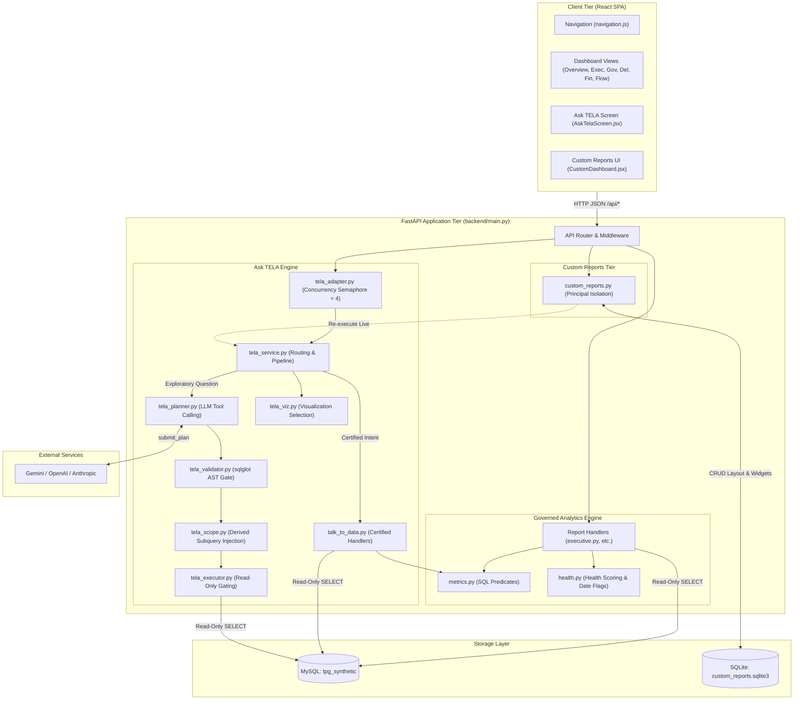
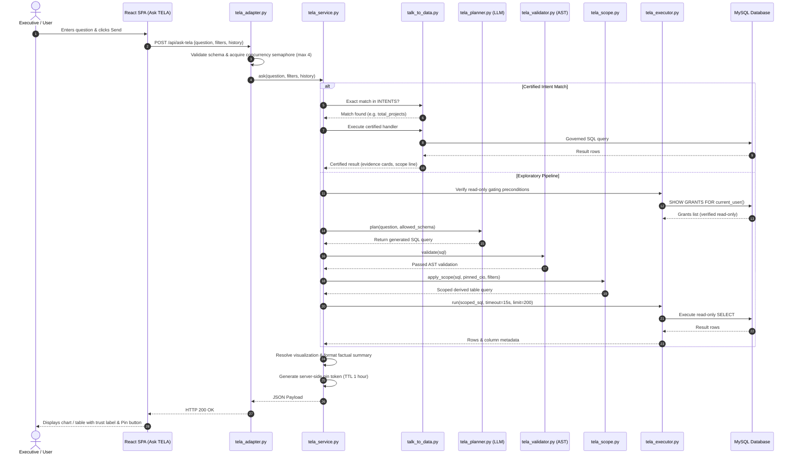

# System Architecture Document: PMO Intelligence & Analytics

| Field | Value |
|---|---|
| Project | PMO Intelligence & Analytics (Prodian / TELA PMO) |
| Document status | Approved |
| Version | 2.0 |
| Last updated | 2026-10-20 |
| Evidence level | L3 (Implemented static source code) with L4 (Configuration) and L1/L2 (Specifications) |
| Sources analyzed | 25 sources: source code, configuration, DOCX research/sprint plans, XLSX field sheets, MySQL dump |
| Related documents | [Project Summary](project_summary.md), [Requirements](requirements.md), [Business Rules](business_rules.md), [API Catalog](api_catalog.md), [Data Dictionary](data_dictionary.md), [Risk Register](risk_register.md), [Diagram Index](diagrams/README.md) |

---

## Table of Contents
- [1. Executive Architecture Overview](#1-executive-architecture-overview)
- [2. Evidence Level & Confidence Statement](#2-evidence-level--confidence-statement)
- [3. Business Context & Architectural Drivers](#3-business-context--architectural-drivers)
- [4. System Boundaries & External Actors](#4-system-boundaries--external-actors)
- [5. Architecture Principles & Constraints](#5-architecture-principles--constraints)
- [6. Current Architecture vs. Target Cloud Architecture](#6-current-architecture-vs-target-cloud-architecture)
- [7. System Context & Component Architecture](#7-system-context--component-architecture)
- [8. Module & Subsystem Breakdown](#8-module--subsystem-breakdown)
- [9. End-to-End Execution Workflows](#9-end-to-end-execution-workflows)
- [10. Governed Metrics & State Transitions Summary](#10-governed-metrics--state-transitions-summary)
- [11. Data Architecture & Storage Analysis](#11-data-architecture--storage-analysis)
- [12. API & Integration Surface](#12-api--integration-surface)
- [13. Authentication, Multi-Tenancy & Security Boundaries](#13-authentication-multi-tenancy--security-boundaries)
- [14. Infrastructure, Deployment & Networking](#14-infrastructure-deployment--networking)
- [15. Performance, Scalability & Concurrency](#15-performance-scalability--concurrency)
- [16. Reliability, Resilience & Degradation Patterns](#16-reliability-resilience--degradation-patterns)
- [17. Observability, Logging & Health Checks](#17-observability-logging--health-checks)
- [18. Backup, Disaster Recovery & Storage Durability](#18-backup-disaster-recovery--storage-durability)
- [19. Testing & Quality Strategy](#19-testing--quality-strategy)
- [20. Architecture Decision Records (ADRs)](#20-architecture-decision-records-adrs)
- [21. Technical Gaps, Risks & Vulnerabilities](#21-technical-gaps-risks--vulnerabilities)
- [22. Architecture Improvement Recommendations](#22-architecture-improvement-recommendations)
- [23. Migration Roadmap & Azure Target Considerations](#23-migration-roadmap--azure-target-considerations)
- [24. Assumptions, Open Questions & Unresolved Decisions](#24-assumptions-open-questions--unresolved-decisions)
- [25. Evidence Needed to Raise Confidence](#25-evidence-needed-to-raise-confidence)
- [26. Technical Glossary](#26-technical-glossary)
- [27. Source Inventory & Provenance References](#27-source-inventory--provenance-references)

---

## 1. Executive Architecture Overview

**PMO Intelligence & Analytics** is an enterprise portfolio governance and decision-intelligence platform. It ingests project delivery and demand-intake records (extracted from Microsoft Dynamics CRM / TPG) and delivers executive dashboards, canonical health scores, natural language querying (**Ask TELA**), and user-curated **Custom Reports**.

```
+---------------------------------------------------------------------------------------------------------+
|                                           EXECUTIVE BROWSER                                             |
|   React 19 SPA (Vite 8, Tailwind CSS 4, Recharts 3, lucide-react)                                       |
|   - Workspaces: Projects & Requests | Ask TELA Screen | Custom Reports Canvas | Project Drawer          |
+---------------------------------------------------------------------------------------------------------+
                                                     |
                                                     | HTTPS / REST (/api/*)
                                                     v
+---------------------------------------------------------------------------------------------------------+
|                                       FASTAPI APPLICATION TIER                                          |
|                                                                                                         |
|   [ Governed Analytics ]              [ Ask TELA Dual-Path Engine ]           [ Custom Reports Engine ] |
|   - executive.py, delivery.py         - tela_service.py (Orchestrator)        - custom_reports.py       |
|   - governance.py, finance.py         - talk_to_data.py (Certified Handlers)  - Owner Principal Isolation|
|   - flow.py, projects.py              - tela_planner.py (LLM Tool-Calling)    - Opaque Pin Tokens (1hr) |
|   - metrics.py (SQL Predicates)       - tela_validator.py (sqlglot AST Gate)  - Re-run Live by Default  |
|   - health.py (4-Factor Model)        - tela_scope.py (Derived Subqueries)    - Snapshot Degradation    |
|                                       - tela_executor.py (Read-Only Gate)                               |
+---------------------------------------------------------------------------------------------------------+
             |                                       |                                    |
             | Read-Only SELECT                      | HTTPS / Tool-Calling               | SQLite WAL
             v                                       v                                    v
+-----------------------------+        +---------------------------+        +-----------------------------+
|    ENTERPRISE DATABASE      |        |   EXTERNAL LLM PROVIDER   |        |   CUSTOM REPORTS STORE      |
|    MySQL 8.0 (tpg_synthetic)|        |   Google Gemini 2.5 Flash |        |   SQLite 3 File:            |
|    - projects (100 rows)    |        |   OpenAI GPT-4.1          |        |   data/custom_reports.sqlite|
|    - project_requests (150) |        |   Anthropic Claude 3.5    |        |   - dashboards, widgets,    |
+-----------------------------+        +---------------------------+        |     items                   |
                                                                            +-----------------------------+
```

### Architectural Key Truths
1. **Governed Determinism First**: Official metrics are calculated exclusively by deterministic code (`backend/metrics.py` and `backend/health.py`). The LLM is **never** permitted to calculate official metrics or alter dashboard figures.
2. **Hard Security Sandbox for Natural Language**: Exploratory SQL generated by the LLM is restricted to a strict two-table, 41-column allow-list, validated via an AST parser (`sqlglot`), rewritten with mandatory server-side tenant predicates (`tela_scope.py`), and executed by an executor that fails closed unless the MySQL connection grant parses strictly as `USAGE ON *.*` and `SELECT` on approved tables (`tela_executor.py`).
3. **Decoupled User Reporting**: Custom Reports are isolated in an independent server-side SQLite store (`data/custom_reports.sqlite3`), completely separated from the MySQL data warehouse.

---

## 2. Evidence Level & Confidence Statement

| Subsystem / Area | Evidence Level | What is Established as Fact | Confidence Limits & Open Gaps |
|---|---|---|---|
| **API & Routing Layer** | **L3 (Implemented)** | Exact routes, parameter schemas, middleware, and CORS policies from `backend/main.py`. | Production rate-limiting and reverse proxy headers unverified. |
| **Governed Metrics & Health** | **L3 (Implemented)** | Predicates in `metrics.py`, 4-factor scoring in `health.py`, missing-data coverage threshold (60%). | PMO charter sign-off on 30-day staleness threshold pending. |
| **Natural Language Pipeline** | **L3 (Implemented)** | LLM tool-calling prompts, AST validation, scope rewriting, read-only grant gating. | Only Gemini exercised live; OpenAI/Anthropic covered by mocks. |
| **Custom Reports Persistence** | **L3 (Implemented)** | SQLite schema, pin token lifecycle, live refresh vs snapshot fallback. | Server restart persistence unit-tested; live process restart unverified. |
| **Frontend Presentation** | **L3 (Implemented)** | React component structure, Recharts visualization, disabled report guards in `navigation.js`. | Full walkthrough completed for Executive/Status only; other screens unit-tested. |
| **Infrastructure & Security** | **L4 (Configured)** | Environment variables in `.env`, connection pooling parameters, database user accounts. | No multi-user authentication; deployment-level `DEMO_CIO` pin only. |
| **Production Cloud Target** | **L1/L2 (Specified)** | Target architecture for Azure App Service, Azure PostgreSQL Flexible Server, Entra ID. | No infrastructure-as-code (Terraform/Bicep) or CI/CD pipelines supplied. |

**Overall Evidence Level**: **L3 (Implemented Source Code) with L4 (Configuration) and L1/L2 (Design Documents)**.

---

## 3. Business Context & Architectural Drivers

### Architectural Drivers (Quality Attribute Scenarios)
1. **Decision Integrity (Accuracy)**: Executives will make multi-million dollar resource allocations based on portfolio metrics. A dashboard figure must match an Ask TELA answer 100% when evaluated under the same scope and date (`NFR-006`).
2. **Least Privilege & AI Safety**: Allowing an LLM to generate SQL against an enterprise database introduces prompt injection and data exfiltration risks. The architecture must enforce a verifiable read-only database execution boundary (`NFR-001`, `NFR-007`).
3. **Tenancy Isolation**: Portfolio data must remain strictly isolated between executive boundaries. A user scoped to one CIO must never access or infer data belonging to another CIO (`NFR-005`).
4. **Data Reality Alignment**: Source data from Dynamics CRM lacks timesheet actuals and historical snapshots. The architecture must actively refuse to render speculative calculations and disable unsupported reports (`REQ-005`, `NFR-008`).

---

## 4. System Boundaries & External Actors

### External Actors
- **CIO / Executive**: Consumes portfolio health, financial exposure, delivery heatmaps, and asks ad-hoc portfolio questions via Ask TELA.
- **PMO Director & Analysts**: Tracks governance compliance, PCR volumes, stage completion, and curates Custom Reports.
- **Project Manager**: Inspects project drawer diagnostics, schedule variances, and baseline slips.

### System Boundaries
- **In-Scope Boundary**: The React SPA, FastAPI backend, in-process Ask TELA natural language engine, and SQLite custom reports store.
- **External Dependencies**:
  - **Enterprise Database**: MySQL 8.0 containing `projects` and `project_requests` tables.
  - **Language Model APIs**: Anthropic Claude API, OpenAI API, or Google Gemini API.
  - **Enterprise Upstream**: Microsoft Dynamics CRM / TPG Project Online (source of truth for ETL ingestion).

See detailed C4 context model in [diagrams/system-context.md](diagrams/system-context.md).

---

## 5. Architecture Principles & Constraints

### Guiding Principles
- **ADR-Driven Separation**: Official reporting and user personalization are strictly decoupled. Custom reports never modify official dashboards (`custom_reports.py:8`).
- **Fail-Closed Execution**: If any security assertion fails (unparseable grants, unknown table, missing scope, query timeout), execution halts immediately and returns a safe error payload.
- **Stateless Application Tier**: Backend instances maintain no session state, enabling horizontal scaling behind a load balancer once authentication and persistent Custom Reports storage are provisioned.

### Technical Constraints
- Single MySQL connection string in default setup (`DB_HOST`, `DB_PORT`, `DB_NAME`, `DB_USER`, `DB_PASSWORD`).
- Maximum query execution time capped at 15,000 ms (`NFR-002`).
- Maximum result set capped at 200 rows (`NFR-003`).

---

## 6. Current Architecture vs. Target Cloud Architecture

| Architectural Dimension | Current Implemented Architecture (L3/L4) | Proposed Target Azure Architecture (L1/L2 Design) |
|---|---|---|
| **Hosting & Compute** | Local Uvicorn process (port 8000) + Vite dev server (port 5173). Static bundle served if built. | Azure App Service (Linux) or Azure Container Apps with auto-scaling. |
| **Frontend Delivery** | Local Vite dev server proxying `/api` $\rightarrow$ `127.0.0.1:8000`. | Azure Front Door / CDN serving pre-compressed React SPA assets with route code splitting. |
| **Relational Database** | Local MySQL 8.0 instance (`tpg_synthetic_mysql.sql`). | Azure Database for PostgreSQL Flexible Server with query-pattern indexes and read replicas. |
| **Authentication & AuthZ** | None. Single server-pinned `DEMO_CIO` in `.env`. Identity = `cio:<DEMO_CIO>` or `anonymous`. | Microsoft Entra ID (Azure AD) using MSAL.js, OAuth2 Bearer tokens, and Entra App Roles / Groups. |
| **Database Access Control** | Shared `DB_USER` with grant checking; optional `PMO_RO_DB_USER`. | Managed Identity authentication for App Service $\rightarrow$ Azure PostgreSQL (no stored passwords). Dedicated read-only role. |
| **Custom Reports Store** | Single server-side SQLite file (`data/custom_reports.sqlite3`). | Relational PostgreSQL flexible server database or Azure Cosmos DB for multi-region durability. |
| **AI / LLM Orchestration** | Direct HTTPS outbound to Google Gemini / OpenAI / Anthropic APIs using API keys. | Azure OpenAI Service on private enterprise VNet endpoints with managed identity auth. |
| **Observability & Logging** | Python standard library `logging` to console output. | Azure Monitor, Application Insights, OpenTelemetry distributed tracing, and Log Analytics. |

---

## 7. System Context & Component Architecture

### C4 Level 2 Component Architecture
The diagram below illustrates the active container and module architecture implemented across the application:



See standalone high-resolution diagrams:
- System Context: [diagrams/system-context.md](diagrams/system-context.md)
- Component Architecture: [diagrams/component-architecture.md](diagrams/component-architecture.md)

---

## 8. Module & Subsystem Breakdown

### 8.1 Backend Core Modules (`backend/`)

| Module Path | Primary Class / Function Responsibilities | Dependencies & Invocations |
|---|---|---|
| `backend/main.py` | FastAPI application initialization, CORS configuration, `.env` loading, connection pooling (`get_engine()`), `SET TIMESTAMP` session listener, metadata endpoint, and router registration. | `SQLAlchemy`, `FastAPI`, all sub-routers |
| `backend/metrics.py` | Governed single source of truth for SQL predicate constants (`ACTIVE`, `IN_DELIVERY`, `PAST_DUE`, `SCHEDULE_RISK`, `OVER_BUDGET_ROW`, `STALE`) and row-twin functions (`is_over_budget()`, `financial_exposure()`, `on_hold_aging()`). | None (pure predicates & math) |
| `backend/health.py` | Objective 4-factor project health scoring model (`calculate_project_health()`), evidence coverage evaluation, severe condition status overrides, and objective calendar date flags (`date_flags()`). | `metrics.py` |
| `backend/executive.py` | Executive dashboard router (`POST /api/executive`): CIO & portfolio mapping, strategic initiatives health, delivery heatmap, and ExCo priorities. | `main.get_engine()`, `metrics.py`, `health.py` |
| `backend/governance.py` | Governance router (`POST /api/governance`): baselining compliance, budget code compliance, PM assignment rate, PCR compliance, and closure compliance. | `main.get_engine()`, `metrics.py` |
| `backend/delivery.py` | Delivery router (`POST /api/delivery`): upcoming delivery horizon buckets (0–30, 31–60, 61–90 days), past due projects, stage completion, and schedule variance. | `main.get_engine()`, `metrics.py` |
| `backend/finance.py` | Finance router (`POST /api/finance`): CAPEX budget vs forecast EAC, cost breakdown (internal, external, HW, SW, contingency). | `main.get_engine()`, `metrics.py` |
| `backend/flow.py` | Flow router (`POST /api/flow`): Kanban board states, WIP aging, throughput velocity. | `main.get_engine()`, `metrics.py` |
| `backend/projects.py` | Projects router (`POST /api/projects`, `GET /api/projects/{id}`): project list and detail drawer payload generation with diagnostic health metrics. | `main.get_engine()`, `health.py` |
| `backend/requests.py` | Requests & demand pipeline router: intake lifecycle, conversion rates, discovery schedule variances, commercial cost estimates, and overdue governance gates (DOU, DARB, SOW). | `main.get_engine()`, `metrics.py` |
| `backend/talk_to_data.py` | Certified natural language intent catalog (`INTENTS`) and deterministic handlers. Composes evidence cards, scope lines, and executive briefings. | `metrics.py`, `health.py`, `talk_compose.py` |
| `backend/tela_adapter.py` | HTTP adapter for Ask TELA (`POST /api/ask-tela`, `GET /api/ask-tela/status`). Enforces request schema validation, parameter whitelisting, and a 4-request concurrency semaphore. | `tela_service.py` |
| `backend/tela_service.py` | Core natural language orchestrator. Handles dual-path routing, certified execution, exploratory pipeline dispatch, pin token generation, and saved widget execution (`run_saved()`). | `talk_to_data.py`, `tela_planner.py`, `tela_validator.py`, `tela_scope.py`, `tela_executor.py`, `tela_viz.py` |
| `backend/tela_planner.py` | LLM planning prompt formulation and provider execution. Invokes `submit_plan` tool to return structured SQL query, clarification request, or unsupported notification. | `chat_providers.py`, `tela_schema.py` |
| `backend/tela_schema.py` | Strict allow-list definition of queryable tables (`projects`, `project_requests`) and permitted columns. Excludes personal names, contact info, and free-text comments. | None |
| `backend/tela_validator.py` | Abstract Syntax Tree (AST) validation using `sqlglot` (MySQL dialect). Enforces single SELECT, allow-list checking, disallowed function blocking, and row limit clamping. | `sqlglot` |
| `backend/tela_scope.py` | Automatic query scope rewriting. Replaces direct table references with filtered derived subqueries enforcing the pinned CIO and active dashboard filters. | `sqlglot` |
| `backend/tela_executor.py` | Trusted read-only execution boundary. Validates database connection grants (`SHOW GRANTS`), enforces statement timeout (15s) and row limit (200), and checks connection identity. | `SQLAlchemy`, `PyMySQL` |
| `backend/tela_viz.py` | Adaptive visualization resolver. Analyzes query result shape to select KPI card, Bar chart, Line chart, or Table, formats numbers, and synthesizes factual explanation sentences. | None |
| `backend/custom_reports.py`| Custom Reports persistence engine (`/api/custom-reports/*`). Manages SQLite database, principal ownership isolation (`cio:<DEMO_CIO>`), pin token verification, and widget execution. | `sqlite3`, `tela_service.py` |

---

## 9. End-to-End Execution Workflows

### 9.1 Ask TELA Natural Language Query Sequence
The diagram below details the dual-path execution pipeline:



See standalone sequence diagram in [diagrams/request-flow-ask-tela.md](diagrams/request-flow-ask-tela.md).

---

## 10. Governed Metrics & State Transitions Summary

Detailed formulas, worked examples, and edge-case handling are owned by [business_rules.md](business_rules.md). Below is the operational summary:

| Rule ID | Metric / Concept | Governing Logic & Inputs | Output / Bands |
|---|---|---|---|
| `RULE-001` | **As-Of Reference Date** | `PMO_AS_OF` environment variable or database `CURDATE()`. | Evaluates all date aging and horizons. |
| `RULE-002` | **Open Projects Population** | `status = 'Active'` in `projects`. | Includes `Project Created`, `Active`, `On Hold` (65 open projects). |
| `RULE-003` | **In-Delivery Population** | `current_state = 'Active'` in `projects`. | Excludes `Project Created` and `On Hold` (13 active projects). |
| `RULE-004` | **Calculated Project Health** | 4-factor weighted score: Schedule (35%), Cost (25%), Progress (25%), Issues (15%). | Green ($\ge 75$), Amber ($50–74$), Red ($< 50$). |
| `RULE-005` | **Health Coverage Gating** | Minimum evidence coverage threshold $C \ge 0.60$. | Evaluates as "Insufficient data" if $C < 0.60$. |
| `RULE-006` | **Severe Condition Overrides** | Schedule $= 0 \rightarrow$ Red; Issue KPI Red $\rightarrow$ Red; Cost $= 0 \rightarrow$ Red; Cost $= 25 \rightarrow$ Max Amber. | Overrides base weighted score. |
| `RULE-007` | **Overdue Go-Live (Past Due)** | `current_state = 'Active'` AND $\text{planned} < \text{asOf}$ AND $\text{actual IS NULL}$. | Objective date fact. Excludes On Hold / Created. |
| `RULE-008` | **Schedule Risk** | `status = 'Active'` AND `schedule_kpi IN ('Red', 'Yellow')`. | Subjective PM warning flag. Distinct from Past Due. |
| `RULE-009` | **RAG Contradiction** | Undeployed open project: Green KPI but $\ge 15$ days late, or Red KPI but $\ge 30$ days early. | Early warning data discrepancy flag. |
| `RULE-012` | **Over Budget Condition** | $\text{cost\_total\_usd} > \text{approved\_budget\_value\_usd}$ AND $\text{budget} > 0$. | Forecast EAC above budget. Budget = 0 never over. |
| `RULE-013` | **Financial Exposure** | Compares budget vs forecast strictly where budget $> 0$ and forecast $\ge 0$. | Excluded projects tracked in `projectsExcluded`. |
| `RULE-015` | **Overdue Governance Gates** | Open requests failing DOU, DARB, or SOW planned issuance dates. | Overdue count and affected request IDs. |

---

## 11. Data Architecture & Storage Analysis

Detailed entity attributes, data types, and constraints are owned by [data_dictionary.md](data_dictionary.md). Below is the architectural storage layout:

### 11.1 Primary Relational Database (MySQL 8.0 `tpg_synthetic`)
- **Engine**: InnoDB, UTF-8 Unicode (`utf8mb4`).
- **Access Pattern**: Read-only via SQLAlchemy 2.1 connection pool with PyMySQL driver.
- **Core Tables**:
  - `projects`: 100 total rows in baseline extract (65 Open, 35 Inactive). 41 queryable columns in TELA allow-list.
  - `project_requests`: 150 intake demand rows. Tracks governance gate milestones (DOU, DARB, SOW) and discovery schedules.

### 11.2 Custom Reports Database (SQLite `data/custom_reports.sqlite3`)
- **Engine**: SQLite 3 configured with `PRAGMA journal_mode = WAL` and `PRAGMA foreign_keys = ON`.
- **Concurrency**: Short-lived per-operation connection manager (`_conn()`), timeout 10 seconds.
- **Schema**:
  - `dashboards`: Container record (`id`, `owner`, `name`, `created_at`, `updated_at`). Indexed on `owner`.
  - `widgets`: Reusable definition (`id`, `owner`, `title`, `question`, `source`, `definition`, `def_hash`, `viz`, `filters`, `snapshot`, `snapshot_at`). Unique index on `(owner, def_hash)`.
  - `items`: Join table (`dashboard_id`, `widget_id`, `position`, `span`). Enforces cascade deletion on report drop.

See ER diagram in [diagrams/entity-relationship.md](diagrams/entity-relationship.md).

---

## 12. API & Integration Surface

Detailed schemas, parameters, and payloads are owned by [api_catalog.md](api_catalog.md). Below is the integration summary:

| Interface Domain | Base Route | Methods | Authentication / Scope | Key Endpoints |
|---|---|---|---|---|
| **System & Metadata** | `/api` | `GET` | Public / Scoped | `/health`, `/meta`, `/filters`, `/overview` |
| **Projects Reports** | `/api` | `POST`, `GET` | Scoped (`DEMO_CIO`) | `/executive`, `/governance`, `/delivery`, `/finance`, `/flow`, `/projects`, `/projects/{id}` |
| **Requests Reports** | `/api/requests` | `POST`, `GET` | Scoped (`DEMO_CIO`) | `/overview`, `/demand`, `/discovery`, `/on-hold`, `/budget-cost`, `/overdue-gates`, `/{id}` |
| **Ask TELA Engine** | `/api/ask-tela` | `GET`, `POST` | Scoped (`DEMO_CIO`) | `/status`, `/ask-tela` (Max 4 concurrent) |
| **Talk to Data / Chat** | `/api` | `GET`, `POST` | Scoped (`DEMO_CIO`) | `/talk-to-data/templates`, `/query`, `/briefing`, `/chat`, `/chat/status` |
| **Custom Reports** | `/api/custom-reports` | `GET`, `POST`, `PATCH`, `DELETE`, `PUT` | Principal Scoped | `/dashboards`, `/widgets`, `/pins`, `/dashboards/{id}/layout`, `/widgets/{id}/data` |

---

## 13. Authentication, Multi-Tenancy & Security Boundaries

### 13.1 Current Security Posture & Tenancy Boundary (Honest Assessment)
- **Authentication**: **None**. The platform lacks user login, sessions, and individual credentials (`RISK-001`).
- **Tenancy Boundary**: Deployment-level identity via `DEMO_CIO` (`backend/main.py:22`).
  - When `DEMO_CIO` is configured, every query (overview, dashboards, certified metrics, exploratory SQL, and custom reports) is pinned to that CIO.
  - Any CIO parameter supplied by the client browser is actively ignored and stripped (`main.py:127`).
  - Custom reports owner principal is resolved as `cio:<DEMO_CIO>`. Users sharing a deployment share custom reports.
  - With `DEMO_CIO` unset, the owner principal is `anonymous` and no CIO scoping is enforced.

### 13.2 Exploratory SQL Security Sandbox
Exploratory natural language queries are protected by five consecutive defense-in-depth gates:
1. **Schema Allow-List (`tela_schema.py`)**: Queries can only touch `projects` and `project_requests`, and only 41 allowed columns. Contact details, personal names, comments, and document links are strictly excluded.
2. **AST Validation (`tela_validator.py`)**: AST inspection via `sqlglot` rejects DML, DDL, locks, file operations (`LOAD_FILE`), timing functions (`SLEEP`, `BENCHMARK`), recursive CTEs, and schema-qualified tables. Wildcard projections (`SELECT *`) are forbidden.
3. **Mandatory Scope Injection (`tela_scope.py`)**: Rewrites table references into derived subqueries applying `WHERE cio = :pinned_cio AND <filters>`. Independent AST verification asserts that no unscoped table remains.
4. **Verifiable Read-Only Database Account (`tela_executor.py`)**: Evaluates `SHOW GRANTS` on the MySQL connection. The account must possess strictly `USAGE ON *.*` and `SELECT` on approved tables. Administrative or write grants cause the gate to fail-closed. Result cached for 60 seconds (`RISK-003`).
5. **Execution Clamping (`tela_executor.py`)**: Hard statement timeout of 15 seconds (`MAX_EXECUTION_TIME = 15000`) and hard row ceiling of 200 rows (`LIMIT 200`).

---

## 14. Infrastructure, Deployment & Networking

### 14.1 Local Development Topology
- **Frontend**: Vite Dev Server on `http://localhost:5173`. Proxies `/api/*` to `http://127.0.0.1:8000`.
- **Backend**: Uvicorn ASGI server on `http://127.0.0.1:8000` executing `main:app`.
- **Database**: Local MySQL 8.0 instance on port 3306/3310.
- **Custom Reports**: Local SQLite file at `data/custom_reports.sqlite3`.

### 14.2 Production Single-Process Deployment
When `frontend/dist/index.html` exists (compiled via `npm run build`), FastAPI mounts static files and serves the React SPA directly from `backend/main.py` via a catch-all route registered last (`main.py:540-555`). This allows deploying the entire application as a single container or service instance.

---

## 15. Performance, Scalability & Concurrency

### 15.1 Concurrency Limits & Load Shedding
- **Ask TELA Semaphore**: Limited to maximum 4 concurrent requests in flight (`backend/tela_adapter.py`). A 5th concurrent request receives immediate HTTP 429 Too Many Requests to prevent LLM thread pool starvation.
- **Database Connection Pooling**: SQLAlchemy `QueuePool` with `pool_pre_ping=True`.
- **Custom Reports SQLite WAL**: SQLite operates in Write-Ahead Logging mode (`PRAGMA journal_mode = WAL`), allowing concurrent readers without blocking writes.

### 15.2 Scalability Bottlenecks (from `Docs/Scalability Notes.docx`)
1. **Unindexed Dashboard Queries**: In-memory filtering and full-table scans in MySQL. Recommendations: add compound indexes on `(cio, status, region, portfolio)`.
2. **Repeated Health Calculations**: Project health is currently computed dynamically in Python by iterating project rows on every dashboard load. Recommendation: cache project health scores or calculate on ingestion.
3. **Large Frontend Bundle**: Monolithic bundle $> 1.2$ MB (`RISK-010`). Recommendation: route-level code splitting via `React.lazy()`.

---

## 16. Reliability, Resilience & Degradation Patterns

### 16.1 Fail-Closed Gating
If the exploratory gate fails (disabled in config, unparseable grants, missing API key), the system does not crash or attempt unsafe execution; it returns an explicit disclaimer: `"Exploratory analysis is not enabled on this server yet"`.

### 16.2 Snapshot Fallback Degradation
If a custom report widget encounters a live execution failure (e.g., upstream database timeout, exploratory gate locked), it automatically degrades to its cached snapshot:
- Renders historical data from SQLite `snapshot` JSON column.
- Displays an explicit **"Snapshot"** badge with the timestamp when the snapshot was captured.
- Presents the failure reason to the user with a Refresh action button (`RULE-021`).

See state machine model in [diagrams/custom-reports-lifecycle.md](diagrams/custom-reports-lifecycle.md).

---

## 17. Observability, Logging & Health Checks

- **Liveness Endpoint**: `GET /api/health` performs an active `SELECT 1` query to verify database connectivity.
- **Readiness / Engine Status**: `GET /api/ask-tela/status` returns `{certified: true, exploratory: true|false}`.
- **Structured Error Responses**: Backend exceptions are caught and sanitized. Internal SQL strings, stack traces, and database credentials are never leaked in API error payloads (`NFR-012`).

---

## 18. Backup, Disaster Recovery & Storage Durability

- **MySQL Database**: In enterprise deployment, MySQL requires automated daily snapshots, point-in-time recovery (PITR) with binary logging enabled, and cross-region replica configuration.
- **SQLite Custom Reports File**: Currently stored locally in `data/custom_reports.sqlite3` (`RISK-004`). In production, this requires mapping to an Azure Files persistent volume or migrating to Azure PostgreSQL.

---

## 19. Testing & Quality Strategy

### 19.1 Automated Test Suites (`backend/tests/`)
- `test_tela_native.py` (346 tests passed): Validates SQL AST parser, allow-list enforcement, derived scope rewriting, executor grants inspection, and visualization resolution.
- `test_tela_adapter.py`: Validates HTTP request/response contracts, load-shedding semaphore, and error mapping.
- `test_custom_reports.py`: Validates dashboard CRUD, layout reordering, owner principal isolation, and snapshot fallback.
- `test_answer_key.py` & `test_metric_consistency.py`: Asserts metric parity across Overview, Executive reports, and Talk to Data handlers.

### 19.2 Known Test Failures (`RISK-007`)
- **22 Scope-Sensitive Tests**: Tests expecting unscoped database counts (e.g. 100 projects) fail when `DEMO_CIO` is active (25 projects in scope). These tests must be parameterized to account for active scope (`REC-007`).
- **2 Missing Dependency Tests**: Tests requiring optional `anthropic` SDK fail if the package is omitted from the test virtualenv.

---

## 20. Architecture Decision Records (ADRs)

### `ADR-001`: In-Process TELA Integration vs. External TELA Service
- **Context**: TELA natural language analytics could run as an independent microservice or be integrated natively within the PMO FastAPI process.
- **Decision**: Integrate TELA natively in-process (`backend/tela_*.py`).
- **Rationale**: Eliminates network latency, removes cross-service authentication overhead, and ensures unified database connection pooling and scope enforcement.
- **Consequences**: Backend process requires Python LLM SDKs and `sqlglot`; high exploratory concurrency could compete with dashboard query threads.

### `ADR-002`: Dual-Tier Storage (MySQL for Core PMO, SQLite for Custom Reports)
- **Context**: Custom reports and user-pinned widgets require persistence.
- **Decision**: Store custom reports in an isolated SQLite database (`data/custom_reports.sqlite3`), leaving the enterprise MySQL database strictly read-only.
- **Rationale**: Guarantees zero write risk to the enterprise PMO database. Ensures user customization does not pollute enterprise schemas.
- **Consequences**: SQLite file requires persistent storage mapping in containerized environments (`RISK-004`).

### `ADR-003`: AST-Based Derived Subquery Scope Rewriting
- **Context**: Exploratory SQL generated by the LLM must be constrained to the authorized CIO and active filters.
- **Decision**: Parse the query AST using `sqlglot` and replace every table reference with a filtered derived subquery: `(SELECT * FROM projects WHERE cio = :pinned_cio AND <filters>)`.
- **Rationale**: Prevents prompt injection from bypassing `WHERE` clauses (e.g. `OR 1=1`), because the outer query only has access to rows already filtered by the inner subquery.
- **Consequences**: Complex outer queries on derived tables require MySQL to optimize subquery execution.

### `ADR-004`: Server-Side Memory Pin Tokens for Widget Creation
- **Context**: Users pinning an Ask TELA answer to a report need to persist the underlying query definition.
- **Decision**: Store the re-runnable definition in server memory mapped to an opaque cryptographically random token (`pin_token`) with a 1-hour TTL.
- **Rationale**: The browser client never receives or submits raw SQL. Injection of arbitrary queries via the pin API is impossible.
- **Consequences**: Pin tokens are lost if the backend restarts before pinning occurs (`GAP-002`).

---

## 21. Technical Gaps, Risks & Vulnerabilities

Detailed risk evaluations, likelihoods, and owners are tracked in [risk_register.md](risk_register.md). Summary of highest-priority architectural concerns:
1. **`RISK-001` (Critical - Security)**: Absence of user authentication and multi-user RBAC. Tenancy is pinned globally at deployment level via `DEMO_CIO`.
2. **`RISK-002` (High - Security)**: Shared database credentials across dashboards and exploratory TELA queries in default configuration.
3. **`RISK-004` (High - Operational)**: SQLite single-file storage for Custom Reports creates a single point of failure and inhibits horizontal cloud scaling.
4. **`RISK-005` (High - Data Integrity)**: Absence of actual spend and timesheet data in source schema; `cost_total_usd` is strictly EAC forecast.
5. **`RISK-007` (Medium - QA)**: 22 scope-sensitive backend tests failing when `DEMO_CIO` is active.

---

## 22. Architecture Improvement Recommendations

| ID | Title & Proposed Architecture Change | Priority | Target Milestone | Linked Risks |
|---|---|---|---|---|
| `REC-001` | **Integrate Microsoft Entra ID (Azure AD) Authentication**: Implement OAuth2/OIDC Bearer token authentication via MSAL. Extract user identity and role groups from verified JWT claims. | Must | Phase 1 Cloud | `RISK-001` |
| `REC-002` | **Enforce Dedicated Read-Only Database Credentials**: Mandate separate database credentials for `PMO_RO_DB_USER` on an isolated connection pool with hardware-enforced read-only grants. | Must | Immediate | `RISK-002` |
| `REC-003` | **Migrate Custom Reports Storage to PostgreSQL**: Transition `custom_reports.sqlite3` to Azure Database for PostgreSQL Flexible Server or Azure Cosmos DB. | Must | Phase 1 Cloud | `RISK-004` |
| `REC-004` | **Implement Route-Level Code Splitting**: Refactor `frontend/src/App.jsx` using `React.lazy()` and `Suspense` to split dashboard modules into discrete chunks $< 300$ KB. | Should | Immediate | `RISK-010` |
| `REC-005` | **Parameterize Scope in Backend Test Suites**: Update 22 scope-sensitive tests in `backend/tests/` to run in scoped fixture contexts, enabling clean CI/CD runs. | Should | Immediate | `RISK-007` |
| `REC-006` | **Rename `backend/requests.py` to `backend/demand_requests.py`**: Eliminate Python standard library package shadowing and resolve third-party plugin import collisions. | Should | Immediate | `RISK-009` |
| `REC-007` | **Implement OpenTelemetry Tracing & Azure Monitor**: Add structured tracing and metrics export for FastAPI routes, database queries, and LLM provider latency. | Should | Phase 2 Cloud | `GAP-003` |

---

## 23. Migration Roadmap & Azure Target Considerations

Based on findings in `Docs/PMO Application-Infra,Auth.docx` and `Docs/PMO_Report_Builder_Sprint_Plan.docx`:
1. **Target Topology**: Azure App Service (Linux, Python 3.13) hosting FastAPI backend, Azure Static Web Apps hosting React frontend, and Azure Database for PostgreSQL Flexible Server.
2. **Database Engine Migration**: Migration from MySQL 8.0 to PostgreSQL Flexible Server requires updating SQL dialects:
   - MySQL `CURDATE()` $\rightarrow$ PostgreSQL `CURRENT_DATE`.
   - MySQL `DATEDIFF(a, b)` $\rightarrow$ PostgreSQL `(a - b)`.
   - MySQL `DATE_ADD(d, INTERVAL n DAY)` $\rightarrow$ PostgreSQL `d + INTERVAL 'n days'`.
   - Update `sqlglot` read dialect in `tela_validator.py` and `tela_scope.py` to `postgres`.
3. **Timesheet Workload Capacity**: Research indicates a 100,000-row timesheet workload is well within the capacity of a standard PostgreSQL Flexible Server instance with B-tree indexing on `(project_id, submission_date)`.

---

## 24. Assumptions, Open Questions & Unresolved Decisions

### Architectural Assumptions
- **`ASSUMP-001`**: Source data extract from Dynamics CRM will continue to be refreshed via scheduled database ETL rather than direct webhook/API synchronization.
- **`ASSUMP-002`**: Single-region cloud deployment is sufficient for initial production release; multi-region active-active replication is not required.

### Open Questions & Unresolved Decisions
- **`Q-001`**: Which Identity Provider (IdP) tenant will host Microsoft Entra ID application registration, and what are the agreed enterprise role claims?
- **`Q-002`**: Will the PMO charter approve the provisional 30-day threshold for classifying active projects as `Stale` (`RULE-010`)?
- **`Q-003`**: What is the target timeline and schema standard for ingesting actual financial spend, timesheets, and milestone records to re-enable the 8 disabled dashboards?

---

## 25. Evidence Needed to Raise Confidence

To elevate technical confidence from **L3/L4** to full **L5 Operational** status, the following artifacts must be provided:
1. **Azure Infrastructure as Code (IaC)**: Terraform or Bicep templates defining target Azure App Service, VNet, Private Endpoints, and PostgreSQL configurations.
2. **CI/CD Pipeline Configurations**: GitHub Actions or Azure DevOps pipeline definitions (`.github/workflows/` or `azure-pipelines.yml`).
3. **Enterprise Identity Mapping**: Entra ID App Registration manifest, client ID, tenant ID, and RBAC group claim specifications.
4. **Production Load & Benchmark Data**: Concurrency test reports evaluating 50+ simultaneous executive users and database connection pool saturation.

---

## 26. Technical Glossary

- **AST (Abstract Syntax Tree)**: Hierarchical tree representation of SQL syntax parsed by `sqlglot` to validate structure without executing.
- **EAC (Estimate at Completion)**: Forecast total cost of a project at completion; compared against approved budget.
- **First Baselined Date**: The earliest approved commitment date for project go-live; used as the anchor for schedule slip.
- **Past Due (Overdue Go-Live)**: Objective date flag for active projects whose planned deployment date has passed without actual deployment.
- **Principal**: Unique security identity string evaluated by Custom Reports (format `cio:<DEMO_CIO>` or `anonymous`).
- **RAG Contradiction**: Early warning discrepancy where a project's self-reported KPI contradicts calendar dates.
- **WAL (Write-Ahead Logging)**: SQLite database mode allowing concurrent reads while writes are committed.

---

## 27. Source Inventory & Provenance References

| Source File / Artifact | Type | Format | Key Architectural Insights Derived |
|---|---|---|---|
| `backend/main.py` | Source Code | Python | FastAPI app, CORS middleware, `.env` loading, connection pooling, `SET TIMESTAMP` session listener, overview route. |
| `backend/metrics.py` | Source Code | Python | Governed SQL predicate fragments (`ACTIVE`, `IN_DELIVERY`, `PAST_DUE`, `OVER_BUDGET_ROW`) and math row twins. |
| `backend/health.py` | Source Code | Python | 4-factor health scoring formula, minimum evidence coverage (60%), severe condition status overrides, date flags. |
| `backend/tela_*.py` | Source Code | Python | In-process Ask TELA engine: adapter semaphore, LLM planner, AST validator, derived scope rewriter, read-only executor, viz resolver. |
| `backend/custom_reports.py` | Source Code | Python | SQLite persistence, owner principal isolation, opaque pin token memory cache, live re-execution, snapshot fallback. |
| `frontend/src/navigation.js` | Source Code | JavaScript | Route tree, workspace definitions, and `DISABLED_REPORTS` catalog with reasons and required data. |
| `data/tpg_synthetic_mysql.sql` | Database Dump | SQL | Physical MySQL schema for `projects` and `project_requests` tables; confirms absence of spend/timesheet tables. |
| `data/custom_reports.sqlite3` | Database | SQLite 3 | Physical schema for `dashboards`, `widgets`, `items` tables and sample user data. |
| `Docs/Field details for Prodian_*.xlsx` | Data Dictionary | XLSX | Field mapping workbooks detailing Dynamics CRM logical attributes, display labels, dropdowns, and MySQL column twins. |
| `Docs/PMO Application-Infra,Auth.docx` | Architecture Doc | DOCX | Azure target architecture, PostgreSQL Flexible Server recommendation, Entra ID authentication plan, timesheet scalability analysis. |
| `Docs/PMO_Report_Builder_Sprint_Plan.docx` | Sprint Plan | DOCX | 10-sprint intelligence roadmap, widget compute contracts, visualization resolver rules, audit requirements. |
| `Docs/Scalability Notes.docx` | Tech Notes | DOCX | Performance audit, database connection pooling recommendations, indexing strategies, timesheet capacity analysis. |
| `Docs/CANONICAL_METRICS.md` | Specification | Markdown | Business contracts for canonical metrics, cost/spend clarification, as-of date rules, request metrics. |
| `README.md` | Documentation | Markdown | Complete operational documentation, setup instructions, API reference, test results, and known limitations. |
