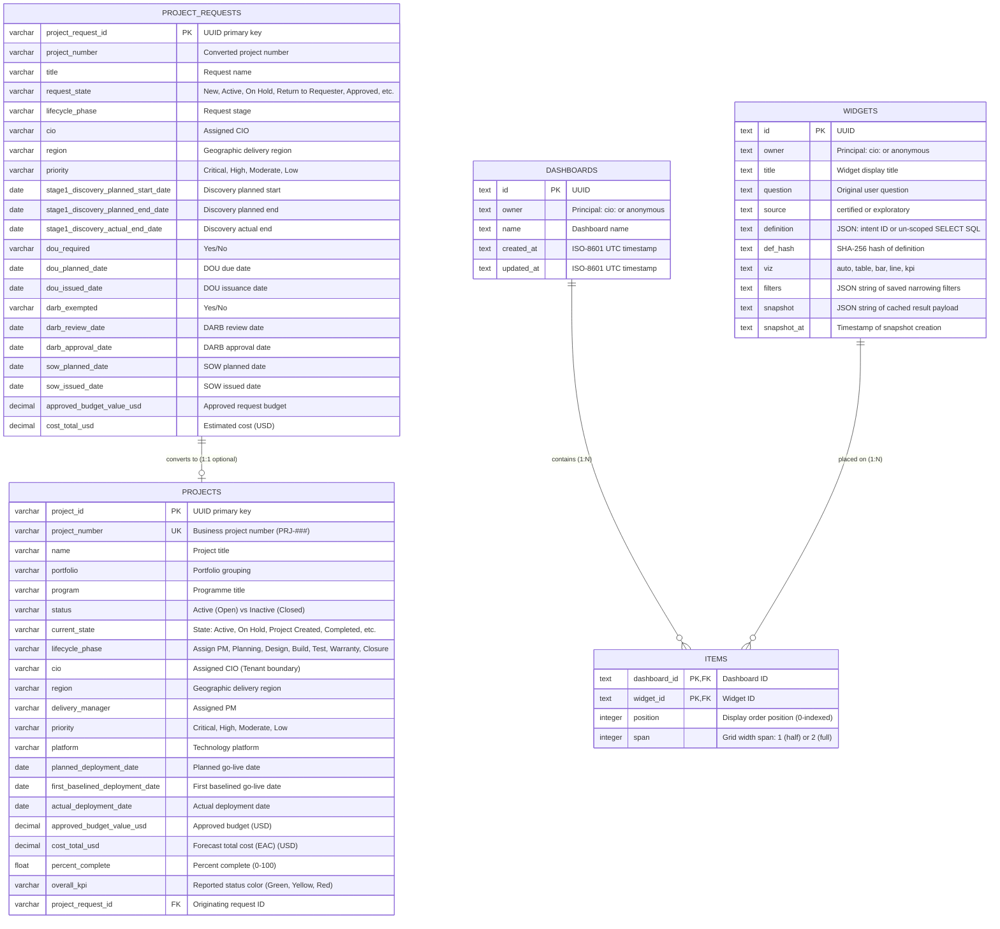

# Data Dictionary: PMO Intelligence & Analytics

| Field | Value |
|---|---|
| Project | PMO Intelligence & Analytics (Prodian / TELA PMO) |
| Document status | Approved |
| Version | 2.0 |
| Last updated | 2026-10-20 |
| Evidence level | L3 (Implemented static source code & schema) with L2 (Field mapping workbooks) |
| Sources analyzed | `data/tpg_synthetic_mysql.sql`, `data/custom_reports.sqlite3`, `backend/tela_schema.py`, `Docs/Field details for Prodian_*.xlsx` |
| Related documents | [Project Summary](project_summary.md), [Architecture](architecture.md), [Requirements](requirements.md), [Business Rules](business_rules.md), [API Catalog](api_catalog.md), [Risk Register](risk_register.md) |

---

## 1. Overview & Data Architecture

The platform operates across two physically distinct data tiers:
1. **PMO Core Relational Database (MySQL `tpg_synthetic`)**: Stores enterprise delivery and demand records originating from Microsoft Dynamics CRM / TPG.
2. **Custom Reports Store (SQLite `custom_reports.sqlite3`)**: Stores user-created dashboards, saved widget queries, and cached visualization snapshots.

### Data Sensitivity Classifications
- **Public**: Non-sensitive aggregate metrics.
- **Internal**: Standard operational portfolio data (project IDs, status, lifecycle stages).
- **Confidential**: Financial budgets, commercial revenue, EAC forecast figures.
- **Restricted / PII**: Personal names, email addresses, and free-text comments (strictly omitted from the Ask TELA exploratory allow-list).

---

## 2. Table of Contents
- [1. Overview & Data Architecture](#1-overview--data-architecture)
- [2. Table of Contents](#2-table-of-contents)
- [3. Entity-Relationship Diagram](#3-entity-relationship-diagram)
- [4. Entity: `projects` (Delivery Portfolio)](#4-entity-projects-delivery-portfolio)
- [5. Entity: `project_requests` (Demand Pipeline)](#5-entity-project_requests-demand-pipeline)
- [6. SQLite Custom Reports Entities (`dashboards`, `widgets`, `items`)](#6-sqlite-custom-reports-entities-dashboards-widgets-items)
- [7. Dynamics CRM to MySQL Schema Mapping](#7-dynamics-crm-to-mysql-schema-mapping)

---

## 3. Entity-Relationship Diagram

---

## 4. Entity: `projects` (Delivery Portfolio)

Physical MySQL table storing core project delivery metrics.

| Field Name | Type | Nullable | Constraints | Classification | Description & Rules |
|---|---|---|---|---|---|
| `project_id` | `VARCHAR(64)` | No | PK | Internal | Unique identifier of the project record in Dynamics CRM / TPG. |
| `project_number` | `VARCHAR(64)` | Yes | Unique | Internal | Human-readable business project identifier (e.g., `PRJ-00142`). |
| `name` | `VARCHAR(255)` | Yes | | Internal | Official project title. |
| `portfolio` | `VARCHAR(100)` | Yes | | Internal | Portfolio domain grouping (e.g., "Issuing", "Acquiring", "Digital"). |
| `program` | `VARCHAR(100)` | Yes | | Internal | Strategic programme containing the project. |
| `status` | `VARCHAR(32)` | No | Enum | Internal | Open/closed flag. `'Active'` = Open portfolio; `'Inactive'` = Closed portfolio. |
| `current_state` | `VARCHAR(64)` | Yes | Enum | Internal | Execution workflow state: `Project Created`, `Active`, `On Hold`, `Completed`, `Dropped`, `Cancelled`, `Archived`, `Expired`. |
| `lifecycle_phase` | `VARCHAR(64)` | Yes | Enum | Internal | Delivery phase: `Assign PM`, `TRB Review`, `Planning`, `Design`, `Build`, `Test`, `Implementation`, `Warranty`, `Closure`. |
| `cio` | `VARCHAR(100)` | Yes | | Internal | Assigned CIO. Serves as the primary multi-tenancy access boundary. |
| `region` | `VARCHAR(64)` | Yes | Enum | Internal | Geographic operating region (`DPO`, `East Africa`, `Francophone`, `GCC - UAE`, `KSA`, `Jordan`). |
| `delivery_manager`| `VARCHAR(100)` | Yes | | Internal | Assigned Delivery / Project Manager (corresponds to UI filter "Project manager"). |
| `priority` | `VARCHAR(32)` | Yes | Enum | Internal | Project urgency level: `Critical`, `High`, `Moderate`, `Low`. |
| `platform` | `VARCHAR(64)` | Yes | Enum | Internal | Core technology stack (`Network One`, `Network Flex`, `Magnati`, `Legacy / Other`). |
| `key_priority_project`| `VARCHAR(8)` | Yes | `Yes`/`No` | Internal | Strategic flag indicating ExCo key priority proxy. |
| `percent_complete`| `FLOAT` | Yes | $0 \le P \le 100$ | Internal | Physical progress recorded by PM. Values outside 0–100 are treated as invalid. |
| `overall_kpi` | `VARCHAR(16)` | Yes | Enum | Internal | Subjective reported status: `Green`, `Yellow` (mapped to Amber), `Red`. `NULL` = Not reported. |
| `schedule_kpi` | `VARCHAR(16)` | Yes | Enum | Internal | Subjective reported schedule health color. |
| `cost_kpi` | `VARCHAR(16)` | Yes | Enum | Internal | Subjective reported cost health color. |
| `issue_kpi` | `VARCHAR(16)` | Yes | Enum | Internal | Subjective reported issue severity: `Green`, `Yellow`, `Red`. |
| `planned_deployment_date` | `DATE` | Yes | | Internal | Current target go-live date. Used for overdue checks and upcoming delivery. |
| `first_baselined_deployment_date` | `DATE` | Yes | | Internal | Original committed baseline go-live date. Reference anchor for schedule slip. |
| `actual_deployment_date` | `DATE` | Yes | | Internal | Physical deployment date. `NULL` indicates project is undeployed. |
| `actual_project_start_date` | `DATE` | Yes | | Internal | Recorded project delivery start date. Used for linear progress calculation. |
| `on_hold_date` | `DATE` | Yes | | Internal | Date project was transitioned into `On Hold`. Used for on-hold aging. |
| `approved_budget_value_usd` | `DECIMAL(15,2)` | Yes | $\ge 0$ | Confidential | Officially approved capital budget in USD. Zero/null indicates no budget. |
| `cost_total_usd` | `DECIMAL(15,2)` | Yes | $\ge 0$ | Confidential | Forecast total cost (Estimate at Completion / EAC) in USD. **Not actual spend**. |
| `cost_internal_usd`| `DECIMAL(15,2)` | Yes | $\ge 0$ | Confidential | Internal labor component of forecast cost. |
| `cost_external_usd`| `DECIMAL(15,2)` | Yes | $\ge 0$ | Confidential | External vendor/contractor component of forecast cost. |
| `cost_hw_usd` | `DECIMAL(15,2)` | Yes | $\ge 0$ | Confidential | Hardware component of forecast cost. |
| `cost_sw_usd` | `DECIMAL(15,2)` | Yes | $\ge 0$ | Confidential | Software component of forecast cost. |
| `cost_contingency_usd`| `DECIMAL(15,2)` | Yes | $\ge 0$ | Confidential | Contingency buffer included in forecast cost. |
| `approved_pcr_counter`| `INT` | Yes | $\ge 0$ | Internal | Count of approved Project Change Requests. |
| `project_request_id` | `VARCHAR(64)` | Yes | FK | Internal | Foreign key link to `project_requests.project_request_id`. |
| `modified_on` | `DATETIME` | Yes | | Internal | System timestamp of last record update. Evaluated for Stale project detection. |

---

## 5. Entity: `project_requests` (Demand Pipeline)

Physical MySQL table storing demand intake and discovery records.

| Field Name | Type | Nullable | Constraints | Classification | Description & Rules |
|---|---|---|---|---|---|
| `project_request_id` | `VARCHAR(64)` | No | PK | Internal | Unique identifier for demand intake request. |
| `project_number` | `VARCHAR(64)` | Yes | | Internal | Project identifier populated once request is approved into delivery. |
| `title` | `VARCHAR(255)` | Yes | | Internal | Business title of the demand request. |
| `request_state` | `VARCHAR(64)` | Yes | Enum | Internal | Demand state: `New`, `Active`, `On Hold`, `Return to Requester`, `Approved`, `Rejected`, `Dropped`. |
| `cio` | `VARCHAR(100)` | Yes | | Internal | Sponsoring CIO. Enforces demand-side multi-tenancy. |
| `region` | `VARCHAR(64)` | Yes | Enum | Internal | Target geographic region. |
| `priority` | `VARCHAR(32)` | Yes | Enum | Internal | Requested business priority. |
| `stage1_discovery_planned_start_date` | `DATE` | Yes | | Internal | Scheduled start of architecture & business analysis discovery. |
| `stage1_discovery_planned_end_date` | `DATE` | Yes | | Internal | Scheduled completion of stage 1 discovery. |
| `stage1_discovery_actual_end_date` | `DATE` | Yes | | Internal | Physical completion date of discovery. |
| `dou_required` | `VARCHAR(8)` | Yes | `Yes`/`No` | Internal | Flag indicating whether Document of Understanding is mandated. |
| `dou_planned_date` | `DATE` | Yes | | Internal | Scheduled target date to issue DOU. Used for DOU overdue check. |
| `dou_issued_date` | `DATE` | Yes | | Internal | Actual date DOU was issued. |
| `darb_exempted` | `VARCHAR(8)` | Yes | `Yes`/`No` | Internal | Flag indicating Design Architecture Review Board exemption. |
| `darb_review_date` | `DATE` | Yes | | Internal | Scheduled DARB architecture review date. |
| `darb_approval_date` | `DATE` | Yes | | Internal | Official DARB sign-off date. |
| `sow_planned_date` | `DATE` | Yes | | Internal | Target date to issue Statement of Work. |
| `sow_issued_date` | `DATE` | Yes | | Internal | Actual date SOW was issued to client/vendor. |
| `cost_total_usd` | `DECIMAL(15,2)` | Yes | $\ge 0$ | Confidential | Pre-delivery estimated total cost of request. |
| `total_setup_revenue_usd` | `DECIMAL(15,2)` | Yes | $\ge 0$ | Confidential | Estimated one-time setup revenue generated. |
| `recurring_revenue_annual_baseline_usd` | `DECIMAL(15,2)` | Yes | $\ge 0$ | Confidential | Projected annual recurring baseline revenue. |
| `efforts_internal_mandays` | `INT` | Yes | $\ge 0$ | Internal | Projected internal delivery effort in man-days. |
| `efforts_external_mandays` | `INT` | Yes | $\ge 0$ | Internal | Projected external contractor effort in man-days. |

---

## 6. SQLite Custom Reports Entities (`dashboards`, `widgets`, `items`)

Managed inside `data/custom_reports.sqlite3` with `PRAGMA foreign_keys = ON` and `journal_mode = WAL`.

### 6.1 Entity: `dashboards`
- **Purpose**: Stores custom dashboard containers owned by specific tenant principals.
- **Fields**:
  - `id` (`TEXT`, PK): UUID string (`uuid.uuid4().hex`).
  - `owner` (`TEXT`, Not Null, Indexed): Principal string (e.g., `cio:Nomsa Osei` or `anonymous`).
  - `name` (`TEXT`, Not Null): Display name of the report (unique per owner).
  - `created_at` (`TEXT`, Not Null): ISO-8601 UTC timestamp.
  - `updated_at` (`TEXT`, Not Null): ISO-8601 UTC timestamp of last edit.

### 6.2 Entity: `widgets`
- **Purpose**: Stores reusable visualization specifications, queries, and snapshot caches.
- **Fields**:
  - `id` (`TEXT`, PK): UUID string.
  - `owner` (`TEXT`, Not Null): Owner principal.
  - `title` (`TEXT`, Not Null): User-editable widget title.
  - `question` (`TEXT`, Not Null): Original Ask TELA question.
  - `source` (`TEXT`, Not Null): `"certified"` (official metric) or `"exploratory"` (TELA SQL).
  - `definition` (`TEXT`, Not Null): JSON string storing execution logic.
    - Certified: `{"kind": "certified", "intent": "total_projects"}`
    - Exploratory: `{"kind": "exploratory", "sql": "SELECT ...", "title": "..."}`
  - `def_hash` (`TEXT`, Not Null): SHA-256 hash of definition string. Unique per `(owner, def_hash)` to prevent duplicate saved widgets in the user's library.
  - `viz` (`TEXT`, Not Null, Default `'auto'`): User's preferred visualization (`auto`, `table`, `bar`, `line`, `kpi`).
  - `filters` (`TEXT`, Not Null, Default `'{}'`): JSON string of dashboard filters captured at pin time.
  - `snapshot` (`TEXT`, Nullable): JSON string of full payload result, capped at 400,000 bytes. Used for degraded offline rendering.
  - `snapshot_at` (`TEXT`, Nullable): Timestamp when snapshot was stored.
  - `created_at` (`TEXT`, Not Null): Creation timestamp.
  - `updated_at` (`TEXT`, Not Null): Last edit timestamp.

### 6.3 Entity: `items`
- **Purpose**: Join table managing placement, ordering, and grid geometry of widgets on dashboards.
- **Fields**:
  - `dashboard_id` (`TEXT`, PK, FK $\rightarrow$ `dashboards.id` ON DELETE CASCADE)
  - `widget_id` (`TEXT`, PK, FK $\rightarrow$ `widgets.id` ON DELETE CASCADE)
  - `position` (`INTEGER`, Not Null): Zero-indexed vertical sequence.
  - `span` (`INTEGER`, Not Null, Default 1): Grid width span (1 = Half width, 2 = Full width).

---

## 7. Dynamics CRM to MySQL Schema Mapping

Derived from `Docs/Field details for Prodian_*.xlsx` (`hiddenSheet` CRM logical schema):

| Dynamics CRM Logical Attribute | Excel Business Display Name | MySQL Physical Column | Table | Notes |
|---|---|---|---|---|
| `tpg_projectid` | (Do Not Modify) Project | `project_id` | `projects` | Primary key |
| `tpgmea_projectnumber` | Project Number | `project_number` | `projects` | Business ID |
| `tpg_title` / `tpg_name` | Name | `name` | `projects` | Title |
| `tpgmea_customcio` | CIO | `cio` | `projects` / `project_requests` | Tenancy scope |
| `tpgmea_region` | Region | `region` | `projects` / `project_requests` | Dropdown values |
| `tpgmea_deliverymanager` | Delivery Manager | `delivery_manager` | `projects` / `project_requests` | "Project manager" in UI |
| `tpgmea_costtotal_usd` | Cost - Total (USD) | `cost_total_usd` | `projects` / `project_requests` | **EAC Forecast, not spend** |
| `tpgmea_approvedbudgetvaluesusd`| Approved Budget Values (USD) | `approved_budget_value_usd` | `projects` / `project_requests` | Baseline budget |
| `tpgmea_planneddeploymentdate` | Planned Deployment Date | `planned_deployment_date` | `projects` | Target go-live |
| `tpgmea_firstbaselineddate` | First Baselined Go-Live Date | `first_baselined_deployment_date` | `projects` | Slip anchor |
| `tpgmea_actualdeploymentdate` | Actual Deployment Date | `actual_deployment_date` | `projects` | Deployment proof |
| `tpgmea_dourequired` | DOU Required | `dou_required` | `project_requests` | Governance flag |
| `tpgmea_planneddouissuancedate`| Planned Date to Issue DOU | `dou_planned_date` | `project_requests` | DOU milestone |
| `tpgmea_dousubmissiondate` | DOU Issued Date | `dou_issued_date` | `project_requests` | DOU actual |
| `tpgmea_darbreviewdate` | DARB Review Date | `darb_review_date` | `project_requests` | DARB milestone |
| `tpgmea_darbapprovaltimestamp` | DARB Approval Date | `darb_approval_date` | `project_requests` | DARB sign-off |
| `tpgmea_tentativedateofsowissuance` | Planned Date to Issue SOW | `sow_planned_date` | `project_requests` | SOW milestone |
| `tpgmea_sowissueddate` | SOW Issued Date | `sow_issued_date` | `project_requests` | SOW actual |
