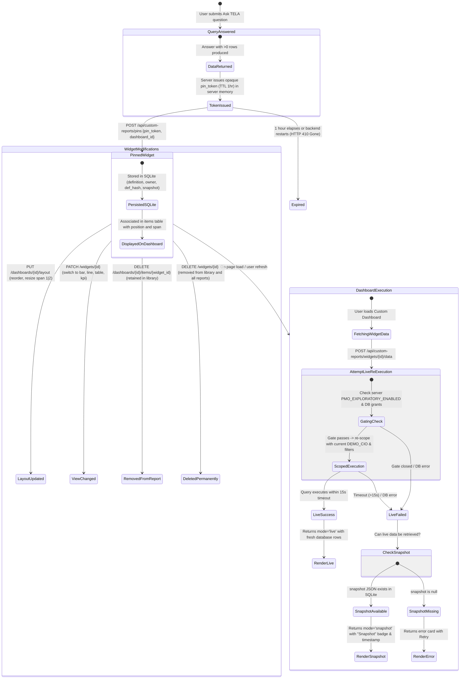

# Custom Reports Widget State Lifecycle Diagram

| Field | Value |
|---|---|
| Project | PMO Intelligence & Analytics (Prodian / TELA PMO) |
| Architecture Label | **Verified (Current Implemented State)** |
| Related documents | [Architecture](../architecture.md), [Business Rules](../business_rules.md), [Diagram Index](README.md) |

---

## Purpose
This state machine diagram models the lifecycle of a Custom Reports widget, starting from natural language query evaluation in Ask TELA, through tokenized pinning, live execution, layout mutations, and snapshot degradation.

