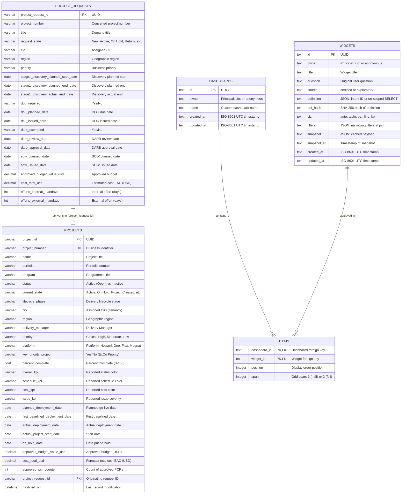

# Entity-Relationship Diagram: PMO Intelligence & Analytics

| Field | Value |
|---|---|
| Project | PMO Intelligence & Analytics (Prodian / TELA PMO) |
| Architecture Label | **Verified (Current Implemented State)** |
| Related documents | [Data Dictionary](../data_dictionary.md), [Architecture](../architecture.md), [Diagram Index](README.md) |

---

## Purpose
This diagram documents the logical data model across the MySQL enterprise database and the SQLite custom reports database.

