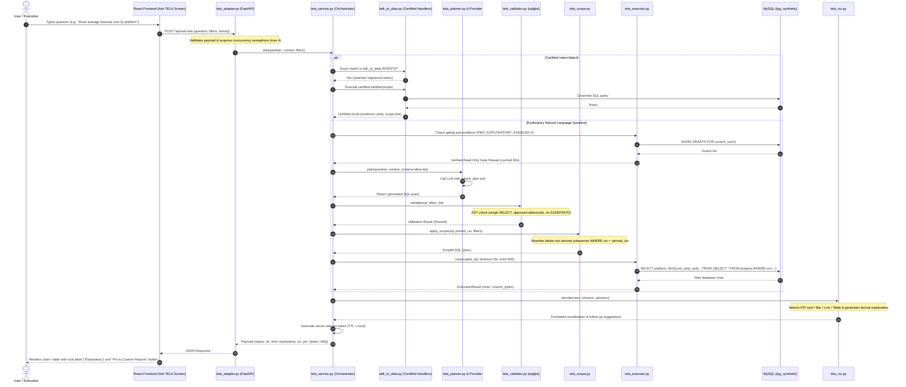

# Ask TELA Request Flow Sequence Diagram

| Field | Value |
|---|---|
| Project | PMO Intelligence & Analytics (Prodian / TELA PMO) |
| Architecture Label | **Verified (Current Implemented State)** |
| Related documents | [Architecture](../architecture.md), [Business Rules](../business_rules.md), [Diagram Index](README.md) |

---

## Purpose
This sequence diagram details the end-to-end request lifecycle when a user asks a question in the Ask TELA interface, highlighting the dual-path decision tree (Certified vs. Exploratory), security gates, AST validation, scope rewriting, and pin token issuance.

