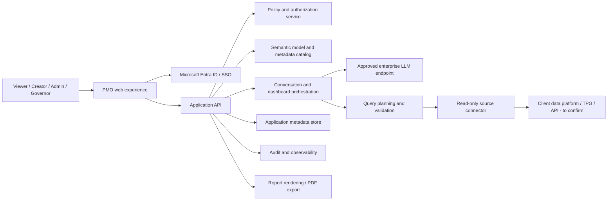
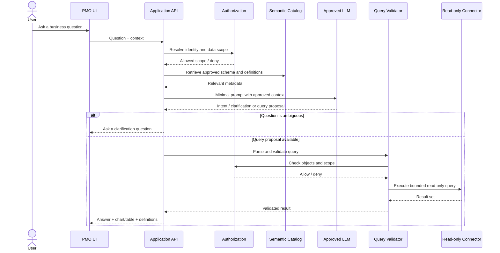
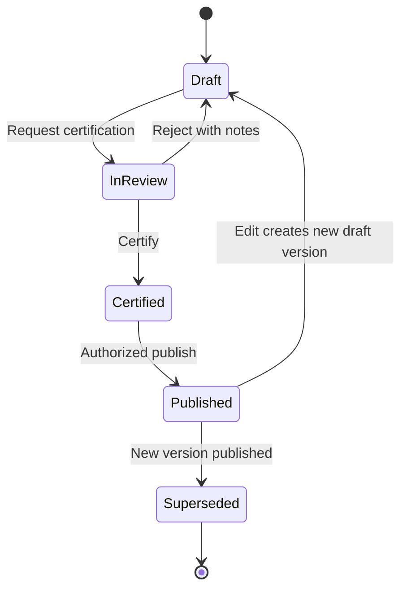

# PMO Analytics Platform — Proposed Architecture

| Field | Value |
|---|---|
| Project | PMO Analytics & Conversational Dashboard Platform |
| Document status | Draft for review |
| Version | 0.1 |
| Last updated | 2026-10-19 |
| Evidence level | L1–L2; proposed logical architecture only |
| Sources analyzed | Meeting scope; `user_journery.html`; master documentation-analysis prompt |
| Related documents | [Project summary](project_summary.md), [Options and plan](options_and_plan.md), [Requirements](requirements.md), [Risk register](risk_register.md) |

## 1. Purpose and confidence

This document describes a **proposed** target architecture for a governed PMO analytics product. The supplied HTML is a clickable journey prototype; it is not source code evidence for the backend or deployment. No repository, schema, API contract or environment configuration was supplied. Nothing here should be interpreted as verified implementation.

## 2. Architecture drivers

1. Data-level access is the top security priority.
2. Read-only access is the first analytics mode.
3. Microsoft SSO is required.
4. Talk-to-data must be grounded in approved schema and business definitions, with clarification, validation and controlled execution.
5. Dashboard/report creation requires certification and role-aware publishing.
6. Reuse of the tested Tela/Insights backend should be evaluated before rebuilding.
7. The client’s source platform and approved model provider remain unresolved.
8. Future write-back must be isolated from read-only analytics.

## 3. Proposed system context

**Status: Proposed.** Identity provider naming is based on the requested Microsoft SSO; exact identity product and integration details must be confirmed.

## 4. Component responsibilities

| Component | Responsibility | Security boundary |
|---|---|---|
| Web experience | Home, dashboards, chat, widget library, report canvas, certification and publishing screens | Never trusted to enforce data permissions by itself |
| Identity integration | SSO, session handling, identity claims and group mapping | Validate issuer, audience, expiry and relevant claims |
| Application API | User-facing business operations; central authorization entry point | Enforce permission checks on every operation |
| Authorization/policy layer | Role permissions plus row/column/data-scope decisions | Deny by default; enforce before query execution and before returning results |
| Semantic catalog | Approved tables/views, joins, definitions, measures, synonyms and certified status | Only approved metadata exposed to query generation |
| Conversation orchestrator | Intent, ambiguity detection, clarification and tool sequencing | Treat user input and model output as untrusted |
| Query planner | Generate a constrained query plan/query from approved metadata | No direct arbitrary execution of raw LLM output |
| Query validator | Parse, allow-list, validate access scope, reject unsafe statements and enforce limits | Server-side enforcement; read-only database identity |
| Connector layer | Database/API/Clarity/TPG integration, timeout, retries, cancellation and result normalization | Secrets server-side; network allow-list |
| Report/widget service | Save widget definitions, layouts, filters, report and dashboard versions | Ownership and object-level ACLs |
| Certification/publishing service | Review, approve/reject, publish versions to roles | Separate creator and certifier/publisher where required |
| Export service | Render authorized reports to PDF/Excel where approved | Re-check authorization at export time |
| Metadata store | Connections metadata (not secrets), dashboards, widgets, definitions, versions, ACLs | Tenant/project isolation, encryption and backups |
| Audit/observability | Record decisions, query metadata, publish/export/change events and failures | Avoid logging secrets or unnecessary sensitive row content |

## 5. Proposed read-only question-to-data sequence

**Mandatory invariant:** authorization is not delegated to the LLM. Query validation and the data source must independently constrain what can be read.

## 6. Query safety and accuracy controls

- Prefer approved views and a semantic catalog over exposing all source tables.
- Use an allow-list of queryable objects and permitted operations.
- Parse the generated SQL with a real SQL parser for the target dialect; reject multiple statements, DDL, DML, stored-procedure execution and unsupported functions.
- Use a read-only identity with only required SELECT permissions; consider approved views and row-level security at the source.
- Apply the caller's scope in the trusted query layer; never rely on a model-generated WHERE clause alone.
- Enforce maximum execution time, row count, bytes returned, concurrency and query-cost limits.
- Require clarification when project, period, status, region, aggregation or comparison is materially ambiguous.
- Return definitions, selected filters, time range, data freshness and an understandable explanation of the result.
- For certified dashboard KPIs, prefer governed measures and reusable queries over regenerating logic independently per prompt.
- Build an evaluation set with ground-truth questions, expected query/result, access-scope cases and regression checks.
- Provide “I can't answer safely/reliably” behavior when schema grounding or validation fails.

## 7. Data architecture

### Initial data boundary
Meeting notes describe a restricted subset of the client’s structured data, with billing, client orders, payments and planned-versus-actual spend mentioned. Exact entities, keys, relationships and definitions are not supplied. Do not assume the full system’s approximately 115 tables are in the initial implementation.

### Proposed logical model
- **Connection**: source type, endpoint reference, credential reference, owner, status, allowed objects.
- **Data model version**: approved tables/views, columns, joins, synonyms, measures, sensitivity and certification status.
- **Widget**: query/measure reference, visualization type, title, filters, owner, version and access policy.
- **Report**: ordered widget layout, filters, sections, tabs/grouping, owner and version.
- **Dashboard**: one or more reports or dashboard pages, audience and publication version.
- **Certification record**: reviewer, decision, notes, artifact version and timestamp.
- **Audit event**: actor, action, object, policy outcome, correlation ID and timestamp.
- **User/group mapping**: identity reference, application role and permitted data scope.

These are proposed application metadata entities, not claims about the client's source schema.

## 8. Data-level authorization model

Use two layers:

1. **Feature/object permissions:** who may connect sources, create/edit widgets, create reports, certify, publish, export, share, or manage starter content.
2. **Data permissions:** which rows, columns, measures and source objects the person may access.

Recommended evaluation sequence:
1. Validate Microsoft identity/session.
2. Resolve application role and group claims.
3. Resolve data scope from a trusted policy mapping.
4. Filter available semantic objects.
5. Generate and validate query within that scope.
6. Enforce row/column access at the source or trusted query layer.
7. Re-check access before export, drill-down and sharing.
8. Audit allow/deny decisions and relevant query metadata.

A CIO/project manager example in the meeting notes implies distinct scopes. Exact mapping rules and source-of-truth attributes are unresolved. UI filtering alone is insufficient.

## 9. Authentication, secrets and model policy

- Use enterprise Microsoft SSO; confirm tenant, app registration, group claims and conditional-access expectations.
- Store source credentials in an approved secret manager; never in frontend code or prompts.
- Confirm with Vijay whether Azure AI Foundry / Microsoft Foundry, Claude, Copilot or other models are approved for schema and client-data processing.
- Confirm data residency, retention, model training usage, logging, contractual terms and whether prompts/results may contain confidential or personal data.
- Minimize data sent to the LLM. Prefer schema/definitions and aggregated results; send row-level text only when necessary and authorized.
- Use TLS, encryption at rest, managed identities where supported, network restrictions, key rotation and separate environment credentials.
- Keep synthetic sandbox data synthetic. Do not replicate production rows into a sandbox without explicit approval.

## 10. Report lifecycle and governance

Proposed lifecycle:

Confirm whether certification is required for every widget, report, dashboard, measure and data-model change. Published artifacts should be immutable versions; edits should create a new draft/version. Re-publishing should preserve prior version and audit history.

## 11. Write-back architecture (future capability; separate from read-only path)

Do not implement write-back by allowing the talk-to-data component to emit arbitrary DML. Proposed flow:

1. User describes the intended change.
2. System maps it to a typed business command, not free-form SQL.
3. Show exact target record, current values, proposed values, impact and validation results.
4. Require explicit approval from a user authorized for that operation; apply separation of duties for high-impact changes.
5. Re-check authorization and current record version at execution time.
6. Execute through a dedicated command service with parameterized statements/stored procedures and transaction boundaries.
7. Use idempotency keys and optimistic concurrency to prevent duplicate/stale changes.
8. Write immutable audit events for request, approval, execution and result.
9. Read back the record and show the verified outcome.
10. Support failure recovery/compensation where business rules allow.

Delete should be disabled unless the business owner explicitly approves soft-delete/retention and recovery behavior. The five-field project-request example and updates to project manager/timeline/budget/risk are examples from the meeting notes, not finalized commands.

## 12. Performance, reliability and operations

No numeric SLA, concurrency target or latency target was supplied. Establish targets from user testing and source-platform limits before sizing infrastructure.

Recommended controls:
- Query timeout and cancellation; result pagination/limits.
- Cache only where freshness and user-scope semantics are explicit; include scope in cache keys.
- Reuse approved materialized views/summary tables when available; do not introduce ClickHouse or temporary analysis tables without workload evidence and architecture approval.
- Connection pooling, bounded concurrency and source-side workload protection.
- Correlation IDs across UI, API, LLM, validator and connector.
- Metrics: clarification rate, query validation rejection, execution latency, result rows, error rate, answer evaluation pass rate, cost per request, export/publish events and denied access attempts.
- Alert on repeated policy denials, abnormal query volume, connector failures and latency/error thresholds.
- Define backups, restore testing, release rollback, incident ownership and environment segregation.

## 13. Proposed environments

- **Local/dev:** synthetic fixtures and mock connector.
- **Shared sandbox on Azure:** synthetic schema/data, restricted test identities, CI deployment and integration tests.
- **Client integration/UAT:** approved connection and test accounts after permissions are granted; masked or approved data only.
- **Production:** separately approved identities/secrets, network path, monitoring, audit retention, backup and release/rollback process.

Azure is mentioned as the desired sandbox platform; exact services, topology, network and deployment model are not specified.

## 14. Architecture decisions to record

| ID | Decision | Recommendation | Alternatives / trade-off |
|---|---|---|---|
| ADR-001 | Build vs reuse | Evaluate Tela/Insights reuse first; compare with PMO hardening and BI products | Rebuild gives control but increases scope and validation burden |
| ADR-002 | Query execution | Server-side validated read-only query path | Direct LLM-to-database is unsafe and hard to govern |
| ADR-003 | Data authorization | Enforce in trusted backend and source where possible | UI-only filtering is not an acceptable security boundary |
| ADR-004 | Semantic definitions | Governed catalog and certified measures | Free-form query generation is flexible but risks inconsistent KPIs |
| ADR-005 | Write-back | Separate typed command/approval service | Shared read/write SQL engine materially expands blast radius |
| ADR-006 | LLM provider | Select only after policy review with Vijay | Provider convenience must not override client data policy |
| ADR-007 | Visualization library | Prioritize needed chart types; validate library/licensing before promising broad catalog | “100 chart types” adds testing and accessibility cost |

## 15. Key architecture gaps

See [risk register](risk_register.md). Highest priority: confirm data source and approved connector, enforce row-level access, obtain code/schema evidence, resolve model-provider policy, and validate query accuracy with ground truth.

## 16. Evidence needed to raise confidence

- PMO and Tela/Insights source repositories, branch/commit and license/ownership details.
- Existing tests, ground-truth corpus and query evaluation reports.
- Actual database schema/DDL, relationships, views, summary tables and sample synthetic data.
- Source platform/API/Clarity documentation and read-only access method.
- Microsoft identity architecture and role/group mapping.
- Client data classification and approved LLM/model policy.
- Deployment, networking, CI/CD, secret-store and monitoring configuration.
- Acceptance criteria and target performance measurements.

## 17. Glossary

- **Semantic model/catalog:** Approved business meaning for tables, fields, joins, measures and synonyms.
- **Talk-to-data:** Natural-language questions translated into governed data queries and visual answers.
- **Ground truth:** Curated questions with expected interpretations/results used to evaluate accuracy.
- **Row-level security:** Rules that restrict which records a user can access.
- **Certification:** Review that an artifact's definitions, behavior and permissions are suitable for trusted reuse.
- **MCP:** Model Context Protocol; a possible integration approach mentioned in the notes, not a decided connector architecture.
- **Write-back:** Changing source-system data, distinct from read-only analytics.
