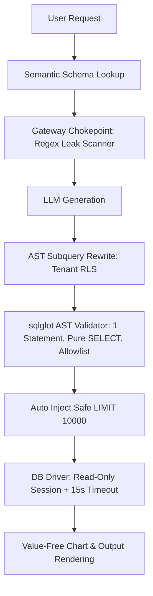
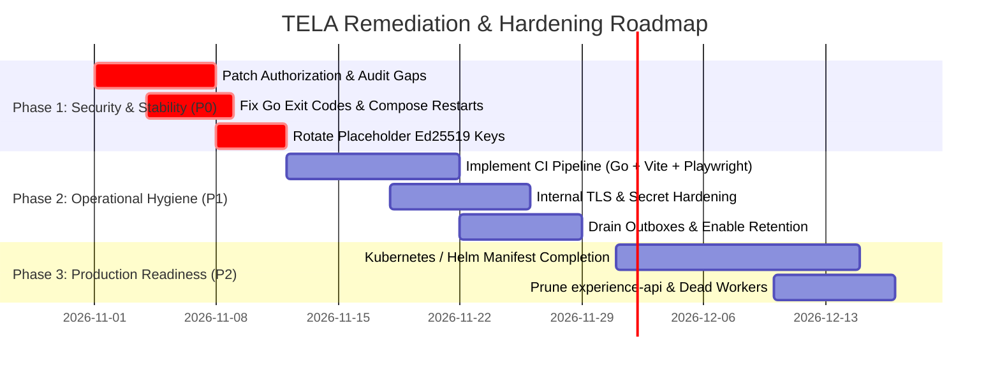

# TELA (TelaKnowledge) — Comprehensive Project Analysis & Evaluation Report

_Audit Date: October 2026 · Branch: `tela/sathish` · Environment: macOS / Linux Containerized Runtime_

---

## 1. Executive Overview

**TELA (TelaKnowledge)** is an enterprise-grade, multi-tenant platform designed for **autonomous application knowledge discovery, plain-language support assistance, and evidence-grounded incident triage**. 

The platform operates under a strict, non-negotiable security tenet: **Customer systems are accessed solely through governed, read-only, proof-verified channels** (source code repositories, databases, logs, server vitals, and APIs).

```
                                  ┌────────────────────────┐
                                  │   5 React Portals      │
                                  │ Admin·Assist·Triage·   │
                                  │ Knowledge·Demo (Vite)  │
                                  └───────────┬────────────┘
                                              │ JWT / PKCE
                                  ┌───────────▼────────────┐
                                  │   Identity Edges (×3)  │
                                  │ Strips & verifies auth │
                                  └───────────┬────────────┘
                                              │ X-TELA-* Headers
                   ┌──────────────────────────┴──────────────────────────┐
                   │                                                     │
        ┌──────────▼──────────┐                               ┌──────────▼──────────┐
        │  agent-orchestrator │                               │    knowledge-api    │
        │ 17-agent Triage RAG │                               │ Hybrid RAG (pgvec)  │
        └──────────┬──────────┘                               └──────────┬──────────┘
                   │                                                     │
   ┌───────────────┼─────────────────────────┬───────────────────────────┤
   │               │                         │                           │
┌──▼────────────┐ ┌▼──────────────────────┐ ┌▼────────────────────────┐ ┌▼────────────────────────┐
│ model-gateway │ │ integration-gateway   │ │ code-intelligence-api  │ │ audit / access / estate │
│ Vault + LLMs  │ │ Signed Ed25519 Tasks  │ │ AST & Symbol Extractors │ │ Tenant Governance & RLS │
└───────────────┘ └──────────┬────────────┘ └─────────────────────────┘ └─────────────────────────┘
                             │
                ┌────────────▼────────────┐
                │ Managed Runner / Worker │
                │  (Read-only Sandboxed)  │
                └────────────┬────────────┘
                             │ Read-Only (SQL AST / HTTPS / Git / SSH)
                ┌────────────▼────────────┐
                │ Target Customer Systems │
                └─────────────────────────┘
```

---

## 2. Core Business Domains & Portals

The application is decomposed into five specialized React 18 SPAs powered by TypeScript, Vite, TanStack Query, and a shared `@tela/ui-foundation` design system:

| Portal | Core Functionality | Primary Tech / Sizing | Key Guardrails |
|---|---|---|---|
| **Assist Portal** | Plain-language Q&A, inventory lookups, workflow walk-throughs (Mermaid diagrams), incident identification, attachment OCR, and hand-off to Triage. | 12 source files, ~3,043 LOC main controller, ~60 unit tests | Traceable sources, visible evidence gaps, production actions permanently blocked. |
| **Triage Portal** | 17-agent automated incident investigation, evidence aggregation, timeline reconstruction, causal agreement engine, and PDF root cause analysis (RCA). | 23 source files, ~129 unit tests | Root causes confirmed only if code, logs, and database agree. Recovery commands restricted to ≤40-line audited scripts. |
| **Knowledge Portal** | Application 360 graph exploration, screen directory & catalogue, impact analysis across codebases, and pgvector hybrid retrieval. | 36 source files, ~165 unit tests | Curator maker-checker review gate. Unreviewed versions are never indexed for production retrieval. |
| **Admin Portal** | Tenant management, system topology discovery, credential custody (client-side AES-GCM + RSA-OAEP), and approval policies. | 52 source files, ~417 unit tests, 4 Playwright specs | Strict maker-checker enforcement. Self-approval blocked unless explicitly mandated by administrative policy. |
| **Demo Portal** | Interactive, synthetic end-to-end user journeys (UAE Cards, India Insurance, Rwanda Banking) with signed cryptographic receipts. | 4 source files, 13 unit tests | Strictly synthetic test data with automated audit assertions. |

---

## 3. Architecture & Service Decomposition

The system runs on **24 Go microservices** adhering strictly to **Hexagonal Architecture** (`cmd/`, `domain/`, `application/`, `ports/`, `adapters/`, `httpapi/`):

### 3.1 Primary Services

1. **`agent-orchestrator` (25.3k LOC, 118 test files):**
   - Coordinates context bundles, Assist execution plans, and a 17-agent Triage state graph with durable leases.
   - Enforces the **Causal Agreement Rule**: An incident root cause is only promoted to "Established" when logged errors, source code pointers, and database records demonstrably corroborate each other.
2. **`knowledge-api` (28.7k LOC, 100 test files):**
   - Manages source document ingestion, pgvector HNSW chunk indexing (1024-dim, `mxbai-embed-large`), graph editions, and the multi-agent **Impact Analysis Team** (Topology → Specialists → Synthesis).
3. **`integration-gateway` (12.9k LOC, 71 test files):**
   - Central control plane for connection profiles, purpose-bound execution grants (`ingestion`, `live_triage`, `self_heal`, `server_vitals`), and task dispatch.
   - Issues Ed25519-signed task envelopes with tight resource caps (e.g., 30s timeout, 5,000 rows, 1 MiB limit).
4. **`model-gateway` (10.6k LOC, 60 test files):**
   - Unified abstraction layer for LLMs (Ollama, Anthropic Claude, OpenAI, Azure OpenAI, Google Gemini, AWS Bedrock).
   - Manages pre-send regex leak filters and validates the **70% evidence citation coverage requirement**.
5. **`triage-api` & `assist-api` (23.4k LOC combined, 95 test files):**
   - Backends for conversational assistance and incident lifecycle management with integrated OPA policy checks.

### 3.2 Infrastructure & Data Topology

* **Databases:** PostgreSQL 16 with `pgvector 0.8.0` (HNSW indexing) and relational Row-Level Security (RLS) on sensitive schemas.
* **Storage & Caching:** MinIO for raw evidence artifacts; Redis 7.4 for ephemeral state and rate limiting.
* **Security & Auth:** Keycloak 26.0.7 (OAuth2/OIDC with PKCE), Open Policy Agent (OPA 0.68.0), and external HashiCorp Vault.
* **Orchestration:** Single Docker Compose graph comprising **105 service definitions** (44 daemon services, 22 database migration jobs, 17 role bootstrappers, 17 schema grant operators, 5 health check gates).

---

## 4. Multi-Layer Guardrails System

TELA enforces a comprehensive **fail-closed defense-in-depth model** where the LLM is treated as an untrusted reasoning engine:



1. **Pre-Egress Leak Protection:** Regex scanners intercept API keys, connection strings, and PII before model dispatch (`RULE-005`, `REQ-006`).
2. **Zero Raw Row Egress:** Only schema definitions and verified few-shot SQL examples enter model context (`REQ-007`).
3. **SQL AST AST Validation:** LLM-generated SQL must be a single `SELECT` statement with zero destructive or transactional keywords (`RULE-001`). All tables/columns must match an approved schema whitelist (`RULE-002`).
4. **Subquery Predicate Rewriting:** User tenant constraints are injected directly into SQL table references via AST subqueries (`RULE-004`).
5. **Driver Read-Only Session Backstop:** Database connection pools execute `SET SESSION TRANSACTION READ ONLY` with strict 15-second timeouts (`REQ-014`).

---

## 5. Quality & Maturity Scorecard

> **Overall Code Completeness Score: 61 / 100**

| Evaluation Dimension | Rating | Key Strengths & Critical Findings |
|---|:---:|---|
| **Architecture & Separation** | **88 / 100** | Strict hexagonal domain isolation, clear boundaries between portals, gateway, and runners. High code modularity. |
| **Governance & Security Design** | **85 / 100** | Exceptional read-only enforcement, AST verification, signed task tokens, and container hardening (`read_only: true`, `no-new-privileges`). |
| **Automated Test Coverage** | **78 / 100** | ~3,081 Go unit tests across 809 test files, ~784 frontend unit tests, and 11 end-to-end Playwright specs. Zero `TODO`/`FIXME` markers. |
| **Operational Resilience** | **35 / 100** | **Critical Gap:** Only 2 of 44 daemon services specify Docker restart policies; 33 services lack HTTP health checks. Fatal errors in Go exit with code 0. |
| **Transport & Identity Hardening** | **42 / 100** | Internal communication defaults to unencrypted (`sslmode=disable`, Redis without auth, Keycloak in dev mode). Five authorization check defects in internal APIs. |
| **Asynchronous Loop Completion** | **45 / 100** | Outbox tables in 6 services are written to transactionally but never published/drained. Dead-letter queue replays are no-ops. |

---

## 6. Identified Vulnerabilities & Technical Debt

### 6.1 Priority 0 (Security & Stability Hazards)
1. **Unchecked Internal API Endpoints:** `access-api` grant/principal mutation endpoints lack capability verification checks.
2. **Audit Bypass:** `audit-api` query handlers omit checking the `admin.audit.read` permission.
3. **Silent Fatal Exits:** Fatal initialization errors in Go microservices (e.g. in `knowledge-api/cmd/server/main.go`) execute `return` instead of `os.Exit(1)`, causing failing containers to terminate with exit code 0.
4. **Triage Status Loophole:** Direct execution of `status` or `progress` commands can close a case while bypassing formal reporter confirmation rules.
5. **Placeholder Runner Key:** Integration gateway registers managed runners with an all-zero Ed25519 placeholder key if unconfigured.

### 6.2 Priority 1 (Operational & Data Hygiene)
1. **Unbounded Outbox Growth:** Six services write transactional outbox rows without an active publisher process, leading to long-term database bloat.
2. **Missing Automated CI/CD:** No GitHub Actions or CI pipeline configurations exist; Dockerfiles do not run automated tests during image builds.
3. **Broad Port Exposure:** All microservice ports in Docker Compose bind to `0.0.0.0` rather than internal loopback/bridge interfaces.
4. **Dormant Code:** An 83,000-line legacy monolith (`experience-api`) remains in the repository without deployment targets.

---

## 7. Recommended Action Plan & Next Steps



1. **Immediate Security Patches:** Implement capability assertions on all `access-api` and `audit-api` endpoints; enforce strict closure rules on Triage case commands.
2. **Process Resilience:** Change Go fatal startup paths to exit non-zero and add `restart: unless-stopped` with standard HTTP `/healthz` endpoints to all Compose services.
3. **Establish CI Automation:** Build a root GitHub Actions workflow validating `go test ./...`, `pnpm test`, and OpenAPI contract synchronization on every pull request.
4. **Transport Security:** Enforce PostgreSQL TLS (`sslmode=require`), set Redis authentication passwords, and switch Keycloak to production mode.
