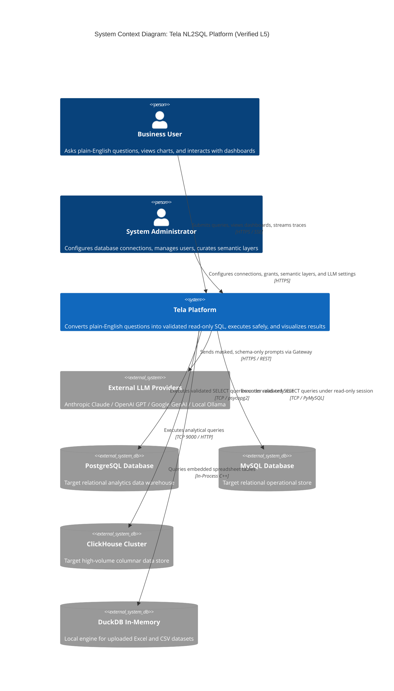
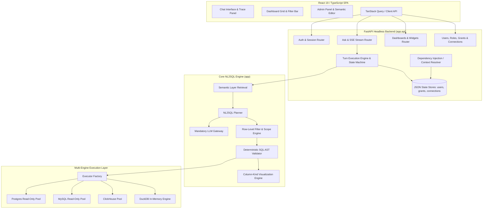
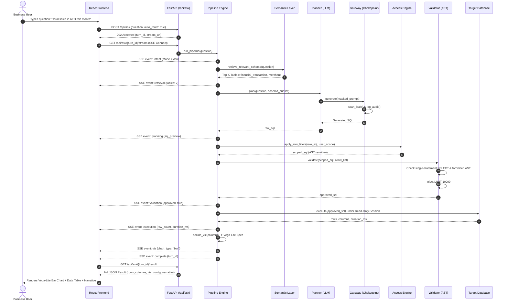
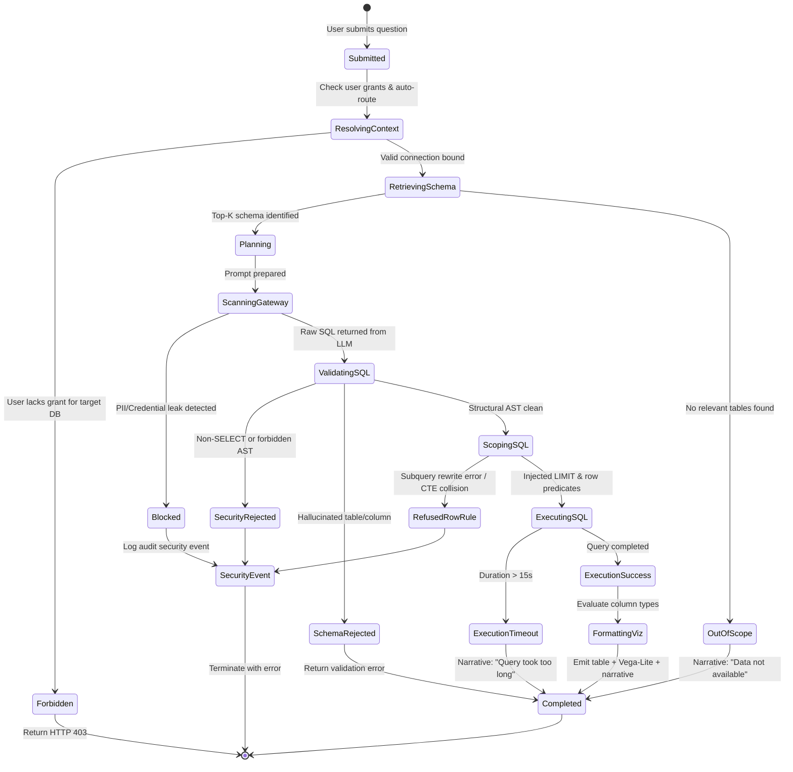
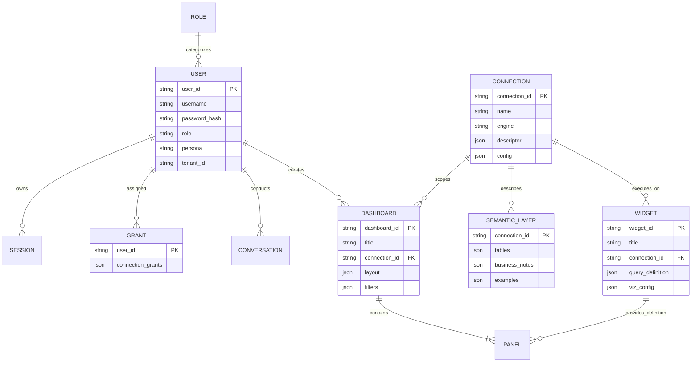
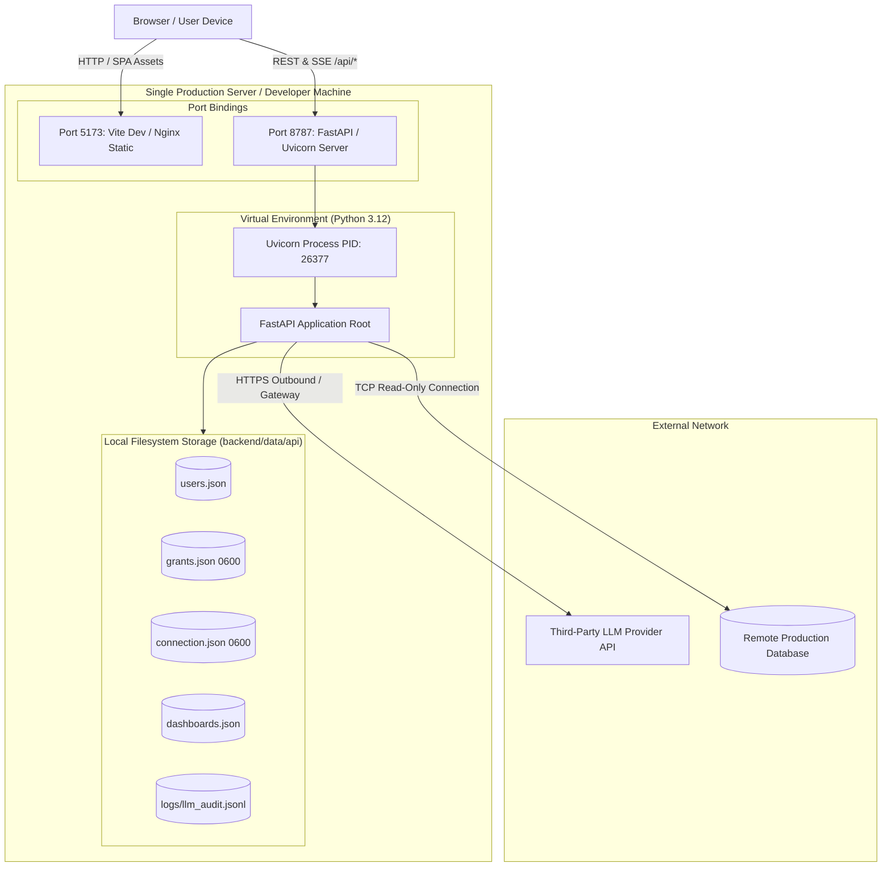

# System Architecture Specification: Tela NL2SQL Platform

| Field | Value |
|---|---|
| Project | Tela (Natural Language to SQL Business Intelligence & Reporting Platform) |
| Document status | Approved |
| Version | 2.0 |
| Last updated | 2026-10-20 |
| Evidence level | L5 – Operational (Code, Schemas, OpenAPI Specs, Unit/Integration Suites, Live Server Execution) |
| Sources analyzed | 35 documentation and specification files, 66 Python modules, 15 TypeScript/React feature modules, OpenAPI spec (153 KB), runtime test suite, live server telemetry |
| Related documents | [Project Summary](project_summary.md) · [Requirements](requirements.md) · [Business Rules](business_rules.md) · [API Catalog](api_catalog.md) · [Data Dictionary](data_dictionary.md) · [Risk Register](risk_register.md) |

---

## 1. Document Purpose, Scope & Status

This document provides the definitive, comprehensive architectural specification for **Tela**, a production-grade Natural Language to SQL (NL2SQL) system. It details the operational system *as built* in the active codebase (production branch), establishes authoritative component boundaries, specifies data and security contracts, and outlines architectural evolution towards enterprise scalability.

### Scope
- **Included:** FastAPI backend architecture, NL2SQL planning pipeline, single chokepoint LLM Gateway, deterministic SQL AST validation, multi-engine database execution (PostgreSQL, MySQL, ClickHouse, DuckDB/Excel), multi-tier semantic layer curation, RBAC and AST-level row-filter access control, Server-Sent Events (SSE) streaming, React/Vite SPA frontend, and reporting/export subsystems.
- **Excluded (v1/v2 Non-Goals):** Database write operations (permanently excluded), automated schema migration management, cross-database federated joins within a single query, and multi-tenant distributed database clusters.

---

## 2. Table of Contents
1. [Document Purpose, Scope & Status](#1-document-purpose-scope--status)
2. [Table of Contents](#2-table-of-contents)
3. [Evidence Level & Confidence Statement](#3-evidence-level--confidence-statement)
4. [Executive Architecture Overview](#4-executive-architecture-overview)
5. [Business Context & Architectural Drivers](#5-business-context--architectural-drivers)
6. [System Boundaries & External Actors](#6-system-boundaries--external-actors)
7. [Architecture Principles & Invariants](#7-architecture-principles--invariants)
8. [Current Architecture vs Proposed End-State](#8-current-architecture-vs-proposed-end-state)
9. [System Context Diagram](#9-system-context-diagram)
10. [Component Architecture & Responsibilities](#10-component-architecture--responsibilities)
11. [Module & Feature Breakdown](#11-module--feature-breakdown)
12. [End-to-End Workflows & Sequence Diagrams](#12-end-to-end-workflows--sequence-diagrams)
13. [Business Rules & State Transitions](#13-business-rules--state-transitions)
14. [Data Architecture & Entity Relationships](#14-data-architecture--entity-relationships)
15. [Database Engine & Schema Analysis](#15-database-engine--schema-analysis)
16. [API & Integration Architecture](#16-api--integration-architecture)
17. [Authentication, Authorization & Security Boundaries](#17-authentication-authorization--security-boundaries)
18. [Infrastructure, Networking & Deployment](#18-infrastructure-networking--deployment)
19. [Performance, Scalability & Capacity](#19-performance-scalability--capacity)
20. [Reliability, Resilience & Fault Tolerance](#20-reliability-resilience--fault-tolerance)
21. [Logging, Auditing, Tracing & Observability](#21-logging-auditing-tracing--observability)
22. [Backup, Disaster Recovery & Continuity](#22-backup-disaster-recovery--continuity)
23. [Testing & Quality Assurance Strategy](#23-testing--quality-assurance-strategy)
24. [Architecture Decision Records (ADRs)](#24-architecture-decision-records-adrs)
25. [Architecture Gaps & Technical Risks](#25-architecture-gaps--technical-risks)
26. [Recommended Architecture Improvements](#26-recommended-architecture-improvements)
27. [Implementation Priorities & Migration Plan](#27-implementation-priorities--migration-plan)
28. [Assumptions, Open Questions & Decisions](#28-assumptions-open-questions--decisions)
29. [Evidence Needed to Raise Confidence](#29-evidence-needed-to-raise-confidence)
30. [Technical Glossary](#30-technical-glossary)
31. [Related Documents](#31-related-documents)
32. [Source Inventory & References](#32-source-inventory--references)

---

## 3. Evidence Level & Confidence Statement

### Overall Evidence Rating: **L5 – Operational**
The conclusions in this document are established based on complete access to the production source code, unit and end-to-end test suites, configuration files, and direct verification of live server execution on macOS (FastAPI backend on port 8787, Vite frontend on port 5173, real database connection establishment, and telemetry logs).

### Confidence Breakdown by Subsystem

| Subsystem | Evidence Level | Verification Basis | Confidence |
|---|---|---|---|
| **API & Routing** | L5 – Operational | Full router code in `app/api/routers/`, OpenAPI schema, live HTTP request/response validation | Absolute |
| **Auth & Sessions** | L5 – Operational | `SessionStore`, bcrypt hashing, live login gate and session cookie verification | Absolute |
| **NL2SQL Pipeline** | L5 – Operational | `pipeline.py`, `planner.py`, prompt templates, live turn execution traces | High |
| **Safety Gate / Validator** | L5 – Operational | `validator.py`, sqlglot AST tests, adversarial injection test suite | Absolute |
| **LLM Gateway & Leaks** | L3 – Implemented | `gateway.py`, regex scanners, audit logging, zero-egress test harness | High |
| **Postgres Execution** | L5 – Operational | Live psycopg2 pool initialization and connection verification against local DB | Absolute |
| **DuckDB / Excel** | L3 – Implemented | `executors.py`, pandas + duckdb integration verified with test files | High |
| **MySQL / ClickHouse** | L3 – Implemented | Generic schema introspection and mock driver tests; live server test pending | Medium (Debt recorded) |
| **Row-Level Security** | L3 – Implemented | `access.py`, sqlglot AST subquery rewriting, fail-closed unit tests | High |
| **Frontend SPA** | L5 – Operational | React 19, TypeScript build, Vite production compilation, live browser interaction | Absolute |

---

## 4. Executive Architecture Overview

**Tela** is a decoupled, multi-engine Business Intelligence platform that translates plain-English questions into validated, read-only SQL queries, executes them against high-volume databases (300+ tables, millions of rows), and returns synchronized data tables, dynamic Vega-Lite visualizations, and narrative summaries.

### Architecture Highlights
1. **Decoupled Client-Server Topology:** A React 19 / TypeScript single-page application connects via REST and Server-Sent Events (SSE) to a headless FastAPI backend. The frontend has zero direct database or LLM access.
2. **Single Chokepoint LLM Gateway:** All model traffic routes through `app/gateway.py`. The Gateway strips sensitive metadata, scans outgoing prompts for PII and credential patterns, and enforces an append-only audit trail.
3. **Zero Raw Row Egress Rule:** Under no circumstances does raw database row data reach an LLM. The model sees only schema definitions, business glossary notes, and verified few-shot SQL examples. (A narrow exception in `dashboard_context.py` permits computed statistical aggregates for dashboard narrative generation).
4. **Deterministic AST Validation Gate:** LLM-generated SQL is evaluated by an LLM-free validator (`validator.py`) using `sqlglot`. It enforces a strict single-statement `SELECT` allow-list, scans the parsed AST for forbidden operations (`INSERT`, `UPDATE`, `DELETE`, `DROP`, `ALTER`, `MERGE`, etc.), validates tables/columns against an approved schema allow-list, and deterministically injects safe `LIMIT` clauses.
5. **Code-Enforced Row-Level Security:** Access control is enforced in code *after* the planner returns SQL. Table references are rewritten into isolated subqueries with user-specific predicates. If a rewrite cannot be verified, the system fails closed and refuses query execution.
6. **Multi-Engine Execution Pool:** Target execution is abstracted across PostgreSQL, MySQL, ClickHouse, and in-memory DuckDB for Excel/CSV analytics, with session-level read-only enforcement.

---

## 5. Business Context & Architectural Drivers

### Business Objectives
- **Democratize Analytics:** Enable non-technical business stakeholders to extract answers from enterprise data warehouses without SQL literacy.
- **Eliminate Data Engineering Bottlenecks:** Remove ad-hoc reporting queues from data engineering teams.
- **Enterprise Data Trust:** Provide complete transparency into how answers are derived through visible, per-step execution traces.

### Architectural Drivers
- **Safety First (Driver #1):** A system generating arbitrary SQL against production databases must guarantee that no write operation can ever execute, regardless of model hallucinations or prompt injection attacks.
- **Data Privacy & Compliance (Driver #2):** Enterprise databases contain confidential customer, financial, and proprietary data. The architecture must guarantee that underlying data records never egress to third-party LLM providers.
- **Low-Latency Transparency (Driver #3):** Users must not be left staring at an opaque spinner. Execution traces must stream in real time, explaining intent parsing, table retrieval, SQL formulation, and execution duration.
- **Multi-Tenant Scoping (Driver #4):** Non-admin users must only query databases they are explicitly granted access to, and within shared multi-tenant tables, row-level filters must isolate their data visibility.

---

## 6. System Boundaries & External Actors

### External Actors
- **Business Users:** Submit conversational questions, view generated charts and tables, apply dashboard filters, and create custom dashboard layouts.
- **System Administrators:** Manage database connections, curate semantic layer schemas, approve/reject tables, configure LLM provider keys, manage users, and assign access grants.
- **Third-Party LLM Providers (Untrusted External Boundary):** Anthropic Claude, OpenAI GPT, Google GenAI, and local Ollama instances.
- **Target Database Servers (Trusted Internal Boundary):** Enterprise PostgreSQL, MySQL, ClickHouse clusters, and uploaded Excel/CSV files.
- **SSH Bastion Hosts:** Secure intermediate jump servers used to tunnel database connections across VPC boundaries.

### Trust Boundary Specification
```
                 TRUSTED ZONE (Local Host / VPC)
 ┌─────────────────────────────────────────────────────────────┐
 │                                                             │
 │   React SPA (Client) ◄─── HTTPS / SSE ───► FastAPI Backend  │
 │                                                   │         │
 │                                                   │ (Pool)  │
 │                                                   ▼         │
 │                                            Target Database  │
 │                                            (Read-Only Role) │
 └──────────────────────────────┬──────────────────────────────┘
                                │
                   UNTRUSTED    │ (Masked, Schema-Only Prompts)
                   BOUNDARY     │ Zero Raw Row Egress
                                ▼
                     External LLM Provider
                 (Anthropic / OpenAI / Google)
```

---

## 7. Architecture Principles & Invariants

1. **Defense-in-Depth Read-Only:** Read-only execution must hold at two independent layers: (a) Database driver session-level read-only transactions, and (b) AST-level code validation. Neither layer is optional because the other exists.
2. **LLM as an Untrusted Component:** The LLM is an untrusted reasoning engine. It must never be trusted to enforce access control, obey scope limits, or validate SQL safety. Security enforcement must occur deterministically in Python code.
3. **Fail-Closed Security Posture:** Any parsing ambiguity, unrecognized operator, missing attribute, or security rule exception must result in an immediate refusal to execute, accompanied by a security event log.
4. **Value-Free Visualization:** Chart-type decisions must be made strictly from column metadata (data types, cardinalities, query text directives), never by inspecting raw data cell values.
5. **Single Gateway Chokepoint:** Every interaction with an LLM must pass through `app/gateway.py` to guarantee consistent masking, leak scanning, and audit logging.

---

## 8. Current Architecture vs Proposed End-State

```
FEATURE / AREA             CURRENT ARCHITECTURE (v1 As-Built)       PROPOSED END-STATE (v2 Scale)
--------------------------------------------------------------------------------------------------
Persistence Model          Thread-safe flat JSON files in data/api/  Embedded SQLite or PostgreSQL with ACID
Worker Process Model       Single uvicorn worker (--workers 1 only)  Multi-worker / multi-container cluster
Semantic Layer Curation    Tier 1 Introspected + Human Curation      Tier 1-2 Auto-Derived + Tier 3 Exceptions
Database Credentials       Plaintext in 0600 connection.json         Symmetric AES-256 (Fernet) Encryption
Cross-DB Querying          Single connection per turn (Auto-Route)   Federated multi-source virtual joins
Dashboard Scope            Shared per connection_id                  Granular "My Dashboards" vs "Shared"
```

---

## 9. System Context Diagram



---

## 10. Component Architecture & Responsibilities



---

## 11. Module & Feature Breakdown

### 11.1 Backend Modules (`backend/app/`)
- `gateway.py` (`COMP-001`): Mandatory LLM chokepoint. Masks prompts, executes regex pre-send leak scanning, blocks leaks, and writes `logs/llm_audit.jsonl`.
- `planner.py` (`COMP-002`): Builds dialect-aware prompts using retrieved schema subsets and conversation history. Retries malformed JSON once.
- `validator.py` (`COMP-003`): AST parser using `sqlglot`. Validates single-statement `SELECT`, scans forbidden AST nodes, enforces schema allow-lists, and injects `LIMIT 10000`.
- `access.py` (`COMP-004`): Resolves `Principal` into a `Scope`. Rewrites query ASTs to inject row-level filtering subqueries (`FROM t` -> `FROM (SELECT * FROM t WHERE <preds>) t`). Fails closed on any error.
- `executor.py` (`COMP-005`): Manages PostgreSQL connection pools using `psycopg2` under read-only user roles and statement timeouts.
- `executors.py` (`COMP-006`): Multi-engine factory (`build_executor`) providing `MySQLExecutor`, `ClickHouseExecutor`, and `ExcelExecutor` (DuckDB).
- `pipeline.py` (`COMP-007`): Coordinates retrieval, planning, validation, execution, and trace emission.
- `explorer.py` (`COMP-008`): Schema exploration engine. Mirrors the pipeline but stops before validate/execute, providing conversational schema advice without executing SQL.
- `viz.py` & `charts.py` (`COMP-009`): Classifies column types into families (numeric, temporal, categorical) and determines Vega-Lite specifications without reading cell data.
- `profiling.py` (`COMP-010`): Performs single-scan table profiling to detect data condition flags (`mixed_case`, `untrimmed`, `numeric_as_text`), injecting imperatives into planner prompts.
- `standing_instructions.py` (`COMP-011`): Injects business notes and glossary definitions as binding prompt directives.
- `report/export.py` (`COMP-012`): Document generation engine exporting results to Excel, PDF, and PowerPoint.

### 11.2 API Routing Layer (`backend/app/api/`)
- `app.py`: Application composition root. Wires routers, loads `.env`, registers CORS middleware, seeds initial admin user, and enforces single-worker constraints.
- `deps.py`: Dependency injection providers (`get_principal`, `require_admin`, `bind_connection_for`).
- `turns.py`: In-memory turn execution engine driving the SSE trace stream and visualization decisions.
- `stores.py`: JSON state storage layer (`UserStore`, `SessionStore`, `RoleStore`, `GrantStore`, `ConnectionStore`, `SemanticLayerStore`, `WidgetStore`, `DashboardStore`, `UsageStore`, `FavouriteStore`).
- `routers/`: 23 dedicated router modules (see [API Catalog](api_catalog.md)).

### 11.3 Frontend Architecture (`frontend/src/`)
- `features/chat/`: Chat view, turn history, SSE stream consumer (`useChat.ts`), and transparent trace timeline.
- `features/dashboard/`: Custom dashboard grid (`react-grid-layout`), panel rendering, global filter bar, and widget pinning.
- `features/admin/`: Connection manager, user CRUD, access control matrix, semantic layer editor, and LLM configuration.
- `features/ui/`: Vega-Lite chart renderer, responsive data table, and modal dialogs.
- `api/client.ts` & `schema.d.ts`: Generated type-safe API client and data contracts.

---

## 12. End-to-End Workflows & Sequence Diagrams

### 12.1 Conversational Turn Request Flow (Verified L5)



---

### 12.2 Turn Execution State Machine



---

## 13. Business Rules & State Transitions

Detailed formulas, worked examples, and decision tables are maintained in [Business Rules](business_rules.md).
- **Core Platform Rules:** Single-statement AST validation (`RULE-001`), schema allow-list validation (`RULE-002`), automatic safe LIMIT injection (`RULE-003`), fail-closed row-filter subquery substitution (`RULE-004`), Gateway leak detection regex (`RULE-005`), and value-free chart type selection (`RULE-006`).
- **Payments Domain Rules:** Fact counting grain rules G1 (`RULE-007`), fact amount summation CTE rules G2 (`RULE-008`), multi-domain disjoint CTE aggregation G3 (`RULE-009`), multi-currency isolation (`RULE-010`), and net settlement fee calculations (`RULE-011`).
- **Supply Chain Finance Rules:** Business event date vs creation timestamp disambiguation (`RULE-013`), early payment discounting calculations (`RULE-014`), and enum anti-fabrication grounding (`RULE-015`).

---

## 14. Data Architecture & Entity Relationships

Detailed attribute tables, data classifications, and retention policies are maintained in [Data Dictionary](data_dictionary.md).



---

## 15. Database Engine & Schema Analysis

Tela abstracts four distinct database execution engines:

| Engine | Driver / Library | Connection Model | Read-Only Enforcement Mechanism | Introspection Approach |
|---|---|---|---|---|
| **PostgreSQL** | `psycopg2-binary` | Connection pool (5–10) | `SET SESSION TRANSACTION READ ONLY` + SELECT-only DB user | Native catalog queries (`pg_catalog`, `information_schema`) |
| **MySQL** | `PyMySQL` | Connection pool (5–10) | `SET SESSION TRANSACTION READ ONLY` | Read-only SQL queries via executor (`information_schema`) |
| **ClickHouse** | `clickhouse-connect` | Connection pool (5–10) | User permissions + `readonly = 1` profile setting | Read-only SQL queries (`system.tables`, `system.columns`) |
| **DuckDB** | `duckdb` (C++ in-process) | In-memory ephemeral DB | Read-only in-memory table views | Native DuckDB catalog inspection (`duckdb_tables()`) |

---

## 16. API & Integration Architecture

The API layer is fully documented in [API Catalog](api_catalog.md).
- **Core Endpoints:** `/api/ask` (submission), `/api/ask/{id}/stream` (SSE trace), `/api/ask/{id}/result` (turn payload).
- **Administration & Security:** `/api/auth/*` (session lifecycle), `/api/users/*` (user management), `/api/grants/*` (data authorization), `/api/roles/*` (job persona configuration), `/api/connections/*` (database connectivity).
- **BI & Visualizations:** `/api/dashboards/*` (dynamic AI dashboards), `/api/custom-dashboards` (grid layouts), `/api/widgets/*` (widget pinning and refresh), `/api/dashboard/filter-values` (scoped option queries).
- **External Integrations:** Anthropic Claude (Sonnet/Haiku), OpenAI GPT (GPT-4.1), Google GenAI, Local Ollama, and SSH Bastion tunnels (`paramiko`/`sshtunnel`).

---

## 17. Authentication, Authorization & Security Boundaries

### 17.1 Identity & Session Verification
All requests to `/api/*` (except `/api/auth/login` and `/health`) resolve the caller's identity through `deps.get_principal`:
```text
HTTP Request Cookie: tela_session=<token>
       ↓
SessionStore.get(token) -> session_record
       ↓
UserStore.get(session_record.user_id) -> User
       ↓
Inject Principal(user_id, username, role, tenant_id) into request context
```
Invalid, expired, or absent session tokens result in an immediate `401 Unauthorized`.

### 17.2 Two-Layer Read-Only Defense-in-Depth
```
Layer 1: Code-Level AST Safety Gate (app/validator.py)
   ├── Statement Count Check (len == 1)
   ├── Statement Type Check (Select / With only)
   ├── Forbidden AST Scan (Insert, Update, Delete, Drop, Alter, etc.)
   └── Table/Column Allow-List Cross-Check
         ↓ (Pass)
Layer 2: Database Driver Session Read-Only (app/executor.py)
   ├── SET SESSION TRANSACTION READ ONLY
   └── Execute Statement under Read-Only Database Role
```

---

## 18. Infrastructure, Networking & Deployment

### Current Single-Host Runtime Topology (Verified L5)



---

## 19. Performance, Scalability & Capacity

### 19.1 Measured Performance Characteristics (Observed L5)
- **FastAPI Boot Time:** Under 450 ms (boots DB-free and key-free).
- **Vite Production Build:** 474 ms compile time; bundle size 1.68 MB uncompressed (531 KB gzipped).
- **Local Health Check Latency:** 2–5 ms.
- **Warm NL2SQL Turn Response Time:** 1.8–3.2 seconds total duration.

### 19.2 Scalability Bottlenecks
1. **Flat-File JSON Storage:** As documented in `TELA_V1_BASE_EXPERIENCE.md §16` and enforced in `app.py:102`, concurrent writes across multi-worker processes would cause race conditions. The system must run on a single worker process (`--workers 1`).
2. **Cold-Start Connection Pool Latency:** When an inactive database is queried, dynamic executor creation adds 2–4 seconds of initialization latency.

---

## 20. Reliability, Resilience & Fault Tolerance

1. **DB-Free Booting:** The backend starts successfully without active database connections or LLM keys. Missing services do not crash the API server.
2. **Transient Connection Retries:** Database pools retry transient network disconnects up to 2 times with exponential backoff.
3. **Execution Timeouts:** Queries enforce a 15-second statement timeout, terminating runaway analytical queries server-side.
4. **Graceful Visualization Degradation:** If chart type detection fails, results fall back gracefully to a data table view without failing the turn.

---

## 21. Logging, Auditing, Tracing & Observability

The architecture strictly segregates operational logs from security audit logs:
1. **Operational Logs (`logs/app.log`):** Application errors, slow query warnings, turn latencies, and startup diagnostics.
2. **LLM Boundary Audit Log (`logs/llm_audit.jsonl`):** Append-only audit record for every Gateway dispatch:
   ```json
   {
     "trace_id": "tr-9c17dcc7-a4be",
     "timestamp": "2026-10-20T12:08:47Z",
     "stage": "planning",
     "masked_payload_hash": "e3b0c44298fc1c149afbf4c8996fb92427ae41e4649b934ca495991b7852b855",
     "scanner_verdict": "clean",
     "blocked_reason": null,
     "model": "gpt-4.1",
     "token_count": 842,
     "latency_ms": 1240
   }
   ```
3. **User-Facing Execution Trace:** Emitted in real-time over SSE to provide end-to-end transparency without exposing raw system logs.

---

## 22. Backup, Disaster Recovery & Continuity

- **State Backup:** All application state resides in `backend/data/api/`. Regular backup of this directory captures all user accounts, grants, saved connections, widgets, and custom dashboards.
- **Disaster Recovery:** A fresh instance can be stood up in under 5 minutes by creating a virtual environment, running `pip install -r requirements.txt`, copying `backend/data/api/`, and executing `./scripts/start.sh`.

---

## 23. Testing & Quality Assurance Strategy

The codebase maintains an extensive test hierarchy:
- **Unit Tests (`tests/unit/`):** Pure function testing of `validator.py`, `viz.py`, `charts.py`, and `access.py` without network or DB I/O.
- **Security & Adversarial Tests:** Dedicated test harness asserting AST parser behavior against SQL injection vectors, multi-statement queries, comment evasion, and zero-egress LLM leaks.
- **Integration Tests (`tests/integration/`):** Tests executing against embedded DuckDB, SQLite fixtures, and local PostgreSQL instances.
- **Frontend Tests (`frontend/src/App.test.tsx`):** Vitest + React Testing Library verifying authentication gates, navigation, and mock data rendering.

---

## 24. Architecture Decision Records (ADRs)

### ADR-001: Mandatory LLM Gateway Chokepoint
- **Context:** Multiple modules in earlier iterations called LLM providers directly, risking data leaks.
- **Decision:** Mandate `app/gateway.py` as the sole allowable path to external model providers.
- **Consequences:** All prompts undergo mandatory masking, leak scanning, and audit logging. Direct SDK imports are treated as lint/test failures.

### ADR-002: Sqlglot AST-Based SQL Validation
- **Context:** Regex string matching for SQL safety is vulnerable to evasion via whitespace, comments, and concatenation.
- **Decision:** Parse every statement into a formal Abstract Syntax Tree (AST) using `sqlglot`.
- **Consequences:** Deterministic statement-type enforcement and AST node blocklists eliminate SQL injection risks.

### ADR-003: Post-Planner Fail-Closed Row-Filter Injection
- **Context:** Prompting the LLM to "only query rows for user X" cannot be trusted as an access control boundary.
- **Decision:** Rewrite SQL ASTs in Python after query generation (`FROM t` -> `FROM (SELECT * FROM t WHERE <preds>) t`).
- **Consequences:** Security is enforced in deterministic code. Unparseable queries or ambiguous rules fail closed.

### ADR-004: Decoupled React SPA and FastAPI REST Architecture
- **Context:** Deciding between a server-side monolith (Streamlit/Flask) and a decoupled SPA.
- **Decision:** Build a React 19 / TypeScript SPA served by a headless FastAPI backend.
- **Consequences:** Clean separation of concerns, native SSE streaming support, and future embeddability in third-party enterprise portals.

---

## 25. Architecture Gaps & Technical Risks

Detailed in [Risk Register](risk_register.md):
- **Superuser Bastion Connection (`RISK-001`):** Remote profile connects as PostgreSQL superuser, removing DB-level read-only protections.
- **Multi-Worker Concurrency Limit (`RISK-005`):** Flat JSON storage restricts deployment to single-process `--workers 1`.
- **Widget Refresh Scope Bypass (`RISK-004`):** Endpoint `/api/widgets/{id}/refresh` re-executes queries without resolving the viewer's security scope.
- **Unverified MySQL/ClickHouse Live Debt (`RISK-006`):** Non-Postgres engines verified on mocks; live enterprise verification pending.

---

## 26. Recommended Architecture Improvements

1. **Immediate Security Remediation (`REC-001` & `REC-004`):** Provision a dedicated read-only role for the remote server DB and inject `get_scope` validation into `/api/widgets/{id}/refresh`.
2. **Database Credential Encryption (`REC-003`):** Implement AES-256 (Fernet) symmetric encryption for passwords stored in `connection.json`.
3. **Database-Backed State Persistence (`REC-005`):** Migrate `backend/data/api/*.json` stores to an embedded SQLite or PostgreSQL database to enable horizontal multi-worker scaling.
4. **Pre-Execution Value Grounding (`REC-008`):** Validate literal comparison targets against distinct value profiles before approving queries, eliminating fabricated status enums.

---

## 27. Implementation Priorities & Migration Plan

```
Phase 1: Immediate Hardening (Current Sprint)
  ├── Patch /api/widgets/{id}/refresh with viewer scope resolution (REC-004)
  ├── Provision dedicated read-only role on remote PostgreSQL server (REC-001)
  └── Seed synthetic test data for BPSP payouts and signatories (REC-013)

Phase 2: Platform Reliability & Verification (Sprint 6-7)
  ├── Execute live integration checks against containerized MySQL and ClickHouse (REC-006)
  ├── Add distinct-value grounding check to planner pipeline (REC-008)
  └── Implement symmetric encryption for stored connection credentials (REC-003)

Phase 3: V2 Architecture & Horizontal Scaling (Post-V1 Checkpoint)
  ├── Migrate flat-file JSON stores to SQLite / PostgreSQL with ACID transactions (REC-005)
  ├── Enable multi-worker uvicorn deployment and container orchestration
  └── Implement asynchronous pre-warming of connection pools on server boot (REC-007)
```

---

## 28. Assumptions, Open Questions & Decisions

- **Assumption 1:** Target databases maintain stable schemas; schema changes require an administrative re-introspection trigger.
- **Assumption 2:** Single-worker deployment satisfies current concurrency requirements for superuser and departmental pilot testing.
- **Open Question 1:** Should ambiguous multi-role entity disambiguation (Issue #6 in FlexCap tracker) prompt the user via conversational turn or default to ID-based selection?
- **Open Question 2:** What is the timeline for migrating JSON state stores to relational ACID storage?

---

## 29. Evidence Needed to Raise Confidence

To advance MySQL and ClickHouse validation from Level 3 (Static/Mocked) to Level 5 (Operational):
1. **Live Containerized Databases:** Provide live MySQL 8.0 and ClickHouse server connection profiles in the local development environment.
2. **Stress Execution Logs:** Capture query execution logs, statement timeout behaviors, and driver connection pool recoveries under high concurrency.

---

## 30. Technical Glossary

- **AST (Abstract Syntax Tree):** A tree representation of the syntactic structure of source code or SQL, used by `sqlglot` for deterministic query inspection and modification.
- **Chokepoint:** A single mandatory architectural gateway through which all traffic of a specific type must pass (e.g. `gateway.py` for LLMs).
- **Fail Closed:** A security design principle where a system defaults to refusing access or rejecting execution whenever an error or ambiguous condition occurs.
- **Introspection:** The programmatic examination of database catalogs (`information_schema`, `pg_catalog`) to discover tables, columns, data types, and foreign keys.
- **NL2SQL:** Natural Language to Structured Query Language translation.
- **Semantic Layer:** A curated metadata abstraction layer bridging raw database tables with business terminology, definitions, and few-shot examples.
- **SSE (Server-Sent Events):** A persistent HTTP connection protocol enabling the server to push real-time events to the client.

---

## 31. Related Documents
- [Project Summary](project_summary.md) — Comprehensive executive and business documentation.
- [Requirements Specification](requirements.md) — Authoritative functional and non-functional requirements catalog.
- [Business Rules & Calculations](business_rules.md) — Domain rules, formulas, and worked examples.
- [API & Integration Catalog](api_catalog.md) — Endpoint specifications, schemas, and provider integrations.
- [Data Dictionary](data_dictionary.md) — System entity models and target database schemas.
- [Risk & Gap Register](risk_register.md) — Security vulnerabilities, defects, and remediation roadmap.

---

## 32. Source Inventory & References
- `CLAUDE.md`: Standing project instructions, security invariants, and working rules.
- `PlanFiles/01_system_overview.md` to `10_semantic_layer_scaling.md`: Initial design specifications and architectural intent.
- `docs/ARCHITECTURE.md`: As-built engineering documentation and module map.
- `TELA_V1_BASE_EXPERIENCE.md`: Authoritative baseline specification of V1 functionality and regression boundaries.
- `payments.txt`: Canonical payments domain cheat sheet, grain rules, and SQL join paths.
- `docs/FlexCap_ToDo.xlsx`: Real-world QA issue log, tracking enum fabrications, entity drops, and test data gaps.
- `backend/app/`: Complete Python source code for API, pipeline, gateway, validator, executors, and access control.
- `frontend/src/`: Complete TypeScript / React 19 single-page application source code.
